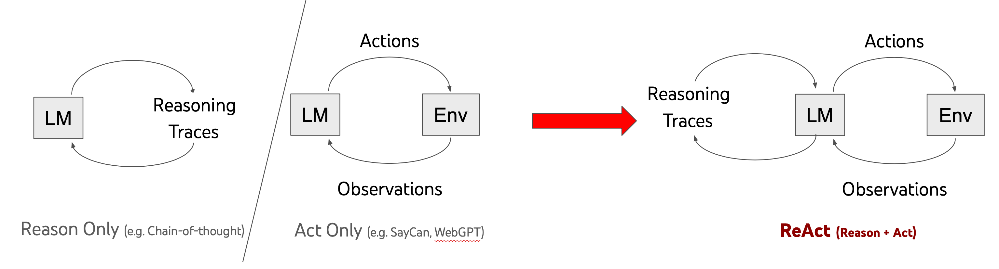
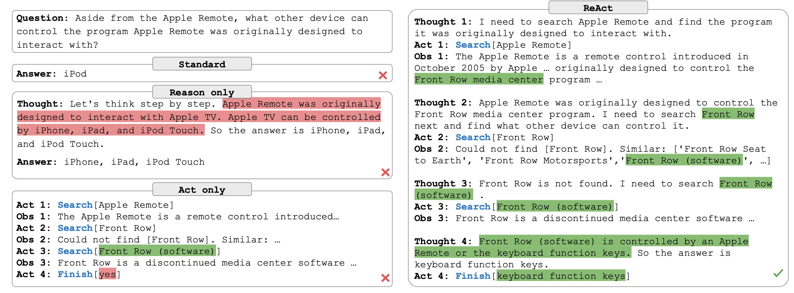
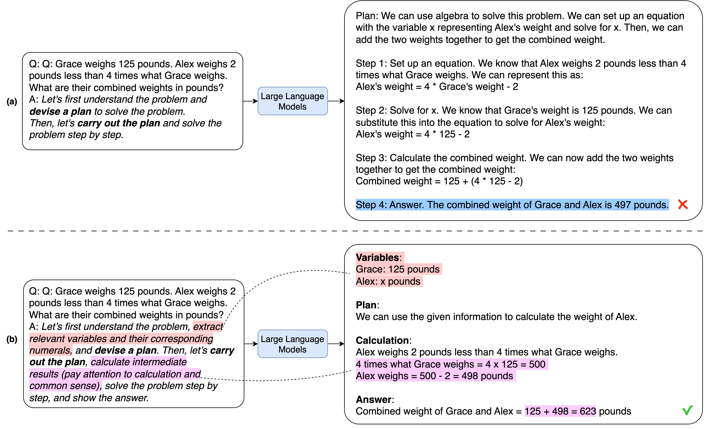
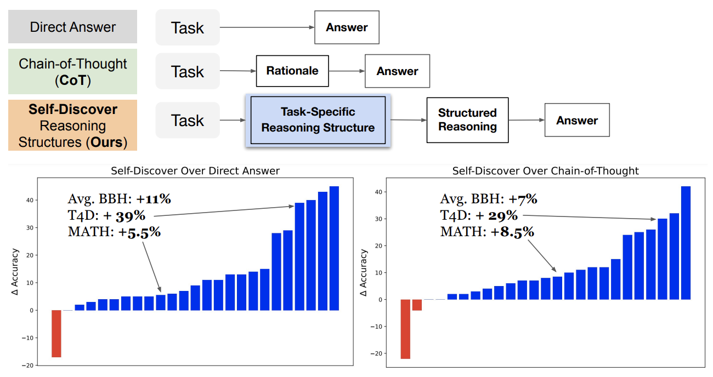
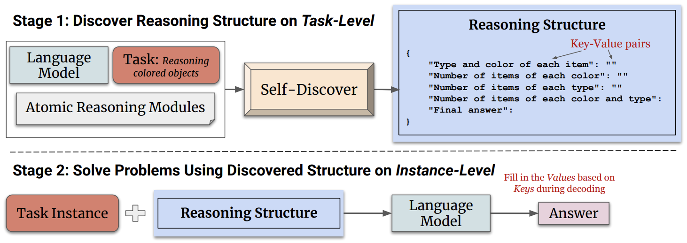
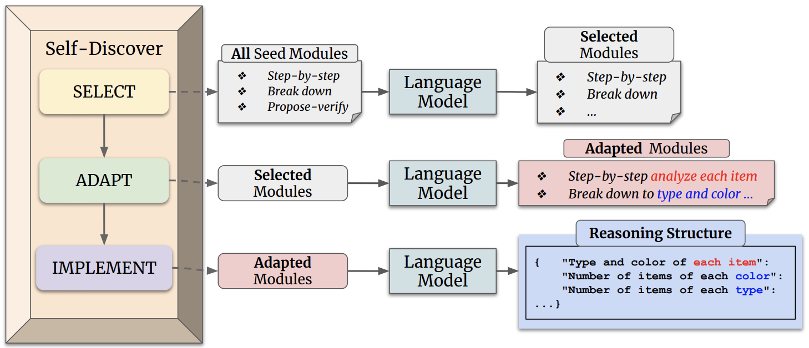

## [ReAct](https://react-lm.github.io/)架构

reasoning traces help the model induce, track, and update action plans as well as handle exceptions, while actions allow it to interface with external sources, such as knowledge bases or environments, to gather additional information. We apply our approach, named ReAct, to a diverse set of language and decision making tasks and demonstrate its effectiveness over state-of-the-art baselines, as well as improved human interpretability and trustworthiness over methods without reasoning or acting components.

<!--more-->

**参考**：

[1][A simple Python implementation of the ReAct pattern for LLMs](https://til.simonwillison.net/llms/python-react-pattern)

[2] [ReAct: Synergizing Reasoning and Acting in Language Models](https://react-lm.github.io/)

## [Plan-and-Solve](https://arxiv.org/abs/2305.04091)架构

改进零样本链式思维（Zero-shot chain-of-thought）推理模型来提高大型语言模型在多步推理任务中的表现。作者提出了“计划和解决问题”（Plan-and-Solve）提示策略，该策略由两个组件组成：首先，将整个任务分解为更小的子任务，并根据计划执行这些子任务；其次，为了消除计算错误并提高生成的推理步骤的质量，作者还扩展了PS提示策略，得到了PS+提示策略。

**参考资料**：

[1][Plan-and-Solve Prompting: Improving Zero-Shot Chain-of-Thought Reasoning by Large Language Models](https://arxiv.org/pdf/2305.04091)

[2][Plan-and-Solve-Prompting](https://github.com/AGI-Edgerunners/Plan-and-Solve-Prompting)

## [Self-Discover](https://arxiv.org/pdf/2402.03620)模式

SELF-DISCOVER是一个通用框架，用于让LLMs自我发现任务内在的推理结构，以解决对典型提示方法具有挑战性的复杂推理问题。该框架的核心是一个自我发现过程，在这个过程中，LLMs选择多个原子推理模块，比如批判性思维和逐步思维，并将它们组合成一个明确的推理结构，供LLMs在解码过程中遵循。

Self-Discovering Reasoning Structures for Problem-Solving，如下图。**Stage 1: Self-Discover Task-Specific Structures** . The first stage consists of three actions: 1) SELECT, where relevant reasoning modules for task-solving are chosen from the set of reasoning module descriptions; 2) ADAPT, where descriptions of selected reasoning modules are rephrased to be more specific to the task at hand; and 3) IMPLEMENT, where the adapted reasoning descriptions are implemented into a structured actionable plan so that the task can be solved by following the structure.

**Stage 2: Tackle Tasks Using Discovered Structures**. we can simply append the reasoning structure to all instances of the task and prompt models to follow the reasoning structure to generate an answer。

