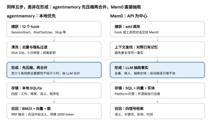

## 1.背景说明

大语言模型在处理和生成文本方面表现出色，但它们在本质上是**无状态（stateless）**的。这意味着每次与LLM的交互都是独立的，模型本身不会“记住”过去的对话或经验。大模型在“记忆”上主要局限于：

<!--more-->

- **上下文窗口的限制导致遗忘问**题。LLM通过一个有限的“上下文窗口”（Context Window）来处理信息。所有输入（包括Prompt和之前的对话片段）都必须塞入这个窗口。一旦信息超出这个窗口，LLM就“忘记”了它，无法再访问。这导致了所谓的“遗忘”问题；
- **难以处理多轮复杂任务**。对于需要跨越多轮对话、追踪状态或执行一系列子任务的复杂任务，LLM很难保持连贯性和进展，因为它会不断“忘记”之前的步骤和决策。特别是在Agent的场景，工具的定义和工具的返回值都会存在于上下文中，同时由于Agent具有自主工作的能力，和LLM的平均交互的轮数也大大增加；
- **无法个性化。**由于不记住特定用户的历史偏好、习惯或之前的互动，LLM难以提供真正个性化的体验。每次互动都像是第一次见面。
- **长上下文带来的性能和成本影响**。
  - 推理速度变慢：LLM在处理更长的上下文时，需要进行更多的计算来处理和理解所有输入信息。这会导致推理时间增加，响应速度变慢。
  - 模型表现下降：尽管LLM的上下文窗口越来越大，但研究发现，模型在超长上下文中检索关键信息的能力可能会下降。
  - 更高的费用：上下文越长，输入的token数量就越多，从而导致每次API调用的成本更高。对于需要频繁交互或处理大量文本的应用来说，这会迅速累积成可观的费用。

## 2.什么是Agent Memory

Give your agents the ability to remember user preferences, context, and past interactions for truly personalized experiences（记住用户偏好、上下文和过往互动的能力，从而提供真正个性化的体验。）

根据定义，Agent Memory主要具有以下特点：

    1. Memory≠Session History，并非对历史对话的管理这么简单，也不是对上下文的维护。
    2. 记忆会根据历史回话中的信息进行抽取，比如：事实知识，用户偏好，用户习惯，用户画像，可达到个性化服务或推荐的目的。
    3. 记忆对针对用户(User)而言，独立于用户存在，不同用户之间应该Memory隔离。

## 3.Agent记忆类型

Agent的记忆一般**有短期记忆**和**长期记忆**。但是不同的框架定义有不同的记忆类型，如CrewAI定义了Entity Memory和Contextual Memory。

**Short-Term Memory**（短期记忆）：临时存储最近的交互和结果，使Agent能够在当前执行期间回忆和利用与其当前上下文相关的信息。

**Long-Term Memory**（长期记忆）：是智能体用于**跨会话、跨任务长期保存知识**的记忆形式。它对应于人类的大脑中持久保存的记忆，例如事实知识、过去经历等。长期记忆的实现通常依赖于**外部存储**或**知识库**，包括但不限于：

    - **摘要记忆**：将长对话内容提炼为关键摘要存储；
    - **结构化知识库**：使用数据库或知识图谱存储结构化信息；
    - **向量化存储**：通过向量数据库实现基于语义的记忆检索。

    长期记忆使智能体能够随着时间累积经验和知识，**知识密集型应用**和**需要长期个性化**的场景。

## 4.Memory管理相关技术

Agent的Memory系统时要考虑不同场景下如何进行**Memory生成**、**Memory触发策略**、**Memory存储与检索**等多个方面。

.png)

### **4.1 Memory生成**

+ #### **记忆提取**：仅从源数据中提取最有意义的信息，将其持久化为记忆。
  + 如何确定哪些信息值得被记忆? 不是所有的信息都需要被记忆，只需要记住有价值的信息。不同的场景可能定义不同。
  + 一般来说，时间关系/序列、空间维度、参与者状态变化、意图/动机/目的等信息需要被Memory。
  + 如代码助手而言：项目结构、命名风格、常用的框架或库、推算出用户的技术方向、技术栈等信息非常重要。
  + 多模态信息如何进行记忆提取？
+ **记忆整合**：将新提取的信息与现有记忆整合，使记忆能够随着新信息的注入而不断演变。您还可以将预提取的记忆与现有记忆整合起来。
  + 整合范围确定：独立用户(User)下的一个Session
  + 记忆合并的依据是什么？
+ **异步生成**：在后台生成记忆，不能影响Agent的推理过程、工作过程。
  + 记忆生成的过程必须是异步步的，不能影响记忆的工作过程。

### 4.2 Memory触发策略

触发包括两个方向：Memory在何时触发生成？什么情况下触发来获取Memory?

+ **何时触发策略生成Memory**
  + Agent的记忆更新可通过**轮数**或**事件**触发。轮数触发是每隔3-5轮对话自动生成摘要存入记忆；事件触发则在完成任务、场景转换等关键节点记录信息。
+ **何时触发获取Memory**

### 4.3 Memory存储：Memory组织结构设计

+ Memory数据通常采用**用户→会话→记忆片段**的三层结构管理。**用户层**区分账号空间，**会话层**隔离各对话上下文，**记忆片段**层存储具体内容及元数据（如时间、关键词、来源等）。复杂系统可能需要维护多个记忆库，包括短期工作记忆、长期情节记忆、语义知识库等。
  + 跨用户的身份隔离：记忆整合和检索按用户隔离
  + 相似度搜索：基于相似度搜索检索记忆，并以用户来限定搜索范围
  + 自动到期：为记忆设置存留时间 (TTL)，以确保过时信息会自动删除。[配置](https://docs.cloud.google.com/agent-builder/agent-engine/memory-bank/set-up?hl=zh-cn#ttl-config)记忆库实例，以便 TTL 自动应用于插入或生成的记忆。

### 4.4 Memory检索：记忆查询与召回逻辑

+ Agent需要基于当前对话意图从记忆库中检索相关信息。主要检索方法包括关**键词匹配**、**向量语义搜索**和**元数据过滤**。系统将检索到的记忆按相关度排序，选取最相关内容加入到对话上下文中，用于生成更准确的响应（类似RAG的过程）。
  + 例如在推荐场景中，可基于用户历史偏好记忆提供个性化建议。

## 5.上下文工程与Memory区别

上下文工程与记忆系统形成共生关系，共同支撑智能体的认知能力。

| 对比项   | 上下文工程                                                                 | Memory                                                                 |
| -------- | -------------------------------------------------------------------------- | ---------------------------------------------------------------------- |
| 功能     | 扮演”智能调度员”，决定从记忆中检索哪些信息及如何组织呈现给LLM。            | 作为”信息仓库”，存储历史对话、知识和用户偏好；                         |
| 关系     | 上下文工程是记忆的“调度员”和“优化器”，决定从Memory中检索哪些信息和如何检索 | memory是上下文的“**仓库**”，为LLM提供上下文                            |
| 维护重点 | 识别意图，特别是意图切换                                                   | 记录关键的决策信息或状态(观测->动作/结果，动作->观测)<br/>实现经验复用 |

## 6.Memory工程实现

Agent的Memory管理是一个很复杂的问题，从工程角度来看，Agent的记忆管理可以分为两类技术方案，一种将复杂问题简化，另外一种是自动化。目前相关的Memory研究在两个方向论文也比较多，前者是提供系统化/可插拔的记忆管理底座框架，如mem0，A-MEM，后者是将手动/规则维护记忆的方式转为自动化，如Memory‑R1，MEM1，Memp， MEMSearcher等。下面主要对一些主要的框架实现进行详细解析。

### 6.1 agentmemory 与 Mem0的实现

两者都不是 harness 内核的一部分，而是通过 hook、MCP、REST 或插件挂接。区别在于：agentmemory 是本地优先、自动捕获并压缩的记忆引擎；Mem0 是以 API 为中心的“抽取 + 检索”记忆层，其编码 Agent 插件在官方文档里标注为依赖托管 Platform。



管线对比 · agentmemory 与 Mem0，各 5 步

两条管线都是“捕获、清洗、形成、存储、召回”五步，高亮的是差异最大的“形成”一步。

**功能对比**

| **维度** | **agentmemory（rohitg00）**                                                                                                                                                                  | **Mem0**                                                                                                                                      |
| -------- | -------------------------------------------------------------------------------------------------------------------------------------------------------------------------------------------- | --------------------------------------------------------------------------------------------------------------------------------------------- |
| 定位     | 面向编码 Agent 的持久记忆服务器，TypeScript，基于 iii 引擎，在本机运行                                                                                                                       | 通用 Agent 记忆层；开源版可作库或 Docker 自托管，也有托管 Platform                                                                            |
| 存储     | iii KV 状态，落在本地 SQLite 文件；REST 默认只绑定 127.0.0.1；无复制、备份与跨机同步                                                                                                         | 每条记忆分存三处：SQL（事实与元数据，真相源）、向量库（嵌入）、实体存储；Platform 托管，开源版自选自运维                                      |
| 记忆结构 | 四层：工作（原始观察）、情景（压缩的会话摘要）、语义（事实与模式）、程序性（流程与决策模式）；艾宾浩斯式衰减，常访问的被强化，检测矛盾，被替换版本保留版本链但不参与召回                     | 默认存抽取出的事实，infer=False 时存原文；文档没有正式的类型划分；用 user_id、agent_id、run_id 与自定义元数据划分作用域                       |
| 如何形成 | hook 捕获观察，经 SHA-256 去重（5 分钟窗）与隐私过滤；压缩用 LLM 或零 token 的合成方式；会话至少 5 条观察且重要性不低于 5 时，由 LLM 合并成类型化记忆（模式、偏好、架构、bug、工作流、事实） | add 先查相关旧记忆，再由 LLM 抽取偏好、决策、计划等事实，去重并嵌入，最后抽取实体；自动路径“只增不改”，更正或删除需应用显式调用 update/delete |
| 如何召回 | BM25（常开）+ 向量（配置嵌入后）+ 知识图（检测到实体后），用 RRF（k=60）融合，每会话最多 3 条；会话开始时加载项目画像并注入，默认预算 2000 token                                             | search 综合语义、关键词、实体、时间四种信号；Platform 全部融合，开源版取决于向量库与可选重排，且实体信号不走图                                |
| 对外接口 | 54 个 MCP 工具（AGENTMEMORY_TOOLS=core 时 8 个）、REST（:3111）、iii SDK；实时查看器 :3113                                                                                                   | 托管 MCP（mcp.mem0.ai，9 个工具）、REST、Python/TS SDK、各 Agent 插件                                                                         |
| 许可     | 第三方文章称 Apache-2.0；README 内容未写明，需查 LICENSE                                                                                                                                     | 开源核心为 Apache-2.0（据 Cognee 博客）                                                                                                       |

**与四个** **harness** **的集成方式**

| **Harness**      | **agentmemory**                                                                                                                                                                                                                                         | **Mem0**                                                                                                                                                                                                                                                 |
| ---------------- | ------------------------------------------------------------------------------------------------------------------------------------------------------------------------------------------------------------------------------------------------------- | -------------------------------------------------------------------------------------------------------------------------------------------------------------------------------------------------------------------------------------------------------- |
| Codex CLI        | codex plugin marketplace add rohitg00/agentmemory 后 codex plugin add agentmemory@agentmemory，注册 6 个 hook 与 MCP。Codex Desktop 的插件 hook 被上游静默，需 agentmemory connect codex --with-hooks；插件 hook 与全局 hook 只能启用一种，否则重复捕获 | 完整插件：codex plugin marketplace add mem0ai/mem0 后 codex plugin add mem0@mem0-plugins，含 hook、search_memories 工具和 6 个记忆 skill；或仅 MCP（[mcp_servers.mem0]，需 MEM0_API_KEY）。两者不可并用，会工具冲突；Codex Cloud 不运行 hook，只能用 MCP |
| opencode         | opencode.json 加 MCP 条目，并复制 plugin/opencode/（22 个捕获 hook，/recall、/remember 命令）                                                                                                                                                           | opencode plugin @mem0/opencode-plugin，用到 chat.message、tool.execute.before/after、experimental.chat.messages.transform、experimental.session.compacting、shell.env；10 个原生工具；作用域 project / session / global                                  |
| pi               | agentmemory connect pi 后在 pi 中 /reload；启动时召回、结束时捕获，工具为 memory_search、memory_save、memory_health                                                                                                                                     | pi install npm:@mem0/pi-agent-plugin；每轮前召回，agent_end 时捕获，单一 mem0_memory 工具；配置文件 ~/.pi/agent/mem0-config.json                                                                                                                         |
| DeepSeek harness | agentmemory connect dsh，加 --with-hooks 才自动捕获；DSH_HOME 默认 ~/.dsh                                                                                                                                                                               | 需从仓库 integrations/deepseek-plugin 构建并打包，在 cordis.yml 中加一行；system-prompt/assemble 召回，session/event 捕获，工具 search_memory、add_memory；失败时放行，不阻塞 Agent                                                                      |

（来源：agentmemory 同上；Mem0 见 [Codex](https://docs.mem0.ai/integrations/codex)、[OpenCode](https://docs.mem0.ai/integrations/opencode)、[Pi Agent](https://docs.mem0.ai/integrations/pi-agent)、[DeepSeek Harness](https://docs.mem0.ai/integrations/deepseek-plugin)）

**这些集成落在第** **5** **节那张图的哪几个点上**

- **启动或首个提示（图中第** **1****、****2** **步）。** Mem0 的 Codex 插件在 SessionStart 初始化，并在首个不少于 20 字符的提示时搜索记忆；agentmemory 在 SessionStart 加载项目画像、跑混合检索并注入。
- **每轮请求前（第** **2** **步）。** opencode 的 Mem0 插件在 chat.message 搜索，并通过 experimental.chat.messages.transform 把结果注入提示；DeepSeek 的 Mem0 插件在 system-prompt/assemble 钩子里只追加未见过的结果；pi 在每轮前搜索项目记忆。
- **模型自主读写（第** **3** **步）。** 两者都提供工具，Mem0 为 add_memory、search_memories 等，agentmemory 为 memory_save、memory_smart_search 等。opencode 的 Mem0 插件还用 tool.execute.before 拦截对 MEMORY.md 的直接写入，并引导模型改用 add_memory。
- **压缩前后（第** **5** **步）。** Mem0 在 Codex 里用 PreCompact 先把待写内容落盘；在 opencode 里用 experimental.session.compacting 保存会话状态，并把旧记忆注入压缩上下文。
- **结束或空闲（第** **6** **步）。** Mem0 的 Stop/SessionEnd、agentmemory 的 Stop/SessionEnd 都在后台做抽取与整合；Mem0 的 opencode 插件每三个合格的用户提示抽取一次。

**几个值得注意的设计细节**

- Mem0 的 Codex 插件把用户提示记作用户的话，把 Codex 的回复记作助手的话，避免模型的建议被当成用户偏好。
- Mem0 的项目标识 app_id 取自 git 远程（owner-repo），其次是仓库根目录名；所以要在仓库内启动 Agent。global 作用域要先 /mem0-scope global，模型自己传 scope 不能单独启用。
- agentmemory 把“采集”和“压缩”分开：不配任何 LLM 密钥也能抓取并做 BM25 检索，配了才有 LLM 压缩与整合；官方建议先用默认合成压缩验证 hook 是否触发。

**限制与风险（来自文档与第三方分析）**

- **云依赖。** Mem0 文档把这些编码 Agent 集成标为 Platform，需要 m0- 开头的 API 密钥，记忆数据存放在托管服务；开源版需自己运维 SQL、向量库和实体存储。agentmemory 则是纯本地、无同步，换机器就没有记忆。
- **成本。** agentmemory 的已关闭 issue 提到自动压缩或 agent-sdk 提供方曾造成意外的 token 消耗或循环；注入预算与 LLM 压缩都会增加每会话成本。
- **隐私与污染。** agentmemory 会剥离密钥、Bearer token 和 private 标签内容，但第三方分析指出过滤范围未充分文档化（如自定义鉴权头、shell 输出里的环境变量）。另外，捕获到的工具输出会被存储并在后续会话重新注入，不可信内容可能因此长期影响 Agent，这是我的推断，文档未评估；Mem0 文档则明确提醒不要存放密钥与未脱敏数据。
- **版本。** agentmemory 固定在特定的 iii 引擎版本；不同来源给出 0.11.2 与 0.22.1 两个版本号，工具数也有 51 与 54 两种说法，应以安装时的 README 为准。
- **基准。** agentmemory 自测 LongMemEval-S 的 R@5 为 95.2%，其内部语料只有 15 个会话，且 README 自己说明竞品数字未复现；Mem0 的成绩也是厂商自报。
- **与前文不一致之处。** Mem0 官方说明自动抽取路径是只增不改，这与上文 3.3 所述论文中的操作集合不完全一致，以文档为准。

**选型参考（作者判断）：** 要零云依赖、数据留在本机，并且主要用单台机器上的编码 Agent，可先试 agentmemory；要跨工具、跨机器共享，或不想自己运维存储，Mem0 Platform 更省事，代价是数据上云。无论选哪个，都建议先在一次性 profile 里验证 hook 确实触发，再检查注入的 token 数。

### 6.2 Agno

Agno框架关于记忆的实现：把对话/任务里的关键信息抽取成可持久化的 memories，支持检索、增删改清、以及“压缩/总结”来控制记忆规模，并且同时提供**同步与异步（async）** 的 DB 适配路径。

- MemoryManager（核心入口）：libs/agno/agno/memory/manager.py，统一封装记忆的读写、LLM 驱动的记忆更新、检索、优化等能力。
- 优化策略（Strategies）：libs/agno/agno/memory/strategies/，通过策略模式做memory压缩/优化。目前内置 SummarizeStrategy。

#### 6.2.1 Memory生成

记忆生成采用**LLM + Function Calling**模式：模型分析用户消息，决定是否调用工具写入记忆。整体流程如下：**用户消息 → 读取现有记忆 → 构建 System Prompt → 准备工具 → 调用模型 → 工具执行 → 写入数据库。**其中的关键机制：

    1. 模型决策：模型读取 system prompt 和 existing_memories，判断是否需要新增/更新/删除。
    2. Function Calling：模型通过工具调用执行操作，而非直接输出文本。
    3. 工具直接写入：工具函数直接调用 db.upsert_user_memory()，无需额外解析。
    4. 去重与更新：通过对比 existing_memories，避免重复添加，并支持更新已有记忆。

整个过程中，模型基于已有的Memory与当前信息，去确定是否要新增/更新/删除记忆，再调用工具去进行操作。 模型不直接写数据库，而是通过调用工具实现，同时让模型进行做决策判断。

#### 6.2.2 Memory 的触发策略

1. **自动触发模式**

在每次 Agent/Team 运行后自动创建/更新记忆。触发条件（需同时满足）：

```plaintext
- memory_manager 已配置
- update_memory_on_run=True
- 存在非空的用户消息（user_message）
- enable_agentic_memory=False（否则走 Agentic 模式）
```

**2. Agentic 模式（enable_agentic_memory=True）**

Agent 在对话过程中主动调用工具更新记忆。触发方式：

    - Agent 在对话中调用 update_user_memory 工具
    - 工具由 Agent 的 system prompt 告知可用

配置要求：

```plaintext
enable_agentic_memory=True
memory_manager 已配置
Agent 的 tools 列表会自动包含 update_user_memory 函数
```

**6.2.3 Memory存储的结构**

```plaintext
@dataclass
class UserMemory:
    memory: str     # 主键（UUID 字符串）
    memory_id: Optional[str] = None      # 记忆内容（通常是简短第三人称事实句）
    topics: Optional[List[str]] = None   # 标签列表（可选）
    user_id: Optional[str] = None        # 归属用户（可选，但实际使用时通常会传）
    input: Optional[str] = None          # 触发生成这条记忆的原始输入（可选，便于追溯）
    created_at: Optional[int] = None     # epoch 秒（int）
    updated_at: Optional[int] = None     # epoch 秒（int）
    feedback: Optional[str] = None       # 反馈文本（可选）

    agent_id: Optional[str] = None       # 来源（可选，用于按 agent/team 过滤）
    team_id: Optional[str] = None        # 来源（可选，用于按 agent/team 过滤）
```

**6.2.4 Memory召回**

**1) 默认召回：把该用户的所有 memories 直接注入到 system prompt**

当 Agent/Team 的 add_memories_to_context=True 时，会在构造 system message阶段调用：并把每条 UserMemory.memory 以 bullet list 的形式拼到 system prompt 的信息里。

关键点：这里没有做“相似度检索 / top-k 截断”，是 全量（该 user_id 下）召回并注入。

**2) 记忆检索 API：MemoryManager.search_user_memories(...)**

```plaintext
def search_user_memories(
    query: Optional[str] = None,
    limit: Optional[int] = None,
    retrieval_method: Optional[Literal["last_n", "first_n", "agentic"]] = None,
    user_id: Optional[str] = None,
) -> List[UserMemory]:
    ...
    if retrieval_method == "agentic":
        return self._search_user_memories_agentic(...)
    elif retrieval_method == "first_n":
        return self._get_first_n_memories(...)
    else:  # Default to last_n
        return self._get_last_n_memories(...)
```

它支持 3 种方式：

    - last_n：按时间取最近的 N 条（默认分支）
    - first_n：按时间取最早的 N 条
    - agentic：把所有 memories 贴给模型，让模型返回相关 memory_ids（再映射回 UserMemory）

## 7.参考文档

[Agent近期记忆技术及落地实践整理-腾讯云开发者社区-腾讯云](https://cloud.tencent.com/developer/article/2588486)

[Agentic AI基础设施实践经验系列（三）：Agent记忆模块的最佳实践 | Amazon Web Services](https://aws.amazon.com/cn/blogs/china/agentic-ai-infrastructure-deep-practice-experience-thinking-series-three-best-practices-for-agent-memory-module/)