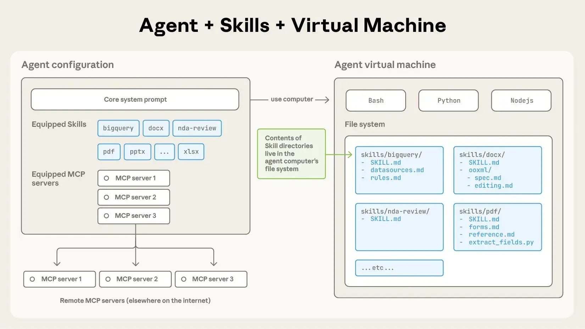
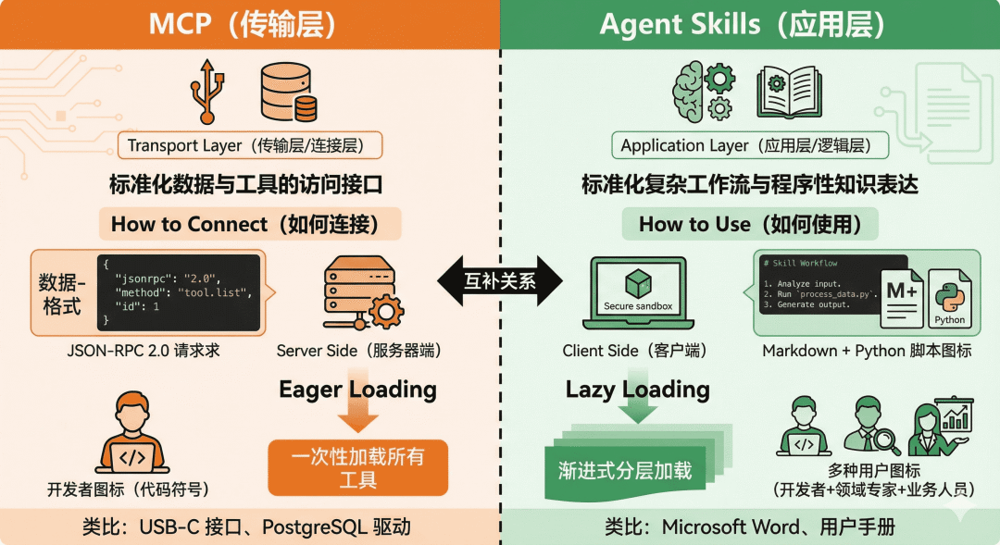
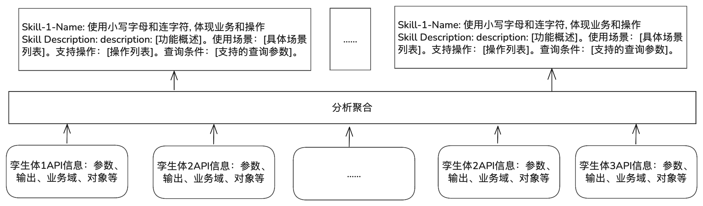

## 1.背景

目前，Agent的能力扩展主要依赖Tools及山下文的管理，但是直接使用工具（Tools）的问题会存在诸多问题，如接口太多，LLM不知道用哪个（*“我有几十个孪生体，每个孪生体暴露 10+ 接口”*）。这样会直接导致Agent的Prompt变成了接口说明书，LLM出显调错 / 漏调 / 顺序错等问题。此外，大量的Prompt可能直接上下文爆炸。即使已经有MCP服务，但是MCP只是解决了如何与外部连接的问题。

<!--more-->

另外，在面向不同的场景或业务构建Agent时，会出现重复定义工具来扩展Agent的能力，使得能力无法被Agent用。Agent的能力没有被资产化，只存在了Prompt中。

因此，统一的智能体Skills标准诞生，它通过将专业知识封装为模块化的资源，将通用代理转变为能够满足特定需求的“专家”。

## 2.什么是Agent Skills

**Agent Skills**是一种将指令、脚本和资源组织在特定文件夹中的机制，AI 代理可以动态地发现并加载这些“技能”，从而在执行特定任务时表现得更加出色。如果说MCP为智能体提供了"手"来操作工具，那么 Skills 就提供了"操作手册"或"SOP（标准作业程序）"，教导智能体如何正确使用这些工具。

通过 `SKILL.md` 文件中的 markdown 指令表达的能力，以及 Agent用于执行特定任务的可选脚本、资源和资产。Agent与Skills的结构如下所示：



## 3.Agent Skills的意义

Agent Skills的意义在于把零散的工具与隐式的专家经验，抽象为可理解、可复用、可治理的能力单元，使 Agent 从“会调用接口”升级为“会完成某些任务的能力”。主要包括：

    - 从“工具中心”到“能力中心”，将工具抽象为能力，为使用工具提供“SOP”
    - 让 Agent明确知道自己能做什么，不能做什么，Skills就是Agent的能力边界
    - 将“专家经验”从Prompt中解耦，将领域知识工程化和知识化
    - 降低Agent系统复杂度，而不是增加一层概念



总之，Skills 的本质意义是把“完成任务的方法”从模型推理中抽离出来，变成系统可理解、可控制、可演进的能力结构。

## 4.Skills的工作方式

Skill的核心是一个包含 `SKILL.md` 文件的文件夹。该文件包含元数据（至少包括 `name` 和 `description` ）以及指示智能体如何执行特定任务的指令。技能还可以包含脚本、模板和参考资料。
每个技能都是从一个包含YAML前置元数据和Markdown指令的 `SKILL.md` 文件开始。agent会根据这些内容来判断在何时以及如何使用该技能。

```markdown
---
name: skill-name
description: Description that helps Codex select the skill
metadata:
  short-description: Optional user-facing description
---

Skill instructions for the Codex agent to follow when using this skill.
```

Skill的目录下一般有`scripts`、`references`、`assets`：

    - `scripts`：包含代理可以运行的可执行代码；
    - `references`：包含Agent需要时可查阅的其他文档，如技术参考、结构化数据格式等
    - `assets`：包含静态资源，如文档模板、数据文件等

### 4.1渐进式上下文

Skill应该结构化的，以便有效利用上下文，主文档 `SKILL.md` 应控制在 500 行以内。详细的参考资料应移至单独的文件中。

    1. **元数据** （约 100 个token）：所有skill的 `name` 和 `description` 字段在启动时加载。
    2. **说明** （建议使用 5000 个代币）：skill激活时，完整的 `SKILL.md` 文件将被加载。
    3. **资源** （按需加载）：文件（例如 `scripts/` 、 `references/` 或 `assets/` 目录中的文件）仅在需要时加载。

### 4.2 Skill与Agent融合

一般基于工具的智能体无需专用计算机环境即可运行。通过实现各种工具，使模型能够触发技能并访问捆绑的资源。具体的工具实现方式由开发者决定。但代理需要进行以下流程：


目前有可以参考的技能处理：skill-ref: [https://github.com/agentskills/agentskills/tree/main/skills-ref](https://github.com/agentskills/agentskills/tree/main/skills-ref)

## 5.BlinkOS A+中如何应用

### 5.1 基于底层API的Skill划分

根据底层的孪生体接口信息（输入、输出、功能描述等）进行接口的能力抽象（按照业务场景、功能等维度），并形成相应的Skill。



    - 分析API的业务场景模式：轨迹查询、航班动态查询、机位状态查询、时间线查询、资源分配查询等。
    - 操作方式：更新、删除、查询、状态等

目的：确定Agent的Skills；原则是：（1）同一个Skill应该统一业务领域、相似的使用场景、相同的数据查询方式等。（2）不能拆分过细，否则API没有起到聚合的作用。（2）同一个Skill下不能包含过多的Skill，否则可能无法准确匹配。划分的步骤参考：

```text
s1:确定顶层业务域（如：航班、登机口、跑道等）
s2:将 API 归入对应域
s3:检查每个域内 API 数量
  (1)如果 > n：按子域拆分（如航班查询 vs 航班更新）
  (2)如果 < k：考虑合并到相关域
s4:验证每个 Skill 的职责是否单一
```

### 5.2 Skill.md设计

该文档设计主要解决skill到具体API的路由，通过该文档可以让Agent正确选择相应的API，同时控制token的数量。该文件的设计参考如下示例：

````markdown
---
name:使用小写字母和连字符, 如flight-query（航班查询）,gate-assignment（登机口分配）
description:[功能概述]。使用场景：[具体场景列表]。支持操作：[操作列表].查询条件：[支持的查询参数]。
---

## Instructions

### 1. 理解用户查询意图

首先分析用户的查询意图：

- **单航班查询**：如果用户提供了明确的航班号（如 "CA1234"），查询该航班的详细信息
- **列表查询**：如果用户查询多个航班（如 "今天延误的航班"），使用列表查询 API
- **搜索查询**：如果用户提供多个条件（日期、机场等），使用搜索 API
- **关联信息查询**：如果用户查询登机口、机位等，使用相应的子接口

### 2. 提取关键参数

从用户查询中提取以下参数：
- **航班号**：识别格式如 "CA1234", "MU5678" 的航班号
- **日期**：处理相对时间（今天、明天）和绝对时间（1月15日）
- **机场**：将城市名或机场名映射到机场代码（如 "北京" → "PEK"）
- **延误时间**：提取延误分钟数或小时数
- **状态**：识别状态关键词（延误、取消、准时等）

### 3. 选择适当的 API

| 查询类型 | API 选择 |
|---------|---------|
| 单个航班详情 | GET /api/flights/{flight_id} |
| 航班状态 | GET /api/flights/{flight_id}/status |
| 延误信息 | GET /api/flights/{flight_id}/delay |
| 延误航班列表 | GET /api/flights/delayed |
| 到达航班列表 | GET /api/flights/arrivals |
| 出发航班列表 | GET /api/flights/departures |
| 多条件搜索 | POST /api/flights/search |
| 登机口信息 | GET /api/flights/{flight_id}/gate |
| 机位信息 | GET /api/flights/{flight_id}/stand |
| 行李转盘 | GET /api/flights/{flight_id}/baggage |

### 4. 构建 API 请求

使用 `scripts/api_client.py` 调用 API：

```python
# 示例：查询航班详情
from scripts.api_client import FlightAPIClient

client = FlightAPIClient()
flight = client.get_flight("CA1234")
```

### 5. 处理 API 响应

- **成功响应**：格式化数据为用户友好的格式
- **404 错误**：提示航班不存在，建议检查航班号
- **400 错误**：提示参数错误，说明正确的参数格式
- **500 错误**：提示服务暂时不可用，建议稍后重试
- **超时**：自动重试 1-2 次，失败后提示用户

### 6. 返回结果

以清晰、结构化的方式呈现信息：

- **航班详情**：显示航班号、起降时间、机场、状态等关键信息
- **延误信息**：突出显示延误时间和原因
- **列表查询**：以表格形式展示，包含关键字段
- **关联信息**：清晰展示登机口、机位、行李转盘等信息

## 使用示例

### 示例1：查询航班详情
**用户**："查询CA1234航班"
**处理**：
1. 提取航班号：CA1234
2. 调用 GET /api/flights/CA1234
3. 返回航班详细信息

### 示例2：查询延误航班
**用户**："今天延误的航班有哪些"
**处理**：
1. 提取日期：今天（转换为当前日期）
2. 调用 GET /api/flights/delayed?date=2025-01-15
3. 返回延误航班列表

### 示例3：多条件搜索
**用户**："搜索1月15日从北京到上海的航班"
**处理**：
1. 提取参数：
   - 日期：2025-01-15
   - 出发机场：北京 → PEK
   - 到达机场：上海 → PVG
2. 调用 POST /api/flights/search
3. 返回符合条件的航班列表

## 相关资源

- API 文档：`reference/api1.json`
- 使用示例：`examples/exmaple.md`
- 调用方法：`scripts/api_client.py`
- 相关 Skill：gate-assignment（登机口分配）
````

### 5.3 Skill目录结构

```text
flight-query/
├── SKILL.md # Skill 定义文件(Agent读取)
├── reference # API 详细参考文档
│ ├── api1.json 
│ ├── api2.json 
├── examples # 使用示例
│ ├── example.md
├── scripts/
│ ├── api_client.py # API调用方法
```

SKILL.md：Agent 读取的主要文件。包含 Skill 描述和指令，引导 Agent 如何使用 API

reference：详细的 API 文档，参数说明、响应格式，错误码和处理方式

examples：使用示例，覆盖各种查询场景，帮助 Agent 学习正确用法

scripts/api_client.py：封装所有 API 调用，处理认证、请求构建、错误处理

## 6. 总结

Agent Skills并不是又一层工具封装，而是一种能力抽象与知识工程方法。它将原本隐含在 Prompt 中、分散在接口说明里、依赖人工经验的“如何完成任务”的方法论，转化为 Agent 可理解、可发现、可组合、可演进的标准化能力单元：

    - Agent 从“知道有哪些 API”转变为“理解自己具备哪些能力、在什么条件下应当如何行动”
    - 工具调用从不稳定的自由推理，转变为受约束、有 SOP、有边界的能力执行
    - 领域专家经验得以工程化沉淀，而不再依赖 Prompt 复制或模型微调
    - 能力首次具备资产属性，可复用、可治理、可版本化、可跨 Agent 共享

在 BlinkOS A+ 的实践场景中，基于孪生体 API 的 Skill 划分与 SKILL.md 设计，探索通过该机制在接口数量多、领域知识强、上下文复**杂**的系统中的可行性。通过合理的业务域划分、渐进式上下文加载与清晰的指令结构，Agent 能够在保持上下文可控的前提下，准确完成复杂任务。

Agent Skills的引入标志着Agent架构从“模型+工具”的阶段，迈向了“能力工程（Skill Engineering）”阶段。它不是对 LLM 能力的替代，而是对 LLM 推理的约束、引导与放大，是实现可规模化、可维护、可治理 Agent 系统的关键基础设施。