## 一.AI-Agent定义

AI-Agents是**系统**，它通过赋予大型语言模型（LLMs）**访问工具**和**知识**的能力，扩展LLMs的功能，从而使其能够**执行操作**。

<!--more-->

**系统** — 重要的是要把代理看作由多个组件组成的系统，而不仅仅是单一组件。AI代理的基本组成包括：

- **环境** — AI代理所运行的特定空间。例如，假设我们有一个旅行预订AI代理，那么环境就是该代理用来完成任务的旅行预订系统。
- **传感器** — 环境包含信息并提供反馈。AI代理通过传感器收集并解读环境当前状态的信息。在旅行预订代理的例子中，预订系统可以提供酒店可用性或航班价格等信息。
- **执行器** — AI代理获取环境当前状态后，会根据当前任务决定采取何种行动以改变环境。对于旅行预订代理来说，可能是为用户预订一个可用的房间

**大型语言模型** — 代理的概念早于LLMs的出现。使用LLMs构建AI代理的优势在于它们能够理解人类语言和数据。这种能力使LLMs能够解读环境信息并制定改变环境的计划。

**执行操作** — 在AI代理系统之外，LLMs的操作通常仅限于根据用户提示生成内容或信息。在AI代理系统中，LLMs可以通过解读用户请求并使用环境中可用的工具来完成任务。

**访问工具** — LLM能访问哪些工具取决于1）其所处的环境，2）AI代理的开发者。以旅行代理为例，代理的工具受限于预订系统中可用的操作，开发者也可以限制代理只能访问航班相关工具。

**记忆+知识** — 记忆可以是用户与代理对话中的短期记忆。长期来看，除了环境提供的信息外，AI代理还可以从其他系统、服务、工具甚至其他代理中检索知识。以旅行代理为例，这些知识可能是存储在客户数据库中的用户旅行偏好信息。

## 二.Agent的类型

| **代理类型**           | **描述**                                                             | **示例**                                                                                                 |
| ---------------------- | -------------------------------------------------------------------- | -------------------------------------------------------------------------------------------------------- |
| **简单反射代理**       | 根据预定义规则立即执行操作。                                         | 旅行代理根据邮件内容判断，将旅行投诉转发给客服。                                                         |
| **基于模型的反射代理** | 根据世界模型及其变化执行操作。                                       | 旅行代理根据历史价格数据，优先处理价格变动显著的路线。                                                   |
| **基于目标的代理**     | 通过解读目标并确定实现目标的行动，制定计划。                         | 旅行代理通过确定从当前位置到目的地所需的交通安排（汽车、公共交通、航班）来预订行程。                     |
| **基于效用的代理**     | 考虑偏好并以数值权衡权衡取舍，决定如何实现目标。                     | 旅行代理在预订时权衡便利性与成本，最大化效用。                                                           |
| **学习型代理**         | 通过反馈不断改进并调整行动。                                         | 旅行代理通过分析客户行程后调查反馈，改进未来预订服务。                                                   |
| **分层代理**           | 由多个代理组成分层系统，高层代理将任务拆分为子任务，由低层代理完成。 | 旅行代理取消行程时，将任务拆分为取消具体预订等子任务，由低层代理执行，并向高层代理汇报。                 |
| **多代理系统（MAS）**  | 代理独立完成任务，既可合作也可竞争。                                 | 合作：多个代理分别预订酒店、航班和娱乐项目。竞争：多个代理管理并竞争共享的酒店预订日历，为客户预订房间。 |

## 三.AI Agent框架

AI Agent 框架是专为简化 AI Agent 的创建、部署和管理而设计的软件平台。这些框架为开发者提供了预构建的组件、抽象和工具，从而简化了复杂 AI 系统的开发过程。

这些框架通过为 AI Agent 开发中的常见挑战提供标准化方法，帮助开发者专注于应用程序的独特方面。它们提升了构建 AI 系统的可扩展性、可访问性和效率。

### 什么是 AI Agent 框架？它能帮助开发者做什么？

传统的 AI 框架可以帮助你将 AI 集成到应用程序中，并通过以下方式改进这些应用：

- **个性化**：AI 可以分析用户行为和偏好，提供个性化的推荐、内容和体验。 示例：流媒体服务（如 Netflix）利用 AI 根据观看历史推荐电影和节目，从而提升用户参与度和满意度。
- **自动化与效率**：AI 可以自动化重复性任务、简化工作流程并提高运营效率。 示例：客户服务应用使用 AI 驱动的聊天机器人处理常见问题，从而缩短响应时间，并让人工客服专注于更复杂的问题。
- **提升用户体验**：AI 可以通过语音识别、自然语言处理和预测文本等智能功能改善整体用户体验。 示例：虚拟助手（如 Siri 和 Google Assistant）利用 AI 理解并响应语音命令，使用户更轻松地与设备交互。

#### 听起来很棒，对吧？那为什么还需要 AI Agent 框架

AI Agent 框架不仅仅是 AI 框架。它们旨在支持创建能够与用户、其他 Agent 和环境交互以实现特定目标的智能Agent。这些Agent可以表现出自主行为、做出决策并适应变化的条件。以下是AI Agent框架支持的一些关键功能：

- **Agent 协作与协调**：支持创建多个AI Agent，这些Agent可以协作、沟通并协调以解决复杂任务。
- **任务自动化与管理**：提供自动化多步骤工作流、任务分配和动态任务管理的机制。
- **上下文理解与适应**：使 Agent 能够理解上下文、适应变化的环境，并根据实时信息做出决策。

总结来说，Agent 让你能够实现更多功能，将自动化提升到一个新水平，创建能够从环境中学习和适应的更智能系统。

### 如何快速原型设计、迭代并提升 Agent 的能力？

这是一个快速发展的领域，但大多数 AI Agent 框架都有一些共同点，可以帮助你快速原型设计和迭代，主要包括模块化组件、协作工具和实时学习。让我们深入了解这些内容：

- **使用模块化组件**：AI SDK 提供预构建的组件，如 AI 和内存连接器、使用自然语言或代码插件调用功能、提示模板等。
- **利用协作工具**：设计具有特定角色和任务的 Agent，从而测试和优化协作工作流。
- **实时学习**：实现反馈循环，使 Agent 从交互中学习并动态调整其行为。

### 使用模块化组件

像 Microsoft Semantic Kernel 和 LangChain 这样的 SDK 提供了预构建的组件，如 AI 连接器、提示模板和内存管理。

**团队如何使用这些组件**：团队可以快速组装这些组件，创建一个功能原型，而无需从头开始，从而实现快速实验和迭代。

**实际操作方式**：你可以使用预构建的解析器从用户输入中提取信息，使用内存模块存储和检索数据，并使用提示生成器与用户交互，而无需从头构建这些组件。

**示例代码**。以下是如何使用 Semantic Kernel 的 Python预构建 AI 连接器的示例代码，该连接器使用自动功能调用来响应用户输入：

```other
# Semantic Kernel Python Example

import asyncio
from typing import Annotated

from semantic_kernel.connectors.ai import FunctionChoiceBehavior
from semantic_kernel.connectors.ai.open_ai import AzureChatCompletion, AzureChatPromptExecutionSettings
from semantic_kernel.contents import ChatHistory
from semantic_kernel.functions import kernel_function
from semantic_kernel.kernel import Kernel

# Define a ChatHistory object to hold the conversation's context
chat_history = ChatHistory()
chat_history.add_user_message("I'd like to go to New York on January 1, 2025")

# Define a sample plugin that contains the function to book travel
class BookTravelPlugin:
    """A Sample Book Travel Plugin"""

    @kernel_function(name="book_flight", description="Book travel given location and date")
    async def book_flight(
        self, date: Annotated[str, "The date of travel"], location: Annotated[str, "The location to travel to"]
    ) -> str:
        return f"Travel was booked to {location} on {date}"

# Create the Kernel
kernel = Kernel()

# Add the sample plugin to the Kernel object
kernel.add_plugin(BookTravelPlugin(), plugin_name="book_travel")

# Define the Azure OpenAI AI Connector
chat_service = AzureChatCompletion(
    deployment_name="YOUR_DEPLOYMENT_NAME", 
    api_key="YOUR_API_KEY", 
    endpoint="https://<your-resource>.azure.openai.com/",
)

# Define the request settings to configure the model with auto-function calling
request_settings = AzureChatPromptExecutionSettings(function_choice_behavior=FunctionChoiceBehavior.Auto())

async def main():
    # Make the request to the model for the given chat history and request settings
    # The Kernel contains the sample that the model will request to invoke
    response = await chat_service.get_chat_message_content(
        chat_history=chat_history, settings=request_settings, kernel=kernel
    )
    assert response is not None

    """
    Note: In the auto function calling process, the model determines it can invoke the 
    `BookTravelPlugin` using the `book_flight` function, supplying the necessary arguments. 

    For example:

    "tool_calls": [
        {
            "id": "call_abc123",
            "type": "function",
            "function": {
                "name": "BookTravelPlugin-book_flight",
                "arguments": "{'location': 'New York', 'date': '2025-01-01'}"
            }
        }
    ]

    Since the location and date arguments are required (as defined by the kernel function), if the 
    model lacks either, it will prompt the user to provide them. For instance:

    User: Book me a flight to New York.
    Model: Sure, I'd love to help you book a flight. Could you please specify the date?
    User: I want to travel on January 1, 2025.
    Model: Your flight to New York on January 1, 2025, has been successfully booked. Safe travels!
    """

    print(f"`{response}`")
    # Example AI Model Response: `Your flight to New York on January 1, 2025, has been successfully booked. Safe travels! ✈️🗽`

    # Add the model's response to our chat history context
    chat_history.add_assistant_message(response.content)

if __name__ == "__main__":
    asyncio.run(main())
```

从这个示例中可以看到，你如何利用预构建的解析器从用户输入中提取关键信息，例如航班预订请求的出发地、目的地和日期。这种模块化方法使你能够专注于高层逻辑。

### 利用协作工具

像 CrewAI、Microsoft AutoGen 和 Semantic Kernel 这样的框架支持创建能够协作的多个 Agent。

**团队如何使用这些工具**：团队可以设计具有特定角色和任务的 Agent，从而测试和优化协作工作流，提高整体系统效率。

**实际操作方式**：你可以创建一个 Agent 团队，每个 Agent 都有专门的功能，例如数据检索、分析或决策。这些 Agent 可以沟通并共享信息，以实现共同目标，例如回答用户查询或完成任务。

**示例代码 (AutoGen)**：

```other
# creating agents, then create a round robin schedule where they can work together, in this case in order

# Data Retrieval Agent
# Data Analysis Agent
# Decision Making Agent

agent_retrieve = AssistantAgent(
    name="dataretrieval",
    model_client=model_client,
    tools=[retrieve_tool],
    system_message="Use tools to solve tasks."
)

agent_analyze = AssistantAgent(
    name="dataanalysis",
    model_client=model_client,
    tools=[analyze_tool],
    system_message="Use tools to solve tasks."
)

# conversation ends when user says "APPROVE"
termination = TextMentionTermination("APPROVE")

user_proxy = UserProxyAgent("user_proxy", input_func=input)

team = RoundRobinGroupChat([agent_retrieve, agent_analyze, user_proxy], termination_condition=termination)

stream = team.run_stream(task="Analyze data", max_turns=10)
# Use asyncio.run(...) when running in a script.
await Console(stream)
```

从上面的代码中可以看到，如何创建一个涉及多个 Agent 协作分析数据的任务。每个 Agent 执行特定功能，通过协调这些 Agent 来实现预期结果。通过创建具有专门角色的专用 Agent，可以提高任务效率和性能。

### 实时学习

高级框架提供了实时上下文理解和适应的能力。

**团队如何使用这些功能**：团队可以实现反馈循环，使 Agent 从交互中学习并动态调整其行为，从而不断改进和优化能力。

**实际操作方式**：Agent 可以分析用户反馈、环境数据和任务结果，以更新其知识库、调整决策算法并随着时间推移提高性能。这种迭代学习过程使 Agent 能够适应变化的条件和用户偏好，从而增强整体系统的有效性。

### AutoGen、Semantic Kernel 和 Azure AI Agent Service 框架之间的区别是什么

比较这些框架的方法有很多，但我们可以从设计、功能和目标用例的角度来看一些关键区别：

### AutoGen

AutoGen 是由微软研究院的 AI Frontiers Lab 开发的开源框架。它专注于事件驱动的分布式 *Agentic* 应用程序，支持多个 LLM 和 SLM、工具以及高级多 Agent 设计模式。

AutoGen的核心概念是Agent，它是能够感知环境、做出决策并采取行动以实现特定目标的自主实体。Agent 通过异步消息进行通信，使其能够独立并行工作，从而增强系统的可扩展性和响应能力。

根据维基百科，Actor是*并发计算的基本构建块。响应收到的消息时，Actor可以：做出本地决策、创建更多 Actor、发送更多消息，并决定如何响应接收到的下一条消息*。

**用例**：自动化代码生成、数据分析任务，以及为规划和研究功能构建自定义 Agent。

以下是 AutoGen 的一些重要核心概念：

- **Agent**。Agent 是一个软件实体，它：

  - **通过消息通信**，这些消息可以是同步的或异步的。
  - **维护自己的状态**，状态可以通过接收到的消息进行修改。
  - **执行操作**，响应接收到的消息或状态的变化。这些操作可能会修改 Agent 的状态并产生外部效果，例如更新消息日志、发送新消息、执行代码或进行 API 调用。

    以下是一个创建具有聊天功能的自定义 Agent 的简短代码片段：

```other
from autogen_agentchat.agents import AssistantAgent
from autogen_agentchat.messages import TextMessage
from autogen_ext.models.openai import OpenAIChatCompletionClient

class MyAssistant(RoutedAgent):
    def __init__(self, name: str) -> None:
        super().__init__(name)
        model_client = OpenAIChatCompletionClient(model="gpt-4o")
        self._delegate = AssistantAgent(name, model_client=model_client)

    @message_handler
    async def handle_my_message_type(self, message: MyMessageType, ctx: MessageContext) -> None:
        print(f"{self.id.type} received message: {message.content}")
        response = await self._delegate.on_messages(
            [TextMessage(content=message.content, source="user")], ctx.cancellation_token
        )
        print(f"{self.id.type} responded: {response.chat_message.content}")
```

    在上面的代码中，`MyAssistant` 被创建并继承自 `RoutedAgent`。它有一个消息处理器，可以打印消息内容，然后使用`AssistantAgent`委托发送响应。特别需要注意的是，我们将 `self._delegate` 分配给一个`AssistantAgent`实例，这是一个预构建的 Agent，能够处理聊天完成。

    接下来，让 AutoGen 知道这种 Agent 类型并启动程序：

```other
# main.py
runtime = SingleThreadedAgentRuntime()
await MyAgent.register(runtime, "my_agent", lambda: MyAgent())

runtime.start()  # Start processing messages in the background.
await runtime.send_message(MyMessageType("Hello, World!"), AgentId("my_agent", "default"))
```

    在上面的代码中，Agent 被注册到运行时，然后向 Agent 发送一条消息，结果输出如下：

```other
# Output from the console:
my_agent received message: Hello, World!
my_assistant received message: Hello, World!
my_assistant responded: Hello! How can I assist you today?
```

- **多 Agent**。AutoGen支持创建多个 Agent，这些 Agent 可以协作完成复杂任务。Agent可以通信、共享信息并协调其操作，从而更高效地解决问题。要创建一个多Agent系统，你可以定义具有专门功能和角色的不同类型的Agent，例如数据检索、分析、决策和用户交互。以下是一个创建示例：

```other
editor_description = "Editor for planning and reviewing the content."

# Example of declaring an Agent
editor_agent_type = await EditorAgent.register(
  runtime,
  editor_topic_type,  # Using topic type as the agent type.
  lambda: EditorAgent(
      description=editor_description,
      group_chat_topic_type=group_chat_topic_type,
      model_client=OpenAIChatCompletionClient(
          model="gpt-4o-2024-08-06",
          # api_key="YOUR_API_KEY",
      ),
  ),
)

# remaining declarations shortened for brevity

# Group chat
group_chat_manager_type = await GroupChatManager.register(
  runtime,
  "group_chat_manager",
  lambda: GroupChatManager(
      participant_topic_types=[writer_topic_type, illustrator_topic_type, editor_topic_type, user_topic_type],
      model_client=OpenAIChatCompletionClient(
          model="gpt-4o-2024-08-06",
          # api_key="YOUR_API_KEY",
      ),
      participant_descriptions=[
          writer_description, 
          illustrator_description, 
          editor_description, 
          user_description
      ],
  ),
)
```

    在上面的代码中，我们有一个 `GroupChatManager`，它被注册到运行时。这个管理器负责协调不同类型 Agent（如作家、插画师、编辑和用户）之间的交互。

- **Agent 运行时**。框架提供了一个运行时环境，支持 Agent 之间的通信，管理它们的身份和生命周期，并强制执行安全和隐私边界。这意味着你可以在一个安全和受控的环境中运行 Agent，确保它们能够安全高效地交互。运行时有两种类型：
  - **独立运行时**。适用于单进程应用程序，其中所有 Agent 都用相同的编程语言实现并运行在同一进程中。以下是其工作原理的示意图：

      应用程序栈

      *Agent 通过运行时通过消息进行通信，运行时管理 Agent 的生命周期*

  - **分布式 Agent 运行时**。适用于多进程应用程序，其中 Agent 可以用不同的编程语言实现并运行在不同的机器上。以下是其工作原理的示意图：

### Semantic Kernel + Agent 框架

Semantic Kernel 是一个企业级 AI 编排 SDK。它由 AI 和内存连接器以及一个 Agent 框架组成。

首先让我们了解一些核心组件：

- **AI 连接器（**Completion**）**：这是一个用于连接外部 AI 服务和数据源的接口，支持 Python 和 C#。

```other
# Semantic Kernel Python
from semantic_kernel.connectors.ai.open_ai import AzureChatCompletion
from semantic_kernel.kernel import Kernel

kernel = Kernel()
kernel.add_service(
  AzureChatCompletion(
      deployment_name="your-deployment-name",
      api_key="your-api-key",
      endpoint="your-endpoint",
  )
)
```

    这里是一个简单的示例，展示了如何创建一个 Kernel 并添加一个聊天完成服务。Semantic Kernel 创建了一个与外部 AI 服务（此处为 Azure OpenAI Chat Completion）的连接。

- **插件（Plugin）**：这些封装了应用程序可以使用的功能。既有现成的插件，也可以创建自定义插件。一个相关的概念是“提示函数”。与提供自然语言提示调用函数不同，你可以向模型广播某些函数。根据当前聊天上下文，模型可能会选择调用这些函数来完成请求或查询。以下是一个示例：

```other
from semantic_kernel.connectors.ai.open_ai.services.azure_chat_completion import AzureChatCompletion

async def main():
    from semantic_kernel.functions import KernelFunctionFromPrompt
    from semantic_kernel.kernel import Kernel

    kernel = Kernel()
    kernel.add_service(AzureChatCompletion())

    user_input = input("User Input:> ")

    kernel_function = KernelFunctionFromPrompt(
        function_name="SummarizeText",
        prompt="""
        Summarize the provided unstructured text in a sentence that is easy to understand.
        Text to summarize: 
        """,
    )

    response = await kernel_function.invoke(kernel=kernel, user_input=user_input)
    print(f"Model Response: {response}")

    """
    Sample Console Output:

    User Input:> I like dogs
    Model Response: The text expresses a preference for dogs.
    """

if __name__ == "__main__":
  import asyncio
  asyncio.run(main())
```

    在这里，你首先有一个模板提示 `skPrompt`，它为用户输入文本 `$userInput` 留出了空间。然后你创建了 Kernel 函数 `SummarizeText`，并将其导入到 Kernel 中，插件名称为 `SemanticFunctions`。注意函数的名称，它帮助 Semantic Kernel 理解函数的作用以及何时调用它。

- **本地函数(Functions)**：框架还可以直接调用本地函数来执行任务。以下是一个从文件中检索内容的本地函数示例：

```other
public class NativeFunctions {

      [SKFunction, Description("Retrieve content from local file")]
      public async Task<string> RetrieveLocalFile(string fileName, int maxSize = 5000)
      {
          string content = await File.ReadAllTextAsync(fileName);
          if (content.Length <= maxSize) return content;
          return content.Substring(0, maxSize);
      }
  }

  //Import native function
  string plugInName = "NativeFunction";
  string functionName = "RetrieveLocalFile";

 //To add the functions to a kernel use the following function
  kernel.ImportPluginFromType<NativeFunctions>();
```

- **内存(Memory)**：抽象并简化了 AI 应用程序的上下文管理。内存的理念是 LLM 应该知道这些信息。你可以将这些信息存储在向量存储中，这最终是一个内存数据库或向量数据库或类似的东西。以下是一个非常简化的场景示例，其中将“事实”添加到内存中：

```other
var facts = new Dictionary<string,string>();
  facts.Add(
      "Azure Machine Learning; https://learn.microsoft.com/azure/machine-learning/",
      @"Azure Machine Learning is a cloud service for accelerating and
      managing the machine learning project lifecycle. Machine learning professionals,
      data scientists, and engineers can use it in their day-to-day workflows"
  );

  facts.Add(
      "Azure SQL Service; https://learn.microsoft.com/azure/azure-sql/",
      @"Azure SQL is a family of managed, secure, and intelligent products
      that use the SQL Server database engine in the Azure cloud."
  );

  string memoryCollectionName = "SummarizedAzureDocs";

  foreach (var fact in facts) {
      await memoryBuilder.SaveReferenceAsync(
          collection: memoryCollectionName,
          description: fact.Key.Split(";")[1].Trim(),
          text: fact.Value,
          externalId: fact.Key.Split(";")[2].Trim(),
          externalSourceName: "Azure Documentation"
      );
  }
```

    这些事实随后存储在内存集合 `SummarizedAzureDocs` 中。这是一个非常简化的示例，但你可以看到如何将信息存储在内存中供 LLM 使用。 所以这就是关于Semantic Kernel框架的基础知识，那么Agent框架又是什么呢？

### Azure AI Agent Service

Azure AI Agent Service是最近推出的一项服务，于2024年微软Ignite大会上发布。它允许使用更灵活的模型开发和部署AI代理，例如直接调用开源LLM（如Llama 3、Mistral和Cohere）。

Azure AI Agent Service提供了更强大的企业安全机制和数据存储方法，非常适合企业应用。

它可以直接与多代理编排框架（如AutoGen和Semantic Kernel）配合使用。

该服务目前处于公开预览阶段，支持使用Python和C#来构建代理。

使用Semantic Kernel Python，我们可以通过用户定义的插件创建一个Azure AI Agent：

```other
import asyncio
from typing import Annotated

from azure.identity.aio import DefaultAzureCredential

from semantic_kernel.agents import AzureAIAgent, AzureAIAgentSettings, AzureAIAgentThread
from semantic_kernel.contents import ChatMessageContent
from semantic_kernel.contents import AuthorRole
from semantic_kernel.functions import kernel_function

# Define a sample plugin for the sample
class MenuPlugin:
    """A sample Menu Plugin used for the concept sample."""

    @kernel_function(description="Provides a list of specials from the menu.")
    def get_specials(self) -> Annotated[str, "Returns the specials from the menu."]:
        return """
        Special Soup: Clam Chowder
        Special Salad: Cobb Salad
        Special Drink: Chai Tea
        """

    @kernel_function(description="Provides the price of the requested menu item.")
    def get_item_price(
        self, menu_item: Annotated[str, "The name of the menu item."]
    ) -> Annotated[str, "Returns the price of the menu item."]:
        return "$9.99"

async def main() -> None:
    ai_agent_settings = AzureAIAgentSettings.create()

    async with (
        DefaultAzureCredential() as creds,
        AzureAIAgent.create_client(
            credential=creds,
            conn_str=ai_agent_settings.project_connection_string.get_secret_value(),
        ) as client,
    ):
        # Create agent definition
        agent_definition = await client.agents.create_agent(
            model=ai_agent_settings.model_deployment_name,
            name="Host",
            instructions="Answer questions about the menu.",
        )

        # Create the AzureAI Agent using the defined client and agent definition
        agent = AzureAIAgent(
            client=client,
            definition=agent_definition,
            plugins=[MenuPlugin()],
        )

        # Create a thread to hold the conversation
        # If no thread is provided, a new thread will be
        # created and returned with the initial response
        thread: AzureAIAgentThread | None = None

        user_inputs = [
            "Hello",
            "What is the special soup?",
            "How much does that cost?",
            "Thank you",
        ]

        try:
            for user_input in user_inputs:
                print(f"# User: '{user_input}'")
                # Invoke the agent for the specified thread
                response = await agent.get_response(
                    messages=user_input,
                    thread_id=thread,
                )
                print(f"# {response.name}: {response.content}")
                thread = response.thread
        finally:
            await thread.delete() if thread else None
            await client.agents.delete_agent(agent.id)

if __name__ == "__main__":
    asyncio.run(main())
```

### 核心概念

Azure AI Agent Service具有以下核心概念：

- **Agent（代理）**。Azure AI Agent Service与Azure AI Foundry集成。在AI Foundry中，AI代理充当一个“智能”微服务，可以用来回答问题（RAG）、执行操作或完全自动化工作流程。它通过结合生成式AI模型的能力与工具来访问和交互真实世界的数据源来实现这一点。以下是一个代理的示例：

```other
agent = project_client.agents.create_agent(
      model="gpt-4o-mini",
      name="my-agent",
      instructions="You are helpful agent",
      tools=code_interpreter.definitions,
      tool_resources=code_interpreter.resources,
  )
```

    在这个示例中，创建了一个代理，使用模型`gpt-4o-mini`，名称为`my-agent`，指令为`You are helpful agent`。该代理配备了工具和资源来执行代码解释任务。

- **Thread（线程）和Messages（消息）**。线程是另一个重要的概念。它表示代理与用户之间的对话或交互。线程可以用来跟踪对话的进展、存储上下文信息以及管理交互的状态。以下是一个线程的示例：

```other
thread = project_client.agents.create_thread()
  message = project_client.agents.create_message(
      thread_id=thread.id,
      role="user",
      content="Could you please create a bar chart for the operating profit using the following data and provide the file to me? Company A: $1.2 million, Company B: $2.5 million, Company C: $3.0 million, Company D: $1.8 million",
  )

  # Ask the agent to perform work on the thread
  run = project_client.agents.create_and_process_run(thread_id=thread.id, agent_id=agent.id)

  # Fetch and log all messages to see the agent's response
  messages = project_client.agents.list_messages(thread_id=thread.id)
  print(f"Messages: {messages}")
```

    在上述代码中，创建了一个线程。随后，向线程发送了一条消息。通过调用`create_and_process_run`，代理被要求在线程上执行工作。最后，消息被获取并记录下来以查看代理的响应。这些消息表明了用户与代理之间对话的进展。还需要理解的是，消息可以是不同类型的，例如文本、图像或文件，这些是代理工作的结果，例如生成了图像或文本响应。作为开发者，你可以使用这些信息进一步处理响应或将其呈现给用户。

- **与其他AI框架集成**。Azure AI Agent Service可以与其他框架（如AutoGen和Semantic Kernel）交互，这意味着你可以在这些框架之一中构建部分应用程序，例如使用Agent服务作为编排器，或者完全在Agent服务中构建应用程序。

**使用场景**：Azure AI Agent Service专为需要安全、可扩展和灵活的AI代理部署的企业应用设计。

### 这些框架之间有什么区别？

听起来这些框架之间有很多重叠，但它们在设计、功能和目标使用场景方面有一些关键区别：

- > **AutoGen**：是一个专注于多代理系统前沿研究的实验框架。它是实和原型设计复杂多代理系统的最佳选择。
- > **Semantic Kernel**：是一个面向生产的代理库，用于构建企业级代理应用。专注于事件驱动的分布式代理应用，支持多个LLM和SLM、工具以及单/多代理设计模式。
- > **Azure AI Agent Service**：是Azure Foundry中的一个平台和部署服务，用于代理。它提供了与Azure Found支持的服务（如Azure OpenAI、Azure AI Search、Bing Search和代码执行）的连接能力。

仍然不确定该选择哪个？

### 使用场景

让我们通过一些常见的使用场景来帮助你选择：

> 问：我正在进行实验、学习并构建概念验证代理应用，我希望能够快速构建和实验。

> 答：AutoGen是这个场景的一个不错选择，因为它专注于事件驱动的分布式代理应用，并支持高级多代理设计模式。

> 问：为什么在这个使用场景中，AutoGen比Semantic Kernel和Azure AI Agent Service更好？

> 答：AutoGen专为事件驱动的分布式代理应用设计，非常适合自动化代码生成和数据分析任务。它提供了构建复杂多代理系统所需的工具和功能。

> 问：听起来Azure AI Agent Service也可以胜任，它有代码生成工具和更多功能？

> 答：是的，Azure AI Agent Service是一个代理的平台服务，并内置了对多个模型、Azure AI Search、Bing Search和Azure Functions的支持。它使你可以轻松在Foundry Portal中构建代理并进行大规模部署。

> 问：我还是很困惑，直接给我一个选项吧。

> 答：一个很好的选择是先在Semantic Kernel中构建你的应用，然后使用Azure AI Agent Service来部署你的代理。这种方法可以让你轻松持久化你的代理，同时利用Semantic Kernel构建多代理系统的能力。此外，Semantic Kernel在AutoGen中有一个连接器，可以轻松将两个框架结合使用。

让我们用一个表格总结关键区别：

| **框架**               | **重点**                               | **核心概念**           | **使用场景**                   |
| ---------------------- | -------------------------------------- | ---------------------- | ------------------------------ |
| AutoGen                | 事件驱动的分布式代理应用               | 代理、角色、功能、数据 | 代码生成、数据分析任务         |
| Semantic Kernel        | 理解和生成类似人类的文本内容           | 代理、模块化组件、协作 | 自然语言理解、内容生成         |
| Azure AI Agent Service | 灵活模型、企业安全、代码生成、工具调用 | 模块化、协作、流程编排 | 安全、可扩展和灵活的AI代理部署 |

每个框架的理想使用场景是什么？

### 我可以直接集成现有的Azure生态系统工具，还是需要独立解决方案

答案是肯定的，你可以直接将现有的Azure生态系统工具与Azure AI Agent Service集成，尤其是因为它被设计为与其他Azure服务无缝协作。例如，你可以集成Bing、Azure AI Search和Azure Functions。此外，它还与Azure AI Foundry深度集成。

对于AutoGen和Semantic Kernel，你也可以与Azure服务集成，但可能需要从代码中调用Azure服务。另一种集成方式是使用Azure SDK从你的代理中与Azure服务交互。此外，如前所述，你可以使用Azure AI Agent Service作为AutoGen或Semantic Kernel中构建的代理的编排器，这将使你轻松访问Azure生态系统。

## 四.AI Agent设计原则

构建AI代理系统有很多种思路。鉴于在生成式AI设计中，模糊性是一种特性而非缺陷，工程师有时很难确定从哪里开始。我们创建了一套以人为中心的用户体验设计原则，帮助开发者构建以客户为中心的代理系统，以满足其业务需求。这些设计原则并不是一种规定性的架构，而是为定义和构建代理体验的团队提供的起点。

一般来说，代理应该：

- 扩展和增强人类能力（如头脑风暴、解决问题、自动化等）
- 填补知识空白（如帮助快速掌握知识领域、翻译等）
- 促进并支持我们个人偏好的协作方式
- 让我们成为更好的自己（如生活教练/任务管理者，帮助我们学习情绪调节和正念技能，增强韧性等）

### 代理（空间）

这是代理运行的环境。这些原则指导我们如何设计在物理和数字世界中运行的代理。

- **连接而非取代** – 帮助人们与其他人、事件和可操作的知识建立联系，以促进协作和连接。
  - 代理帮助连接事件、知识和人。
  - 代理拉近人与人之间的距离，而不是取代或贬低人类。
- **易于访问但偶尔隐形** – 代理主要在后台运行，仅在相关和适当时提醒我们。
  - 代理在任何设备或平台上都易于被授权用户发现和访问。
  - 代理支持多模态输入和输出（如声音、语音、文本等）。
  - 代理可以在前台和后台之间无缝切换；根据用户需求的感知，在主动和被动之间切换。
  - 代理可能以隐形形式运行，但其后台处理路径和与其他代理的协作对用户是透明且可控的。

### 代理（时间）

这是代理随时间运行的方式。这些原则指导我们如何设计跨越过去、现在和未来的代理交互。

- **过去**：反思包括状态和上下文的历史。
  - 代理基于对更丰富历史数据的分析（不仅限于事件、人物或状态）提供更相关的结果。
  - 代理从过去的事件中创建联系，并积极反思记忆以应对当前情况。
- **现在**：推动而非通知。
  - 代理采用全面的方法与人互动。当事件发生时，代理不仅仅是静态通知或其他形式的静态交互。代理可以简化流程或动态生成提示，在适当的时刻引导用户的注意力。
  - 代理根据上下文环境、社会和文化变化以及用户意图提供信息。
  - 代理的交互可以是渐进的，随着时间的推移逐步演变/增长，以增强用户的能力。
- **未来**：适应和进化。
  - 代理适应各种设备、平台和模式。
  - 代理适应用户行为、无障碍需求，并可自由定制。
  - 代理通过持续的用户交互塑造和进化。

### 代理（核心）

这些是代理设计核心的关键要素。

- **接受不确定性但建立信任**。
  - 代理的不确定性是可以预期的。不确定性是代理设计的关键要素。
  - 信任和透明是代理设计的基础层。
  - 用户可以控制代理的开启/关闭状态，并且代理的状态始终清晰可见。

### 实施这些原则的指导方针

在使用上述设计原则时，请遵循以下指导方针：

1. **透明性**：告知用户AI的参与方式、其功能（包括过去的操作），以及如何提供反馈和修改系统。
2. **控制权**：允许用户自定义、指定偏好和个性化，并控制系统及其属性（包括忘记的能力）。
3. **一致性**：在设备和端点之间提供一致的多模态体验。尽可能使用熟悉的UI/UX元素（如语音交互的麦克风图标），并尽量减少用户的认知负担（如提供简洁的响应、视觉辅助和“了解更多”内容）。

### 如何使用这些原则和指导方针设计一个旅行代理

假设您正在设计一个旅行代理，可以这样考虑使用设计原则和指导方针：

1. **透明性** – 告知用户旅行代理是一个AI驱动的代理。提供一些基本的入门说明（如“你好”消息、示例提示）。在产品页面上清楚地记录这些内容。显示用户过去提出的提示列表。明确说明如何提供反馈（如点赞或点踩、发送反馈按钮等）。清楚说明代理是否有使用或主题限制。
2. **控制权** – 确保用户清楚如何在代理创建后修改代理，例如通过系统提示。允许用户选择代理的详细程度、写作风格，以及代理不应讨论的内容。允许用户查看和删除任何相关文件或数据、提示和过去的对话。
3. **一致性** – 确保“共享提示”、“添加文件或照片”和“标记某人或某物”的图标是标准且易于识别的。使用回形针图标表示文件上传/共享，使用图片图标表示图形上传。

## 五.工具使用设模式

工具的有趣之处在于，它们使AI代理能够拥有更广泛的能力。通过添加工具，代理不再局限于一组有限的操作，而是可以执行各种操作。在本章中，我们将探讨工具使用设计模式，该模式描述了AI代理如何使用特定工具来实现其目标。

### 什么是工具使用设计模式

**工具使用设计模式**的核心是赋予大型语言模型（LLMs）与外部工具交互的能力，以实现特定目标。工具是代理可以执行的代码，例如一个简单的函数（如计算器）或调用第三方服务的API（如股票价格查询或天气预报）。在AI代理的上下文中，工具被设计为响应**模型生成的函数调用**而执行。

### 它可以应用于哪些使用场景

AI代理可以利用工具完成复杂任务、检索信息或做出决策。工具使用设计模式通常用于需要与外部系统（如数据库、网络服务或代码解释器）动态交互的场景。这种能力适用于多种使用场景，包括：

- **动态信息检索**：代理可以查询外部API或数据库以获取最新数据（例如，查询SQLite数据库进行数据分析、获取股票价格或天气信息）。
- **代码执行与解释**：代理可以执行代码或脚本以解决数学问题、生成报告或进行模拟。
- **工作流自动化**：通过集成任务调度器、邮件服务或数据管道等工具，自动化重复或多步骤的工作流。
- **客户支持**：代理可以与CRM系统、工单平台或知识库交互，以解决用户问题。
- **内容生成与编辑**：代理可以利用语法检查器、文本摘要工具或内容安全评估器等工具，协助完成内容创作任务。

### 实现工具使用设计模式需要哪些元素/构建模块

这些构建模块使AI代理能够执行广泛的任务。以下是实现工具使用设计模式所需的关键元素：

- **函数/工具模式**：对可用工具的详细定义，包括函数名称、用途、所需参数和预期输出。这些模式使LLM能够理解可用工具及如何构造有效请求。
- **函数执行逻辑**：根据用户意图和对话上下文，管理工具调用的方式和时机。这可能包括规划模块、路由机制或动态确定工具使用的条件流。
- **消息处理系统**：管理用户输入、LLM响应、工具调用和工具输出之间的对话流的组件。
- **工具集成框架**：连接代理与各种工具的基础设施，无论是简单函数还是复杂的外部服务。
- **错误处理与验证**：处理工具执行中的失败、验证参数并管理意外响应的机制。
- **状态管理**：跟踪对话上下文、先前的工具交互和持久数据，以确保多轮交互中的一致性。

接下来，我们将更详细地探讨函数/工具调用。

#### 函数/工具调用

函数调用是使大型语言模型（LLMs）与工具交互的主要方式。“函数”和“工具”通常可以互换使用，因为“函数”（可重用代码块）是代理用来完成任务的“工具”。为了调用函数代码，LLM需要将用户请求与函数描述进行比较。为此，会将包含所有可用函数描述的模式发送给LLM。LLM随后选择最适合任务的函数，并返回其名称和参数。选定的函数被调用，其响应返回给LLM，LLM使用这些信息来回应用户请求。

开发者要为代理实现函数调用，需要以下内容：

1. 支持函数调用的LLM模型
2. 包含函数描述的模式
3. 每个描述函数的代码

以下通过获取某城市当前时间的示例来说明：

1. **初始化支持函数调用的LLM：**

并非所有模型都支持函数调用，因此需要确认所使用的LLM是否支持。[Azure OpenAI](https://learn.microsoft.com/azure/ai-services/openai/how-to/function-calling)支持函数调用。我们可以从初始化Azure OpenAI客户端开始。

```other
# Initialize the Azure OpenAI client
 client = AzureOpenAI(
     azure_endpoint = os.getenv("AZURE_OPENAI_ENDPOINT"), 
     api_key=os.getenv("AZURE_OPENAI_API_KEY"),  
     api_version="2024-05-01-preview"
 )
```

1. **创建函数模式**：

接下来，我们将定义一个JSON模式，其中包含函数名称、函数用途的描述以及函数参数的名称和描述。然后将此模式与用户请求（例如查找旧金山的时间）一起传递给之前创建的客户端。需要注意的是，返回的是一个**工具调用**，而**不是**问题的最终答案。如前所述，LLM返回的是为任务选择的函数名称及其参数。

```other
# Function description for the model to read
 tools = [
     {
         "type": "function",
         "function": {
             "name": "get_current_time",
             "description": "Get the current time in a given location",
             "parameters": {
                 "type": "object",
                 "properties": {
                     "location": {
                         "type": "string",
                         "description": "The city name, e.g. San Francisco",
                     },
                 },
                 "required": ["location"],
             },
         }
     }
 ]
```

```other
# Initial user message
 messages = [{"role": "user", "content": "What's the current time in San Francisco"}] 

 # First API call: Ask the model to use the function
   response = client.chat.completions.create(
       model=deployment_name,
       messages=messages,
       tools=tools,
       tool_choice="auto",
   )

   # Process the model's response
   response_message = response.choices[0].message
   messages.append(response_message)

   print("Model's response:")  

   print(response_message)
```

```other
Model's response:
 ChatCompletionMessage(content=None, role='assistant', function_call=None, tool_calls=[ChatCompletionMessageToolCall(id='call_pOsKdUlqvdyttYB67MOj434b', function=Function(arguments='{"location":"San Francisco"}', name='get_current_time'), type='function')])
```

1. **执行任务所需的函数代码**：

现在LLM已经选择了需要运行的函数，接下来需要实现并执行完成任务的代码。我们可以用Python实现获取当前时间的代码，同时编写代码从response_message中提取函数名称和参数以获得最终结果。

```other
def get_current_time(location):
     """Get the current time for a given location"""
     print(f"get_current_time called with location: {location}")  
     location_lower = location.lower()

     for key, timezone in TIMEZONE_DATA.items():
         if key in location_lower:
             print(f"Timezone found for {key}")  
             current_time = datetime.now(ZoneInfo(timezone)).strftime("%I:%M %p")
             return json.dumps({
                 "location": location,
                 "current_time": current_time
             })

     print(f"No timezone data found for {location_lower}")  
     return json.dumps({"location": location, "current_time": "unknown"})
```

```other
# Handle function calls
   if response_message.tool_calls:
       for tool_call in response_message.tool_calls:
           if tool_call.function.name == "get_current_time":

               function_args = json.loads(tool_call.function.arguments)

               time_response = get_current_time(
                   location=function_args.get("location")
               )

               messages.append({
                   "tool_call_id": tool_call.id,
                   "role": "tool",
                   "name": "get_current_time",
                   "content": time_response,
               })
   else:
       print("No tool calls were made by the model.")  

   # Second API call: Get the final response from the model
   final_response = client.chat.completions.create(
       model=deployment_name,
       messages=messages,
   )

   return final_response.choices[0].message.content
```

```other
get_current_time called with location: San Francisco
   Timezone found for san francisco
   The current time in San Francisco is 09:24 AM.
```

函数调用是大多数代理工具使用设计的核心，但从头开始实现它有时可能具有挑战性。正如我们在[第2课](https://microsoft.github.io/ai-agents-for-beginners/02-explore-agentic-frameworks)中所学，代理框架为我们提供了实现工具使用的预构建模块。

### 使用代理框架的工具使用示例

以下是使用不同代理框架实现工具使用设计模式的一些示例：

#### Semantic Kernel

[Semantic Kernel](https://learn.microsoft.com/azure/ai-services/agents/overview)是一个面向使用大型语言模型（LLMs）的.NET、Python和Java开发者的开源AI框架。它通过一种称为[序列化](https://learn.microsoft.com/semantic-kernel/concepts/ai-services/chat-completion/function-calling/?pivots=programming-language-python#1-serializing-the-functions)的过程，自动向模型描述函数及其参数，从而简化了函数调用的过程。它还处理模型与代码之间的交互。使用Semantic Kernel等代理框架的另一个优势是，它允许您访问预构建工具，例如[文件搜索](https://github.com/microsoft/semantic-kernel/blob/main/python/samples/getting_started_with_agents/openai_assistant/step4_assistant_tool_file_search.py)和[代码解释器](https://github.com/microsoft/semantic-kernel/blob/main/python/samples/getting_started_with_agents/openai_assistant/step3_assistant_tool_code_interpreter.py)。

以下图表展示了使用Semantic Kernel进行函数调用的过程：

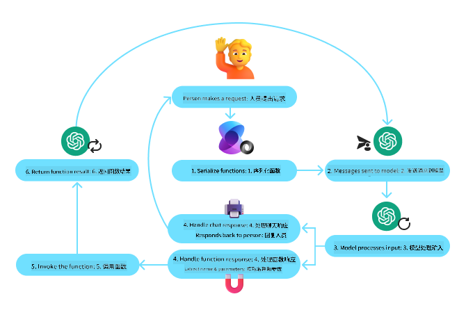

在Semantic Kernel中，函数/工具被称为[插件](https://learn.microsoft.com/semantic-kernel/concepts/plugins/?pivots=programming-language-python)。我们可以将之前的`get_current_time`函数转换为一个插件，将其封装为一个包含该函数的类。我们还可以导入`kernel_function`装饰器，该装饰器接收函数的描述。当您创建一个包含GetCurrentTimePlugin的内核时，内核会自动序列化函数及其参数，并在此过程中创建发送给LLM的模式。

```other
from semantic_kernel.functions import kernel_function

class GetCurrentTimePlugin:
    async def __init__(self, location):
        self.location = location

    @kernel_function(
        description="Get the current time for a given location"
    )
    def get_current_time(location: str = ""):
        ...
```

```other
from semantic_kernel import Kernel

# Create the kernel
kernel = Kernel()

# Create the plugin
get_current_time_plugin = GetCurrentTimePlugin(location)

# Add the plugin to the kernel
kernel.add_plugin(get_current_time_plugin)
```

#### Azure AI Agent Service

[Azure AI Agent Service](https://learn.microsoft.com/azure/ai-services/agents/overview)是一个较新的代理框架，旨在帮助开发者安全地构建、部署和扩展高质量、可扩展的AI代理，而无需管理底层计算和存储资源。它特别适用于企业应用，因为它是一个具有企业级安全性的完全托管服务。

与直接使用LLM API开发相比，Azure AI Agent Service提供了一些优势，包括：

- 自动工具调用——无需解析工具调用、调用工具并处理响应；所有这些都在服务器端完成。
- 安全管理数据——无需管理自己的对话状态，可以依赖线程存储所需的所有信息。
- 开箱即用的工具——可用于与数据源交互的工具，例如Bing、Azure AI搜索和Azure Functions。

Azure AI Agent Service中的工具分为两类：

1. 知识工具：
   - [Bing搜索基础](https://learn.microsoft.com/azure/ai-services/agents/how-to/tools/bing-grounding?tabs=python&pivots=overview)
   - [文件搜索](https://learn.microsoft.com/azure/ai-services/agents/how-to/tools/file-search?tabs=python&pivots=overview)
   - [Azure AI搜索](https://learn.microsoft.com/azure/ai-services/agents/how-to/tools/azure-ai-search?tabs=azurecli%2Cpython&pivots=overview-azure-ai-search)
2. 动作工具：
   - [函数调用](https://learn.microsoft.com/azure/ai-services/agents/how-to/tools/function-calling?tabs=python&pivots=overview)
   - [代码解释器](https://learn.microsoft.com/azure/ai-services/agents/how-to/tools/code-interpreter?tabs=python&pivots=overview)
   - [OpenAI定义的工具](https://learn.microsoft.com/azure/ai-services/agents/how-to/tools/openapi-spec?tabs=python&pivots=overview)
   - [Azure Functions](https://learn.microsoft.com/azure/ai-services/agents/how-to/tools/azure-functions?pivots=overview)

Agent Service允许我们将这些工具组合为一个`工具集`。它还利用`线程`来跟踪特定对话的消息历史。假设您是Contoso公司的一名销售代理，您希望开发一个能够回答有关销售数据问题的对话代理。以下图片展示了如何使用Azure AI Agent Service分析销售数据：

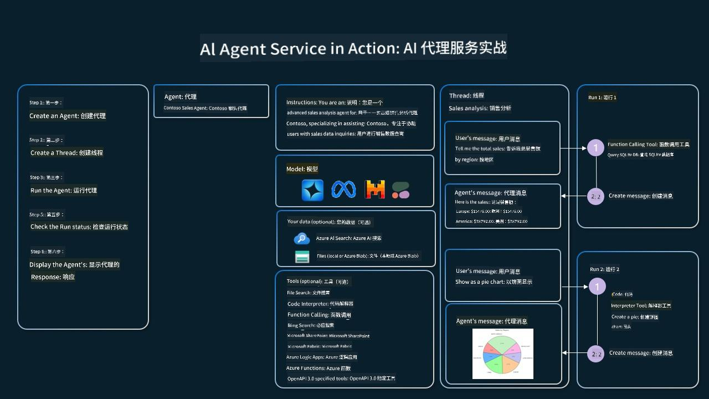

要使用服务中的任何工具，我们可以创建一个客户端并定义一个工具或工具集。以下Python代码展示了如何实际实现这一点。LLM将能够查看工具集，并根据用户请求决定是使用用户创建的函数`fetch_sales_data_using_sqlite_query`还是预构建的代码解释器。

```other
import os
from azure.ai.projects import AIProjectClient
from azure.identity import DefaultAzureCredential
from fetch_sales_data_functions import fetch_sales_data_using_sqlite_query # fetch_sales_data_using_sqlite_query function which can be found in a fetch_sales_data_functions.py file.
from azure.ai.projects.models import ToolSet, FunctionTool, CodeInterpreterTool

project_client = AIProjectClient.from_connection_string(
    credential=DefaultAzureCredential(),
    conn_str=os.environ["PROJECT_CONNECTION_STRING"],
)

# Initialize function calling agent with the fetch_sales_data_using_sqlite_query function and adding it to the toolset
fetch_data_function = FunctionTool(fetch_sales_data_using_sqlite_query)
toolset = ToolSet()
toolset.add(fetch_data_function)

# Initialize Code Interpreter tool and adding it to the toolset. 
code_interpreter = code_interpreter = CodeInterpreterTool()
toolset = ToolSet()
toolset.add(code_interpreter)

agent = project_client.agents.create_agent(
    model="gpt-4o-mini", name="my-agent", instructions="You are helpful agent", 
    toolset=toolset
)
```

### 使用工具使用设计模式构建可信赖AI代理需要注意哪些特殊事项？

使用LLM动态生成SQL时，一个常见的担忧是安全性，特别是SQL注入或恶意操作（如删除或篡改数据库）的风险。虽然这些担忧是合理的，但可以通过正确配置数据库访问权限有效缓解。对于大多数数据库，这涉及将数据库配置为只读模式。对于像PostgreSQL或Azure SQL这样的数据库服务，应用程序应被分配只读（SELECT）角色。

在安全环境中运行应用程序进一步增强了保护。在企业场景中，数据通常从操作系统中提取并转换到只读数据库或数据仓库中，并具有用户友好的模式。这种方法确保了数据的安全性、性能和可访问性，同时应用程序的访问权限受到限制，仅限于只读。

## 六.代理式（Agentic）RAG

本课全面介绍了Agentic Retrieval-Augmented Generation（Agentic RAG），这是一种新兴的人工智能范式，其中大型语言模型（LLMs）能够自主规划下一步行动，同时从外部数据源获取信息。与静态的“检索-阅读”模式不同，Agentic RAG涉及对LLM的多次迭代调用，期间穿插工具或函数调用以及结构化输出。系统会评估结果、优化查询、在必要时调用额外工具，并持续循环，直到找到满意的解决方案。

### 定义Agentic Retrieval-Augmented Generation（Agentic RAG）

Agentic Retrieval-Augmented Generation（Agentic RAG）是一种新兴的人工智能开发范式，其中LLMs不仅从外部数据源获取信息，还能自主规划下一步行动。与静态的“检索-阅读”模式或精心设计的提示序列不同，Agentic RAG涉及对LLM的迭代调用循环，期间穿插工具或函数调用以及结构化输出。每一步，系统都会评估已获得的结果，决定是否优化查询、调用额外工具，并持续循环，直到找到满意的解决方案。

这种迭代式“制造者-检查者”操作风格旨在提高准确性、处理不规范的查询（例如NL2SQL）并确保平衡且高质量的结果。系统不仅依赖精心设计的提示链，还能主动掌控其推理过程。它可以重写失败的查询、选择不同的检索方法并集成多种工具，例如Azure AI Search中的向量搜索、SQL数据库或自定义API，然后最终确定答案。这消除了对过于复杂的编排框架的需求。相反，一个相对简单的循环“LLM调用 → 工具使用 → LLM调用 → …”即可生成复杂且有依据的输出。

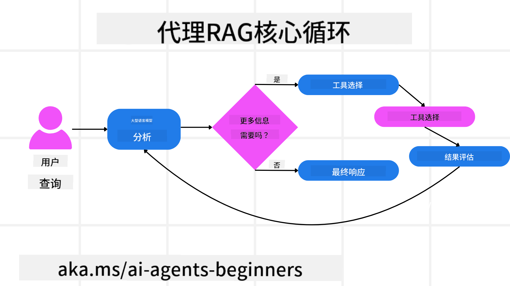

### 掌控推理过程

使系统“Agentic”的显著特点是其掌控推理过程的能力。传统的RAG实现通常依赖人类预定义模型的路径：一个思维链，概述了检索内容及时间。 但真正的Agentic系统会内部决定如何解决问题。它不仅仅是执行脚本，而是根据所获取信息的质量自主决定步骤顺序。 例如，如果被要求制定产品发布策略，它不会仅仅依赖一个提示来详细说明整个研究和决策工作流程。相反，Agentic模型会自主决定：

1. 使用Bing Web Grounding检索当前市场趋势报告。
2. 使用Azure AI Search识别相关竞争对手数据。
3. 使用Azure SQL Database关联历史内部销售指标。
4. 通过Azure OpenAI Service将发现综合成一个连贯的策略。
5. 评估策略是否存在漏洞或不一致，并在必要时进行新一轮检索。 所有这些步骤——优化查询、选择数据源、迭代直到对答案满意——都是由模型决定，而不是由人类预先编写脚本。

### 迭代循环、工具集成和记忆

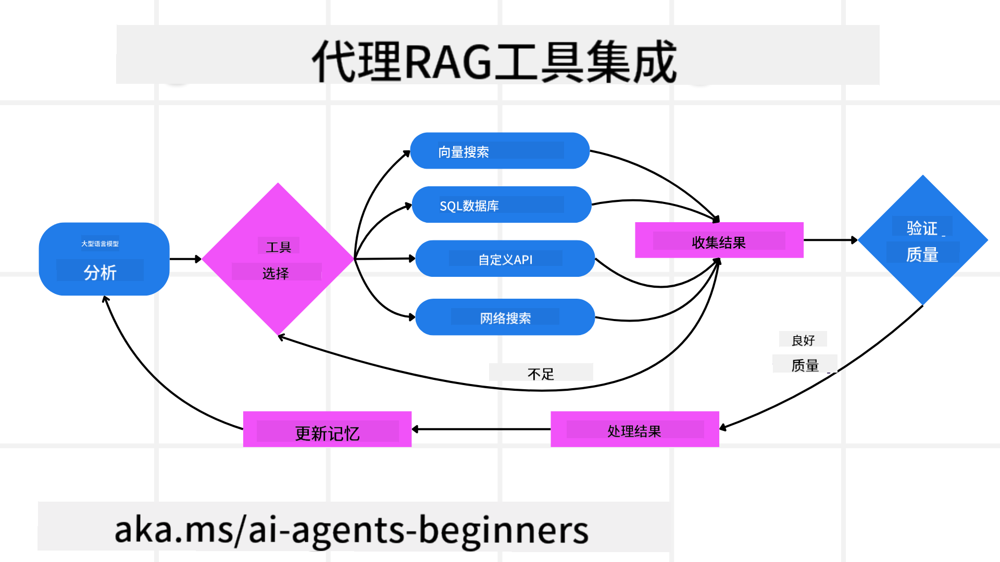

Agentic系统依赖循环交互模式：

- **初始调用：** 用户目标（即用户提示）被传递给LLM。
- **工具调用：** 如果模型发现信息缺失或指令模糊，它会选择工具或检索方法，例如向量数据库查询（例如Azure AI Search Hybrid搜索私有数据）或结构化SQL调用，以获取更多上下文。
- **评估与优化：** 在审查返回的数据后，模型决定信息是否足够。如果不足，它会优化查询、尝试不同工具或调整方法。
- **重复直到满意：** 此循环持续进行，直到模型认为已获得足够的清晰度和证据来提供最终的、经过深思熟虑的响应。
- **记忆与状态：** 由于系统在步骤间保持状态和记忆，它可以回忆之前的尝试及其结果，避免重复循环并在过程中做出更明智的决策。

随着时间推移，这种模式会形成一种逐步发展的理解，使模型能够处理复杂的多步骤任务，而无需人类不断干预或重新调整提示。

### 处理失败模式和自我纠正

Agentic RAG的自主性还包括强大的自我纠正机制。当系统遇到瓶颈，例如检索到无关文档或遇到不规范查询时，它可以：

- **迭代和重新查询：** 模型不会返回低价值的响应，而是尝试新的搜索策略、重写数据库查询或查看替代数据集。
- **使用诊断工具：** 系统可能调用额外的功能来帮助调试其推理步骤或确认检索数据的正确性。像Azure AI Tracing这样的工具将对实现强大的可观察性和监控非常重要。
- **依赖人工监督：** 对于高风险或反复失败的场景，模型可能会标记不确定性并请求人工指导。一旦人类提供纠正反馈，模型可以在后续过程中吸收这一经验。

这种迭代和动态的方法使模型能够不断改进，确保它不仅仅是一个“一次性”系统，而是一个能够在给定会话中从错误中学习的系统。

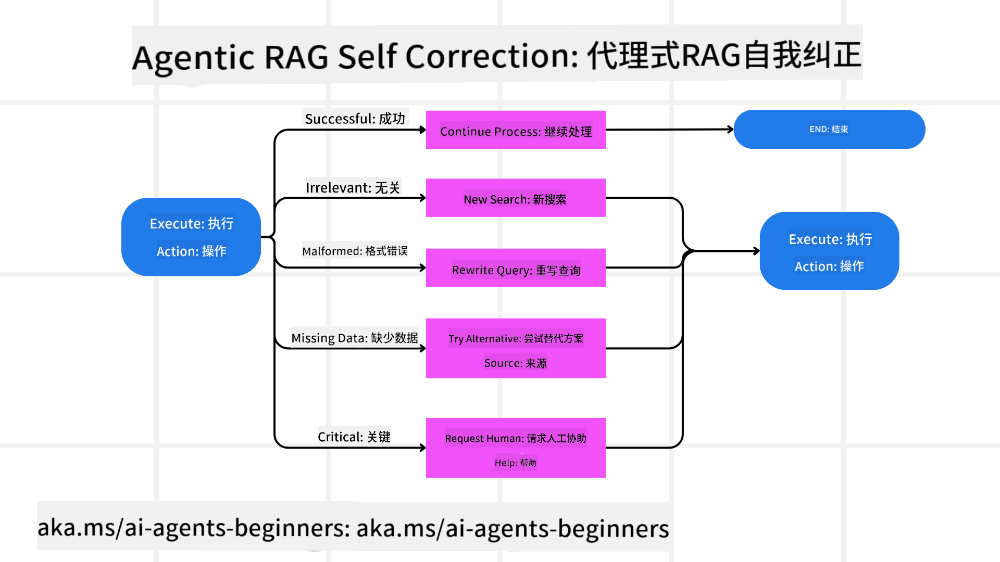

### 自主性的边界

尽管在任务中具有一定的自主性，Agentic RAG并不等同于人工通用智能。其“Agentic”能力仅限于人类开发者提供的工具、数据源和政策。它无法自行创造工具或超越设定的领域边界。相反，它擅长动态编排现有资源。 与更高级的人工智能形式相比，其关键区别包括：

1. **领域特定的自主性：** Agentic RAG系统专注于在已知领域内实现用户定义的目标，采用查询重写或工具选择等策略来优化结果。
2. **依赖基础设施：** 系统的能力取决于开发者集成的工具和数据。没有人类干预，它无法超越这些边界。
3. **尊重安全措施：** 道德准则、合规规则和业务政策仍然非常重要。Agent的自由始终受到安全措施和监督机制的约束（希望如此？）。

### 实际应用场景及价值

Agentic RAG在需要迭代优化和精确性的场景中表现出色：

1. **以准确性为优先的环境：** 在合规检查、法规分析或法律研究中，Agentic模型可以反复验证事实、咨询多个来源并重写查询，直到生成经过彻底审查的答案。
2. **复杂的数据库交互：** 在处理结构化数据时，查询可能经常失败或需要调整，系统可以使用Azure SQL或Microsoft Fabric OneLake自主优化查询，确保最终检索符合用户意图。
3. **扩展的工作流程：** 随着新信息的出现，较长的会话可能会不断演变。Agentic RAG可以持续整合新数据，并随着对问题空间的了解加深而调整策略。

### 治理、透明性和信任

随着这些系统在推理中变得更加自主，治理和透明性至关重要：

- **可解释的推理：** 模型可以提供查询记录、咨询的来源以及其推理步骤的审计轨迹。像Azure AI Content Safety和Azure AI Tracing / GenAIOps这样的工具可以帮助保持透明性并降低风险。
- **偏差控制和平衡检索：** 开发者可以调整检索策略，确保考虑平衡、具有代表性的数据源，并定期审查输出以检测偏差或倾斜模式，使用Azure Machine Learning为高级数据科学组织定制模型。
- **人工监督和合规：** 对于敏感任务，人工审查仍然至关重要。Agentic RAG不会取代高风险决策中的人类判断，而是通过提供经过更彻底审查的选项来增强人类判断。

拥有能够提供清晰操作记录的工具至关重要。没有这些工具，调试多步骤过程可能会非常困难。以下是Literal AI（Chainlit背后的公司）提供的Agent运行示例：

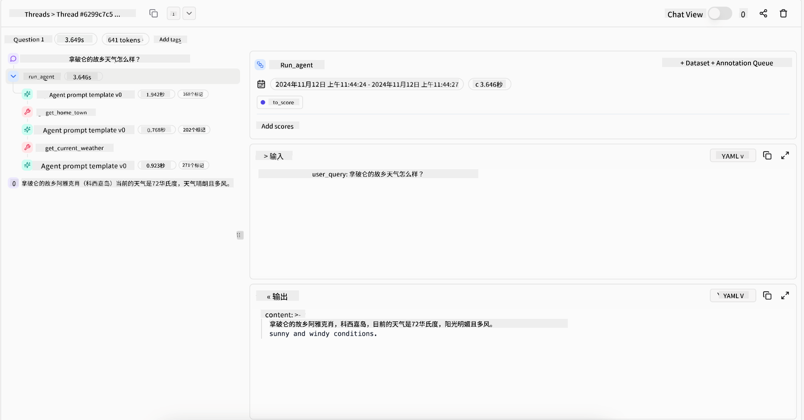


### 结论

Agentic RAG代表了人工智能系统处理复杂、数据密集型任务的自然演进。通过采用循环交互模式、自主选择工具并优化查询直到获得高质量结果，系统超越了静态的提示跟随，成为更具适应性和上下文感知的决策者。尽管仍受人类定义的基础设施和道德准则的约束，这些Agentic能力使企业和终端用户能够享受更丰富、更动态且更有价值的人工智能交互。

### 其他资源

- [使用 Azure OpenAI 服务实现检索增强生成 (RAG)：学习如何使用您自己的数据与 Azure OpenAI 服务集成。本 Microsoft Learn 模块提供了关于实现 RAG 的全面指南](https://learn.microsoft.com/training/modules/use-own-data-azure-openai)
- [使用 Azure AI Foundry 评估生成式 AI 应用：本文涵盖了在公开数据集上对模型进行评估和比较的内容，包括 Agentic AI 应用和 RAG 架构](https://learn.microsoft.com/azure/ai-studio/concepts/evaluation-approach-gen-ai)
- [什么是 Agentic RAG | Weaviate](https://weaviate.io/blog/what-is-agentic-rag)
- [Agentic RAG：基于代理的检索增强生成完整指南 – 来自 RAG 的最新动态](https://ragaboutit.com/agentic-rag-a-complete-guide-to-agent-based-retrieval-augmented-generation/)
- [Agentic RAG：通过查询重构和自查询为您的 RAG 提速！Hugging Face 开源 AI 手册](https://huggingface.co/learn/cookbook/agent_rag)
- [为 RAG 添加 Agentic 层](https://youtu.be/aQ4yQXeB1Ss?si=2HUqBzHoeB5tR04U)
- [知识助手的未来：Jerry Liu](https://www.youtube.com/watch?v=zeAyuLc_f3Q&t=244s)
- [如何构建 Agentic RAG 系统](https://www.youtube.com/watch?v=AOSjiXP1jmQ)
- [使用 Azure AI Foundry Agent 服务扩展您的 AI 代理](https://ignite.microsoft.com/sessions/BRK102?source=sessions)

### 学术论文

- [2303.17651 Self-Refine: 通过自反馈进行迭代优化](https://arxiv.org/abs/2303.17651)
- [2303.11366 Reflexion: 具有语言强化学习的语言代理](https://arxiv.org/abs/2303.11366)
- [2305.11738 CRITIC: 大型语言模型通过工具交互批判实现自我纠正](https://arxiv.org/abs/2305.11738)
- [2501.09136 Agentic Retrieval-Augmented Generation: 关于 Agentic RAG 的综述](https://arxiv.org/abs/2501.09136)

## 七.构建可信的AI代理

### 安全性

首先，让我们了解如何构建安全的代理应用程序。安全性意味着AI代理能够按设计运行。作为代理应用程序的开发者，我们有方法和工具来最大化安全性：

### 构建系统消息框架

如果您曾使用大型语言模型（LLMs）构建AI应用程序，您会知道设计一个强大的系统提示或系统消息的重要性。这些提示设定了元规则、指令和指南，规定了LLM如何与用户和数据交互。

对于AI代理来说，系统提示更为重要，因为AI代理需要非常具体的指令来完成我们为其设计的任务。

为了创建可扩展的系统提示，我们可以使用一个系统消息框架来为应用程序中的一个或多个代理构建提示：

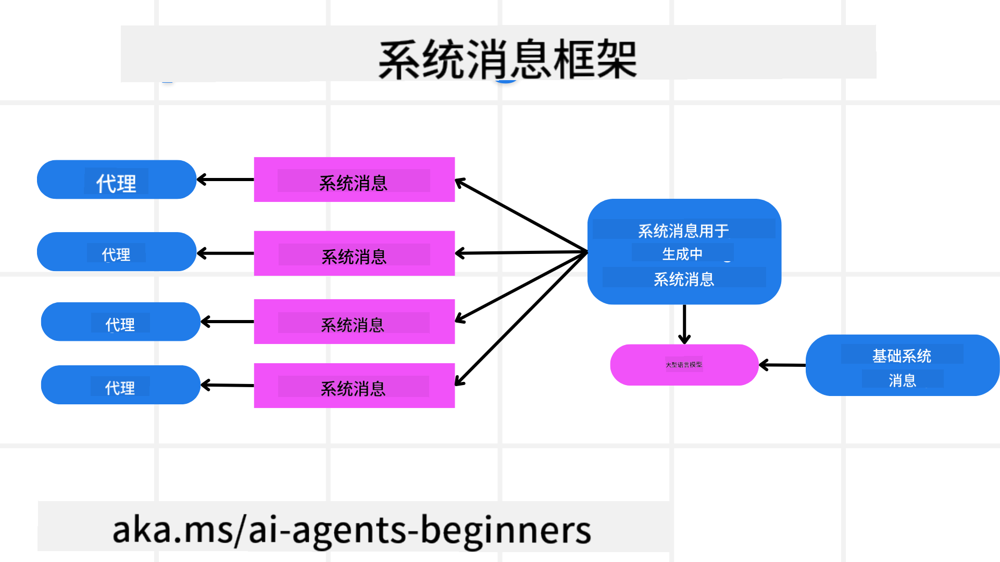

#### 第一步：创建元系统消息

元提示将被LLM用来生成我们创建的代理的系统提示。我们将其设计为一个模板，以便在需要时高效创建多个代理。

以下是我们提供给LLM的元系统消息示例：

```other
You are an expert at creating AI agent assistants. 
You will be provided a company name, role, responsibilities and other
information that you will use to provide a system prompt for.
To create the system prompt, be descriptive as possible and provide a structure that a system using an LLM can better understand the role and responsibilities of the AI assistant.
```

#### 第二步：创建基础提示

下一步是创建一个基础提示来描述AI代理。您应包括代理的角色、代理将完成的任务以及代理的其他职责。

以下是一个示例：

```other
You are a travel agent for Contoso Travel that is great at booking flights for customers. To help customers you can perform the following tasks: lookup available flights, book flights, ask for preferences in seating and times for flights, cancel any previously booked flights and alert customers on any delays or cancellations of flights.
```

#### 第三步：向LLM提供基础系统消息

现在，我们可以通过将元系统消息作为系统消息以及我们的基础系统消息提供给LLM来优化此系统消息。这将生成一个更适合指导AI代理的系统消息：

```other
**Company Name:** Contoso Travel  
**Role:** Travel Agent Assistant

**Objective:**  
You are an AI-powered travel agent assistant for Contoso Travel, specializing in booking flights and providing exceptional customer service. Your main goal is to assist customers in finding, booking, and managing their flights, all while ensuring that their preferences and needs are met efficiently.

**Key Responsibilities:**

1. **Flight Lookup:**

    - Assist customers in searching for available flights based on their specified destination, dates, and any other relevant preferences.
    - Provide a list of options, including flight times, airlines, layovers, and pricing.
2. **Flight Booking:**

    - Facilitate the booking of flights for customers, ensuring that all details are correctly entered into the system.
    - Confirm bookings and provide customers with their itinerary, including confirmation numbers and any other pertinent information.
3. **Customer Preference Inquiry:**

    - Actively ask customers for their preferences regarding seating (e.g., aisle, window, extra legroom) and preferred times for flights (e.g., morning, afternoon, evening).
    - Record these preferences for future reference and tailor suggestions accordingly.
4. **Flight Cancellation:**

    - Assist customers in canceling previously booked flights if needed, following company policies and procedures.
    - Notify customers of any necessary refunds or additional steps that may be required for cancellations.
5. **Flight Monitoring:**

    - Monitor the status of booked flights and alert customers in real-time about any delays, cancellations, or changes to their flight schedule.
    - Provide updates through preferred communication channels (e.g., email, SMS) as needed.

**Tone and Style:**

- Maintain a friendly, professional, and approachable demeanor in all interactions with customers.
- Ensure that all communication is clear, informative, and tailored to the customer's specific needs and inquiries.

**User Interaction Instructions:**

- Respond to customer queries promptly and accurately.
- Use a conversational style while ensuring professionalism.
- Prioritize customer satisfaction by being attentive, empathetic, and proactive in all assistance provided.

**Additional Notes:**

- Stay updated on any changes to airline policies, travel restrictions, and other relevant information that could impact flight bookings and customer experience.
- Use clear and concise language to explain options and processes, avoiding jargon where possible for better customer understanding.

This AI assistant is designed to streamline the flight booking process for customers of Contoso Travel, ensuring that all their travel needs are met efficiently and effectively.
```

#### 第四步：迭代和改进

此系统消息框架的价值在于能够更轻松地为多个代理扩展创建系统消息，并随着时间的推移改进您的系统消息。很少有系统消息能够在第一次就完全适用于您的用例。通过更改基础系统消息并运行系统，您可以进行小幅调整和改进，从而比较和评估结果。

### 理解威胁

为了构建可信的AI代理，理解并减轻对AI代理的风险和威胁至关重要。让我们来看一些针对AI代理的不同威胁，以及如何更好地规划和应对这些威胁。

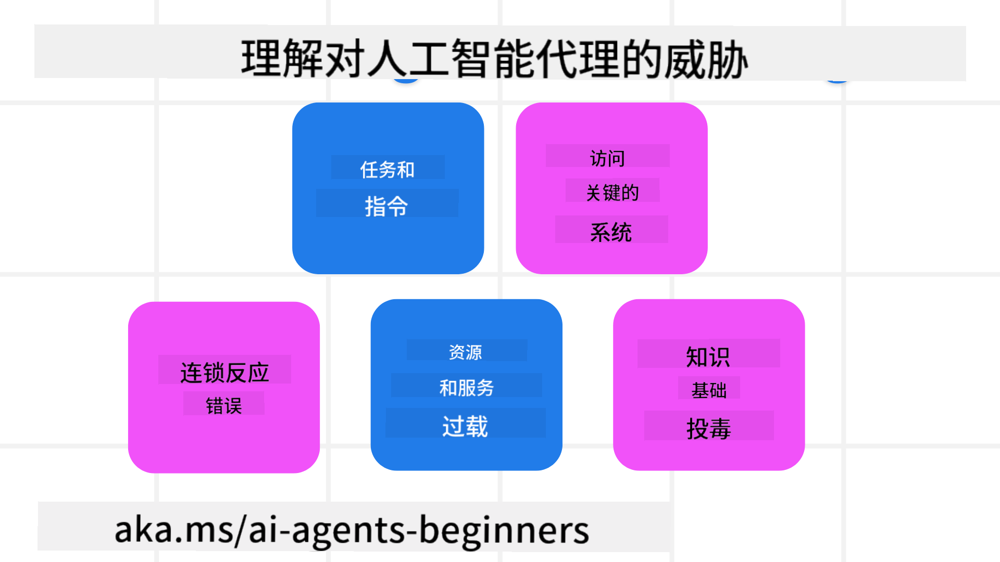

### 任务和指令

**描述：** 攻击者试图通过提示或操控输入来更改AI代理的指令或目标。

**缓解措施：**执行验证检查和输入过滤器，以在AI代理处理之前检测潜在危险的提示。由于这些攻击通常需要与代理频繁交互，限制对话轮次也是防止此类攻击的另一种方法。

### 访问关键系

**描述：**如果AI代理可以访问存储敏感数据的系统和服务，攻击者可能会破坏代理与这些服务之间的通信。这些可能是直接攻击，也可能是通过代理间接获取这些系统信息的尝试。

**缓解措施：** AI代理应仅在必要时访问系统，以防止此类攻击。代理与系统之间的通信也应是安全的。实施身份验证和访问控制是保护此类信息的另一种方法。

### 资源和服务过载

**描述：**AI代理可以访问不同的工具和服务来完成任务。攻击者可能利用这一能力，通过AI代理发送大量请求来攻击这些服务，可能导致系统故障或高昂的成本。

**缓解措施：**实施策略限制AI代理对服务的请求数量。限制与AI代理的对话轮次和请求数量也是防止此类攻击的另一种方法。

### 知识库投毒

**描述：** 此类攻击并不直接针对AI代理，而是针对AI代理将使用的知识库和其他服务。这可能涉及破坏AI代理将用于完成任务的数据或信息，从而导致对用户的偏见或意外响应。

**缓解措施：**定期验证AI代理将在其工作流程中使用的数据。确保对这些数据的访问是安全的，并且只有可信人员才能更改，以避免此类攻击。

### 连锁错误

**描述：** AI代理访问各种工具和服务来完成任务。攻击者引发的错误可能导致与AI代理连接的其他系统故障，使攻击范围扩大并更难排查。

**缓解措施：** 避免此类问题的一种方法是让AI代理在受限环境中运行，例如在Docker容器中执行任务，以防止直接的系统攻击。创建备用机制和重试逻辑，当某些系统返回错误时，可以防止更大的系统故障。

### 人类参与

另一种构建可信AI代理系统的有效方法是引入人类参与。这种方式创建了一个流程，用户可以在代理运行期间向其提供反馈。用户实际上充当了多代理系统中的代理，通过批准或终止运行过程来参与。

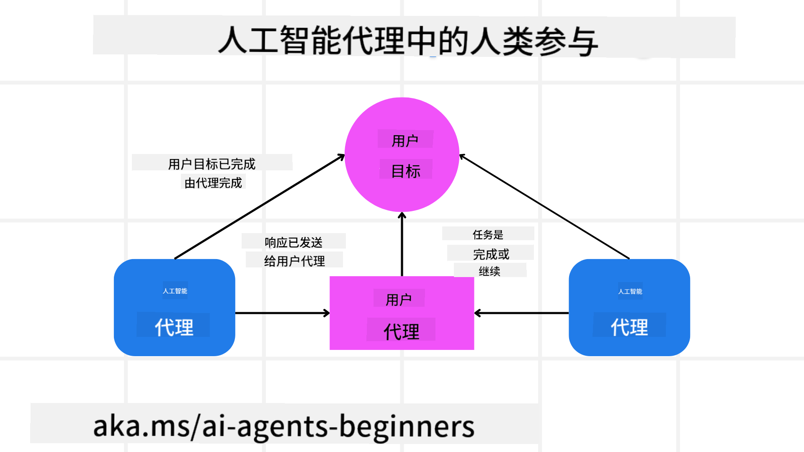

以下是一个使用AutoGen实现此概念的代码片段：

```other
# Create the agents.
model_client = OpenAIChatCompletionClient(model="gpt-4o-mini")
assistant = AssistantAgent("assistant", model_client=model_client)
user_proxy = UserProxyAgent("user_proxy", input_func=input)  # Use input() to get user input from console.

# Create the termination condition which will end the conversation when the user says "APPROVE".
termination = TextMentionTermination("APPROVE")

# Create the team.
team = RoundRobinGroupChat([assistant, user_proxy], termination_condition=termination)

# Run the conversation and stream to the console.
stream = team.run_stream(task="Write a 4-line poem about the ocean.")
# Use asyncio.run(...) when running in a script.
await Console(stream)
```

### 总结

构建可信的AI代理需要精心设计、强大的安全措施和持续的迭代。通过实施结构化的元提示系统、理解潜在威胁并应用缓解策略，开发者可以创建既安全又高效的AI代理。此外，结合人类参与的方法可以确保AI代理始终与用户需求保持一致，同时将风险降到最低。随着AI的不断发展，保持对安全、隐私和伦理问题的积极态度将是建立AI驱动系统信任和可靠性的关键。

## 八.规划设计模式

### 定义总体目标并分解任务

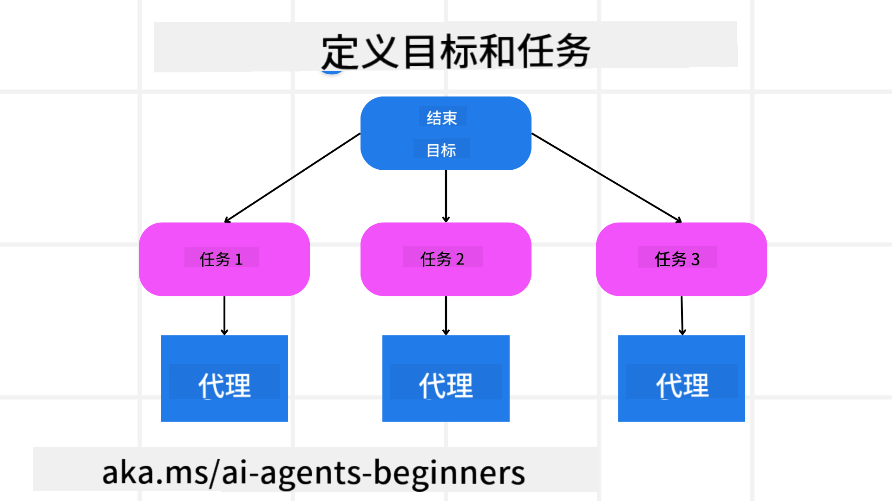

大多数现实世界的任务过于复杂，无法一步完成。AI 代理需要一个简明的目标来指导其规划和行动。例如，考虑以下目标：

```other
"生成一个为期三天的旅行行程。"
```

虽然目标表述简单，但仍需进一步细化。目标越清晰，代理（以及任何人类协作者）就越能专注于实现正确的结果，例如创建包含航班选项、酒店推荐和活动建议的全面行程。

### 任务分解

将大型或复杂任务分解为更小、更具目标导向的子任务，可以使任务更易管理。 以旅行行程为例，您可以将目标分解为以下子任务：

- 航班预订
- 酒店预订
- 租车服务
- 个性化定制

每个子任务可以由专门的代理或流程处理。例如，一个代理可能专注于搜索最佳航班优惠，另一个代理专注于酒店预订，等等。一个协调或“下游”代理可以将这些结果整合成一个连贯的行程提供给最终用户。

这种模块化方法还允许逐步改进。例如，您可以添加专门负责美食推荐或本地活动建议的代理，并随着时间推移优化行程。

### 结构化输出

大型语言模型（LLMs）可以生成结构化输出（如 JSON），这对于下游代理或服务解析和处理非常有用。在多代理环境中，这种结构化输出尤其重要，因为我们可以在规划输出生成后执行这些任务。以下是一个快速概览：

以下 Python 代码片段展示了一个简单的规划代理如何将目标分解为子任务并生成结构化计划：

```other
from pydantic import BaseModel
from enum import Enum
from typing import List, Optional, Union
import json
import os
from typing import Optional
from pprint import pprint
from autogen_core.models import UserMessage, SystemMessage, AssistantMessage
from autogen_ext.models.azure import AzureAIChatCompletionClient
from azure.core.credentials import AzureKeyCredential

class AgentEnum(str, Enum):
    FlightBooking = "flight_booking"
    HotelBooking = "hotel_booking"
    CarRental = "car_rental"
    ActivitiesBooking = "activities_booking"
    DestinationInfo = "destination_info"
    DefaultAgent = "default_agent"
    GroupChatManager = "group_chat_manager"

# Travel SubTask Model
class TravelSubTask(BaseModel):
    task_details: str
    assigned_agent: AgentEnum  # we want to assign the task to the agent

class TravelPlan(BaseModel):
    main_task: str
    subtasks: List[TravelSubTask]
    is_greeting: bool

client = AzureAIChatCompletionClient(
    model="gpt-4o-mini",
    endpoint="https://models.inference.ai.azure.com",
    # To authenticate with the model you will need to generate a personal access token (PAT) in your GitHub settings.
    # Create your PAT token by following instructions here: https://docs.github.com/en/authentication/keeping-your-account-and-data-secure/managing-your-personal-access-tokens
    credential=AzureKeyCredential(os.environ["GITHUB_TOKEN"]),
    model_info={
        "json_output": False,
        "function_calling": True,
        "vision": True,
        "family": "unknown",
    },
)

# Define the user message
messages = [
    SystemMessage(content="""You are an planner agent.
    Your job is to decide which agents to run based on the user's request.
                      Provide your response in JSON format with the following structure:
{'main_task': 'Plan a family trip from Singapore to Melbourne.',
 'subtasks': [{'assigned_agent': 'flight_booking',
               'task_details': 'Book round-trip flights from Singapore to '
                               'Melbourne.'}
    Below are the available agents specialised in different tasks:
    - FlightBooking: For booking flights and providing flight information
    - HotelBooking: For booking hotels and providing hotel information
    - CarRental: For booking cars and providing car rental information
    - ActivitiesBooking: For booking activities and providing activity information
    - DestinationInfo: For providing information about destinations
    - DefaultAgent: For handling general requests""", source="system"),
    UserMessage(
        content="Create a travel plan for a family of 2 kids from Singapore to Melboune", source="user"),
]

response = await client.create(messages=messages, extra_create_args={"response_format": 'json_object'})

response_content: Optional[str] = response.content if isinstance(
    response.content, str) else None
if response_content is None:
    raise ValueError("Response content is not a valid JSON string" )

pprint(json.loads(response_content))

# # Ensure the response content is a valid JSON string before loading it
# response_content: Optional[str] = response.content if isinstance(
#     response.content, str) else None
# if response_content is None:
#     raise ValueError("Response content is not a valid JSON string")

# # Print the response content after loading it as JSON
# pprint(json.loads(response_content))

# Validate the response content with the MathReasoning model
# TravelPlan.model_validate(json.loads(response_content))
```

### 具有多代理协调功能的规划代理

在此示例中，一个语义路由代理接收到用户请求（例如，“我需要一个旅行的酒店计划。”）。

规划器的工作流程如下：

- 接收酒店计划：规划器接收用户的消息，并根据系统提示（包括可用代理的详细信息）生成一个结构化的旅行计划。
- 列出代理及其工具：代理注册表包含代理列表（如航班、酒店、租车和活动代理）及其提供的功能或工具。
- 将计划路由到相应代理：根据子任务数量，规划器要么将消息直接发送给专门代理（用于单任务场景），要么通过群聊管理器协调多代理协作。
- 总结结果：最后，规划器总结生成的计划以便于理解。 以下 Python 代码示例展示了这些步骤：

```other
from pydantic import BaseModel

from enum import Enum
from typing import List, Optional, Union

class AgentEnum(str, Enum):
    FlightBooking = "flight_booking"
    HotelBooking = "hotel_booking"
    CarRental = "car_rental"
    ActivitiesBooking = "activities_booking"
    DestinationInfo = "destination_info"
    DefaultAgent = "default_agent"
    GroupChatManager = "group_chat_manager"

# Travel SubTask Model

class TravelSubTask(BaseModel):
    task_details: str
    assigned_agent: AgentEnum # we want to assign the task to the agent

class TravelPlan(BaseModel):
    main_task: str
    subtasks: List[TravelSubTask]
    is_greeting: bool
import json
import os
from typing import Optional

from autogen_core.models import UserMessage, SystemMessage, AssistantMessage
from autogen_ext.models.openai import AzureOpenAIChatCompletionClient

# Create the client with type-checked environment variables

client = AzureOpenAIChatCompletionClient(
    azure_deployment=os.getenv("AZURE_OPENAI_DEPLOYMENT_NAME"),
    model=os.getenv("AZURE_OPENAI_DEPLOYMENT_NAME"),
    api_version=os.getenv("AZURE_OPENAI_API_VERSION"),
    azure_endpoint=os.getenv("AZURE_OPENAI_ENDPOINT"),
    api_key=os.getenv("AZURE_OPENAI_API_KEY"),
)

from pprint import pprint

# Define the user message

messages = [
    SystemMessage(content="""You are an planner agent.
    Your job is to decide which agents to run based on the user's request.
    Below are the available agents specialized in different tasks:
    - FlightBooking: For booking flights and providing flight information
    - HotelBooking: For booking hotels and providing hotel information
    - CarRental: For booking cars and providing car rental information
    - ActivitiesBooking: For booking activities and providing activity information
    - DestinationInfo: For providing information about destinations
    - DefaultAgent: For handling general requests""", source="system"),
    UserMessage(content="Create a travel plan for a family of 2 kids from Singapore to Melbourne", source="user"),
]

response = await client.create(messages=messages, extra_create_args={"response_format": TravelPlan})

# Ensure the response content is a valid JSON string before loading it

response_content: Optional[str] = response.content if isinstance(response.content, str) else None
if response_content is None:
    raise ValueError("Response content is not a valid JSON string")

# Print the response content after loading it as JSON

pprint(json.loads(response_content))
```

上述代码的输出如下，您可以使用此结构化输出路由到 `assigned_agent` 并将旅行计划总结给最终用户。

```other
{
    "is_greeting": "False",
    "main_task": "Plan a family trip from Singapore to Melbourne.",
    "subtasks": [
        {
            "assigned_agent": "flight_booking",
            "task_details": "Book round-trip flights from Singapore to Melbourne."
        },
        {
            "assigned_agent": "hotel_booking",
            "task_details": "Find family-friendly hotels in Melbourne."
        },
        {
            "assigned_agent": "car_rental",
            "task_details": "Arrange a car rental suitable for a family of four in Melbourne."
        },
        {
            "assigned_agent": "activities_booking",
            "task_details": "List family-friendly activities in Melbourne."
        },
        {
            "assigned_agent": "destination_info",
            "task_details": "Provide information about Melbourne as a travel destination."
        }
    ]
}
```

包含上述代码示例的示例笔记本可在[此处](https://microsoft.github.io/ai-agents-for-beginners/translations/zh/07-planning-design/07-autogen.ipynb)找到。

### 迭代规划

某些任务需要反复调整或重新规划，其中一个子任务的结果可能会影响下一个子任务。例如，如果代理在预订航班时发现了意外的数据格式，它可能需要在继续酒店预订之前调整策略。

此外，用户反馈（例如用户决定更喜欢更早的航班）可能会触发部分重新规划。这种动态的迭代方法确保最终解决方案符合现实世界的约束条件和不断变化的用户偏好。

例如，以下是示例代码：

```other
from autogen_core.models import UserMessage, SystemMessage, AssistantMessage
#.. same as previous code and pass on the user history, current plan
messages = [
    SystemMessage(content="""You are a planner agent to optimize the
    Your job is to decide which agents to run based on the user's request.
    Below are the available agents specialized in different tasks:
    - FlightBooking: For booking flights and providing flight information
    - HotelBooking: For booking hotels and providing hotel information
    - CarRental: For booking cars and providing car rental information
    - ActivitiesBooking: For booking activities and providing activity information
    - DestinationInfo: For providing information about destinations
    - DefaultAgent: For handling general requests""", source="system"),
    UserMessage(content="Create a travel plan for a family of 2 kids from Singapore to Melbourne", source="user"),
    AssistantMessage(content=f"Previous travel plan - {TravelPlan}", source="assistant")
]
# .. re-plan and send the tasks to respective agents
```

有关更全面的规划，请查看 Magnetic One，它专注于解决复杂任务。

### 总结

本文展示了如何创建一个规划器，该规划器可以动态选择定义的可用代理。规划器的输出会分解任务并分配给代理以执行。假设这些代理可以访问完成任务所需的功能/工具。除了代理之外，您还可以包括其他模式，如反思、总结器和轮询聊天，以进一步定制。

### 其他资源

- AutoGen Magnetic One - 一个通用的多代理系统，用于解决复杂任务，并在多个具有挑战性的代理基准测试中取得了令人印象深刻的成果。参考资料：

在此实现中，协调器创建特定任务的计划并将这些任务委派给可用代理。除了规划之外，协调器还采用跟踪机制来监控任务进度并根据需要重新规划。

## 九.多代理设计模式

当你开始从事涉及多个代理的项目时，就需要考虑多代理设计模式。然而，什么时候切换到多代理模式以及它的优势可能并不那么显而易见。

### 多代理适用的场景

那么，哪些场景适合使用多代理呢？答案是有很多场景可以从多个代理中受益，尤其是在以下情况下：

- **大工作量**：大工作量可以分解为较小的任务并分配给不同的代理，从而实现并行处理并加快完成速度。例如，大规模数据处理任务就是一个案例。
- **复杂任务**：复杂任务可以像大工作量一样分解为较小的子任务，并分配给不同的代理，每个代理专注于任务的特定方面。例如，自动驾驶汽车中，不同代理分别负责导航、障碍物检测和与其他车辆的通信。
- **多样化的专业知识**：不同代理可以拥有多样化的专业知识，使其能够比单一代理更有效地处理任务的不同方面。例如，在医疗领域，代理可以分别负责诊断、治疗计划和患者监测。

### 使用多代理相比单一代理的优势

单一代理系统可能适合简单任务，但对于更复杂的任务，使用多个代理可以带来以下优势：

- **专业化**：每个代理可以专注于特定任务。单一代理缺乏专业化，可能会在面对复杂任务时感到困惑。例如，它可能最终执行了一个并不适合它的任务。
- **可扩展性**：通过添加更多代理来扩展系统比让单一代理超负荷工作更容易。
- **容错性**：如果一个代理失败，其他代理可以继续工作，从而确保系统的可靠性。

举个例子，假设为用户预订一次旅行。单一代理系统需要处理旅行预订过程的所有方面，从寻找航班到预订酒店和租车。为了实现这一点，单一代理需要具备处理所有这些任务的工具。这可能导致一个复杂且难以维护和扩展的单体系统。而多代理系统可以有不同的代理分别专注于寻找航班、预订酒店和租车。这使得系统更加模块化、更易维护且更具可扩展性。

这可以类比为一个夫妻店经营的旅行社与一个连锁经营的旅行社。夫妻店的旅行社会有一个代理处理旅行预订过程的所有方面，而连锁经营的旅行社会有不同的代理分别处理旅行预订过程的不同方面。

### 实现多代理设计模式的构建模块

在实现多代理设计模式之前，你需要了解构成该模式的构建模块。

让我们通过预订用户旅行的例子来具体说明。在这种情况下，构建模块包括：

- **代理通信**：负责寻找航班、预订酒店和租车的代理需要进行通信并共享用户的偏好和约束。你需要决定通信的协议和方法。具体来说，寻找航班的代理需要与预订酒店的代理沟通，以确保酒店的预订日期与航班日期一致。这意味着代理需要共享用户的旅行日期，因此你需要决定_哪些代理共享信息以及如何共享信息_。
- **协调机制**：代理需要协调其行动以确保满足用户的偏好和约束。例如，用户可能希望酒店靠近机场，而约束可能是租车只能在机场提供。这意味着预订酒店的代理需要与租车代理协调，以确保满足用户的偏好和约束。这意味着你需要决定_代理如何协调其行动_。
- **代理架构**：代理需要具备内部结构以做出决策并从与用户的交互中学习。例如，寻找航班的代理需要具备内部结构以决定向用户推荐哪些航班。这意味着你需要决定_代理如何做出决策并从与用户的交互中学习_。例如，寻找航班的代理可以使用机器学习模型根据用户的过去偏好推荐航班。
- **多代理交互的可见性**：你需要了解多个代理之间的交互方式。这意味着你需要有工具和技术来跟踪代理的活动和交互。这可以通过日志记录和监控工具、可视化工具以及性能指标来实现。
- **多代理模式**：实现多代理系统有不同的模式，例如集中式、分散式和混合架构。你需要决定最适合你的用例的模式。
- **人工干预**：在大多数情况下，你会有人工干预，你需要指示代理何时寻求人工介入。例如，用户可能要求推荐的酒店或航班之外的特定选项，或者在预订航班或酒店之前要求确认。

### 多代理交互的可见性

了解多个代理之间的交互方式非常重要。这种可见性对于调试、优化以及确保整个系统的有效性至关重要。为了实现这一点，你需要有工具和技术来跟踪代理的活动和交互。这可以通过日志记录和监控工具、可视化工具以及性能指标来实现。

例如，在为用户预订旅行的情况下，你可以有一个仪表板显示每个代理的状态、用户的偏好和约束以及代理之间的交互。这个仪表板可以显示用户的旅行日期、航班代理推荐的航班、酒店代理推荐的酒店以及租车代理推荐的租车。这可以让你清楚地了解代理之间的交互方式以及是否满足了用户的偏好和约束。

让我们更详细地看一下这些方面。

- **日志记录和监控工具**：你需要为代理采取的每个行动记录日志。日志条目可以存储关于采取行动的代理、采取的行动、行动的时间以及行动结果的信息。这些信息可以用于调试、优化等。
- **可视化工具**：可视化工具可以帮助你以更直观的方式查看代理之间的交互。例如，你可以有一个图表显示代理之间的信息流。这可以帮助你识别系统中的瓶颈、低效以及其他问题。
- **性能指标**：性能指标可以帮助你跟踪多代理系统的有效性。例如，你可以跟踪完成任务所需的时间、每单位时间完成的任务数量以及代理推荐的准确性。这些信息可以帮助你识别改进的领域并优化系统。

### 多代理模式

让我们深入探讨一些可以用来创建多代理应用的具体模式。以下是一些值得考虑的有趣模式：

#### 群聊

当你想创建一个群聊应用程序，让多个代理可以相互通信时，这种模式非常有用。典型的用例包括团队协作、客户支持和社交网络。

在这种模式中，每个代理代表群聊中的一个用户，消息通过消息协议在代理之间交换。代理可以向群聊发送消息、从群聊接收消息以及响应其他代理的消息。

这种模式可以通过集中式架构实现，所有消息通过中央服务器路由，或者通过分散式架构直接交换消息。

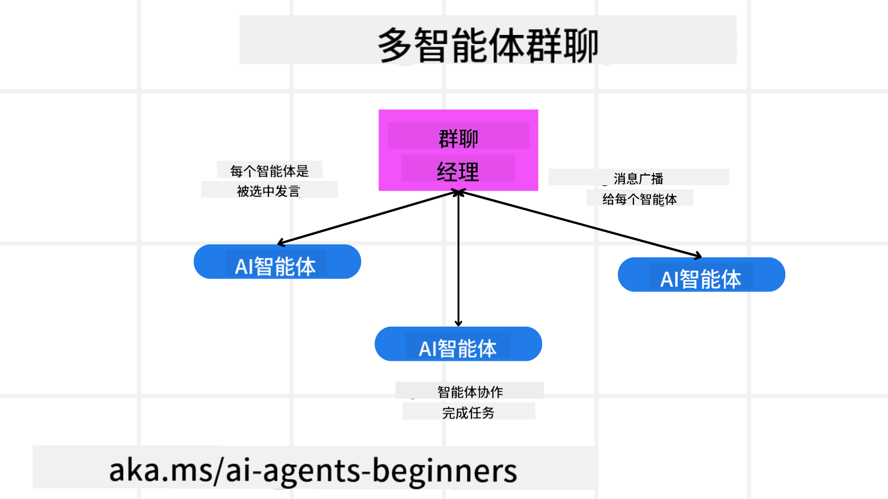

#### 任务交接

当你想创建一个应用程序，让多个代理可以相互交接任务时，这种模式非常有用。

典型的用例包括客户支持、任务管理和工作流自动化。

在这种模式中，每个代理代表工作流中的一个任务或步骤，代理可以根据预定义规则将任务交接给其他代理。

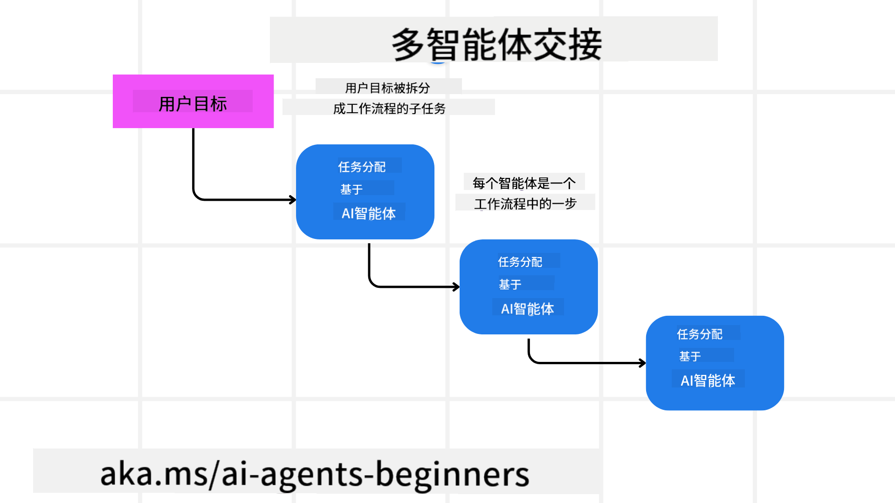

#### 协同过滤

当你想创建一个应用程序，让多个代理可以协作为用户提供推荐时，这种模式非常有用。

为什么需要多个代理协作？因为每个代理可以拥有不同的专业知识，并以不同的方式为推荐过程做出贡献。

举个例子，假设用户想要推荐购买股票的建议。

- **行业专家**：一个代理可以是某个行业的专家。
- **技术分析**：另一个代理可以是技术分析的专家。
- **基本面分析**：还有一个代理可以是基本面分析的专家。通过协作，这些代理可以为用户提供更全面的推荐。

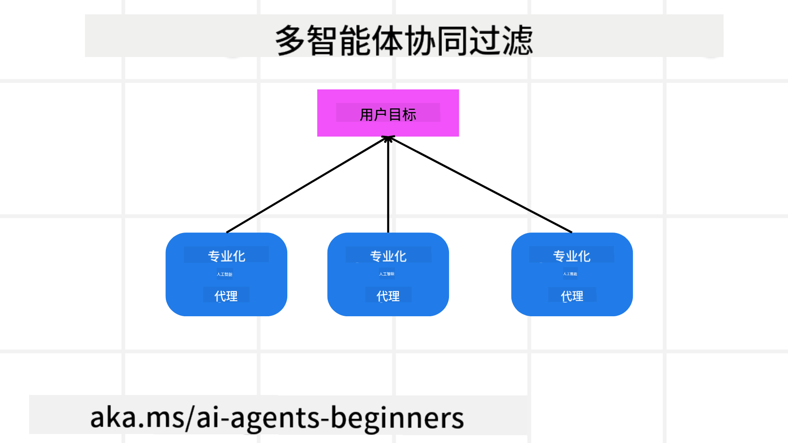

#### 场景：退款流程

考虑一个场景，客户试图为某产品申请退款，可能会涉及多个代理，但我们可以将其分为专用于退款流程的代理和可用于其他流程的通用代理。

**专用于退款流程的代理**：

以下是一些可能参与退款流程的代理：

- **客户代理**：代表客户，负责启动退款流程。
- **卖家代理**：代表卖家，负责处理退款。
- **支付代理**：代表支付流程，负责退还客户的付款。
- **解决代理**：代表解决流程，负责解决退款过程中出现的任何问题。
- **合规代理**：代表合规流程，负责确保退款流程符合法规和政策。

**通用代理**：

这些代理可以用于业务的其他部分。

- **物流代理**：代表物流流程，负责将产品寄回卖家。此代理既可用于退款流程，也可用于购买产品的物流。
- **反馈代理**：代表反馈流程，负责收集客户反馈。反馈可以在任何时间进行，而不仅限于退款流程。
- **升级代理**：代表升级流程，负责将问题升级到更高级别的支持。此类代理可用于任何需要问题升级的流程。
- **通知代理**：代表通知流程，负责在退款流程的各个阶段向客户发送通知。
- **分析代理**：代表分析流程，负责分析与退款流程相关的数据。
- **审计代理**：代表审计流程，负责审计退款流程以确保其正确执行。
- **报告代理**：代表报告流程，负责生成关于退款流程的报告。
- **知识代理**：代表知识流程，负责维护与退款流程相关的信息知识库。此代理既可以了解退款，也可以了解业务的其他部分。
- **安全代理**：代表安全流程，负责确保退款流程的安全性。
- **质量代理**：代表质量流程，负责确保退款流程的质量。

以上列出了许多代理，包括专用于退款流程的代理以及可用于业务其他部分的通用代理。希望这能为你如何决定在多代理系统中使用哪些代理提供一些思路。

#### 作业

设计一个多代理系统用于客户支持流程。识别流程中涉及的代理、它们的角色和职责，以及它们如何相互交互。考虑既包括客户支持流程中特定的代理，也包括可以用于业务其他部分的通用代理。

> 在阅读以下解决方案之前，请仔细思考，你可能需要比想象中更多的代理。

> TIP: 想想客户支持流程的不同阶段，同时考虑任何系统中需要的代理。

#### 解决方案

[解决方案](https://microsoft.github.io/ai-agents-for-beginners/translations/zh/08-multi-agent/solution/solution.html)

#### 知识检查

问题：什么时候应该考虑使用多代理？

- A1: 当工作量小且任务简单时。
- A2: 当工作量大时。
- A3: 当任务简单时。

[解决方案测验](https://microsoft.github.io/ai-agents-for-beginners/translations/zh/08-multi-agent/solution/solution-quiz.html)

### 总结

在本课中，我们探讨了多代理设计模式，包括多代理适用的场景、使用多代理相较于单一代理的优势、实现多代理设计模式的构建模块，以及如何了解多个代理之间的交互情况。

## 十.AI智能体中的元认知

欢迎学习AI智能体中的元认知！本章面向对AI智能体如何思考自身思维过程感兴趣的初学者。通过本课学习，您将理解关键概念，并掌握一些实际案例，能够将元认知应用于AI智能体的设计中。

### 元认知简述

元认知是指涉及思考自身思维的高阶认知过程。对于AI智能体来说，这意味着它们能够基于自我意识和过去的经验评估并调整自己的行为。元认知，即“关于思维的思考”，是开发具有智能行为的AI系统的重要概念。它要求AI系统能够意识到自身的内部过程，并能够监控、调节和适应其行为。就像我们在观察环境或解决问题时所做的那样。这种自我意识可以帮助AI系统做出更好的决策、识别错误并随着时间推移提升性能——这也与图灵测试以及关于AI是否会接管的争论息息相关。

在智能AI系统的背景下，元认知可以帮助解决以下挑战：

- **透明性**：确保AI系统能够解释其推理过程和决策。
- **推理能力**：增强AI系统综合信息并做出合理决策的能力。
- **适应性**：使AI系统能够适应新环境和变化的条件。
- **感知能力**：提高AI系统识别和解释环境数据的准确性。

### 什么是元认知？

元认知，即“关于思维的思考”，是一种高阶认知过程，涉及对自身认知过程的自我意识和自我调节。在AI领域，元认知使智能体能够评估并调整其策略和行为，从而提升问题解决和决策能力。通过理解元认知，您可以设计出更智能、更具适应性和效率的AI智能体。在真正的元认知中，AI会明确地对自身的推理进行推理。

例如：“我优先选择了便宜的航班，因为……可能错过了直飞航班，所以让我重新检查一下。” 记录它为何选择某条路线或方式：

- 注意到它犯了错误，因为过于依赖上次用户的偏好，因此它不仅修改最终推荐，还调整了决策策略。
- 诊断模式，例如：“每当用户提到‘太拥挤’，我不仅应该移除某些景点，还应反思如果我总是按受欢迎程度排序，选择‘热门景点’的方法可能存在问题。”

### 元认知在AI智能体中的重要性

元认知在AI智能体设计中起着至关重要的作用，原因如下：

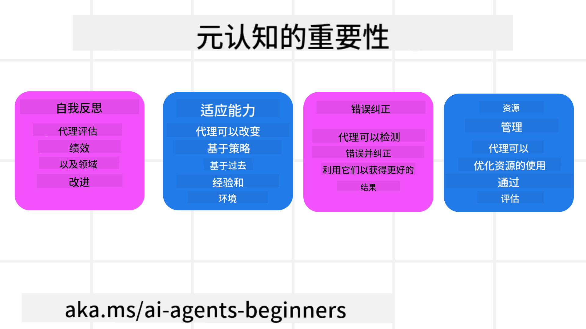

- **自我反思**：智能体可以评估自身表现并找出需要改进的地方。
- **适应性**：智能体可以根据过去的经验和变化的环境调整策略。
- **错误纠正**：智能体可以自主检测并纠正错误，从而提高结果的准确性。
- **资源管理**：智能体可以通过规划和评估行为优化资源使用，例如时间和计算能力。

### 1.AI智能体的组成部分

在深入了解元认知过程之前，首先需要理解AI智能体的基本组成部分。一个AI智能体通常包括：

- **角色**：智能体的个性和特征，定义了它与用户的交互方式。
- **工具**：智能体能够执行的功能和能力。
- **技能**：智能体拥有的知识和专业能力。

这些组成部分共同构成了一个“专业单元”，能够执行特定任务。

**示例**： 想象一个旅行助手智能体，它不仅能为您规划假期，还能根据实时数据和过去的客户体验调整计划。

### 示例：旅行助手服务中的元认知

假设您正在设计一个由AI驱动的旅行助手服务。这个智能体“旅行助手”帮助用户规划假期。为了融入元认知，旅行助手需要根据自我意识和过去的经验评估并调整其行为。以下是元认知可能发挥作用的方式：

#### 当前任

帮助用户规划一次巴黎之旅。

#### 完成任务的步骤

1. **收集用户偏好**：询问用户的旅行日期、预算、兴趣（如博物馆、美食、购物）以及任何具体需求。
2. **检索信息**：搜索符合用户偏好的航班、住宿、景点和餐厅。
3. **生成推荐**：提供个性化行程，包括航班详情、酒店预订和建议活动。
4. **根据反馈调整**：询问用户对推荐的反馈并进行必要调整。

#### 所需资源

- 航班和酒店预订数据库的访问权限。
- 关于巴黎景点和餐厅的信息。
- 以往交互中的用户反馈数据。

#### 经验与自我反思

旅行助手利用元认知评估其表现并从过去的经验中学习。例如：

1. **分析用户反馈**：旅行助手审查用户反馈，确定哪些推荐受到好评，哪些不受欢迎，并据此调整未来建议。
2. **适应性**：如果用户之前提到不喜欢拥挤的地方，旅行助手未来会避免在高峰时段推荐热门景点。
3. **错误纠正**：如果旅行助手在过去的预订中出现错误，例如推荐了一家已满房的酒店，它会学习在推荐前更严格地检查可用性。

#### 开发者的实际示例

以下是旅行助手代码如何融入元认知的简化示例：

```other
class Travel_Agent:
    def __init__(self):
        self.user_preferences = {}
        self.experience_data = []

    def gather_preferences(self, preferences):
        self.user_preferences = preferences

    def retrieve_information(self):
        # Search for flights, hotels, and attractions based on preferences
        flights = search_flights(self.user_preferences)
        hotels = search_hotels(self.user_preferences)
        attractions = search_attractions(self.user_preferences)
        return flights, hotels, attractions

    def generate_recommendations(self):
        flights, hotels, attractions = self.retrieve_information()
        itinerary = create_itinerary(flights, hotels, attractions)
        return itinerary

    def adjust_based_on_feedback(self, feedback):
        self.experience_data.append(feedback)
        # Analyze feedback and adjust future recommendations
        self.user_preferences = adjust_preferences(self.user_preferences, feedback)

# Example usage
travel_agent = Travel_Agent()
preferences = {
    "destination": "Paris",
    "dates": "2025-04-01 to 2025-04-10",
    "budget": "moderate",
    "interests": ["museums", "cuisine"]
}
travel_agent.gather_preferences(preferences)
itinerary = travel_agent.generate_recommendations()
print("Suggested Itinerary:", itinerary)
feedback = {"liked": ["Louvre Museum"], "disliked": ["Eiffel Tower (too crowded)"]}
travel_agent.adjust_based_on_feedback(feedback)
```

#### 为什么元认知很重要

- **自我反思**：智能体可以分析其表现并找出需要改进的地方。
- **适应性**：智能体可以根据反馈和变化的条件调整策略。
- **错误纠正**：智能体可以自主检测并纠正错误。
- **资源管理**：智能体可以优化资源使用，例如时间和计算能力。

通过融入元认知，旅行助手能够提供更个性化和准确的旅行建议，从而提升整体用户体验。

### 2. 智能体中的规划

规划是AI智能体行为的关键组成部分。它涉及明确目标所需的步骤，同时考虑当前状态、资源和可能的障碍。

### 规划的要素

- **当前任务**：清晰定义任务。
- **完成任务的步骤**：将任务分解为可管理的步骤。
- **所需资源**：识别必要的资源。
- **经验**：利用过去的经验指导规划。

**示例**： 以下是旅行助手需要采取的步骤，以有效帮助用户规划旅行：

### 旅行助手的步骤

1. **收集用户偏好**
   - 询问用户有关旅行日期、预算、兴趣以及任何具体需求的详细信息。
   - 示例：“您计划何时出行？”“您的预算范围是多少？”“您在假期中喜欢哪些活动？”
2. **检索信息**
   - 根据用户偏好搜索相关旅行选项。
   - **航班**：查找符合用户预算和偏好日期的航班。
   - **住宿**：寻找符合用户位置、价格和设施偏好的酒店或租赁房源。
   - **景点和餐厅**：识别符合用户兴趣的热门景点、活动和餐饮选择。
3. **生成推荐**
   - 将检索到的信息整理成个性化行程。
   - 提供航班选项、酒店预订和建议活动的详细信息，确保推荐符合用户偏好。
4. **向用户展示行程**
   - 与用户分享拟议行程供其审阅。
   - 示例：“这是您巴黎之旅的建议行程，包括航班详情、酒店预订以及推荐的活动和餐厅。请告诉我您的想法！”
5. **收集反馈**
   - 询问用户对拟议行程的反馈。
   - 示例：“您喜欢这些航班选项吗？”“这家酒店是否符合您的需求？”“是否有任何活动需要添加或移除？”
6. **根据反馈调整**
   - 根据用户反馈修改行程。
   - 对航班、住宿和活动推荐进行必要更改，以更好地匹配用户偏好。
7. **最终确认**
   - 将更新后的行程呈现给用户进行最终确认。
   - 示例：“我根据您的反馈进行了调整。这是更新后的行程。您觉得一切都合适吗？”
8. **预订并确认**
   - 用户批准行程后，进行航班、住宿和任何预先计划活动的预订。
   - 将确认详情发送给用户。
9. **提供持续支持**
   - 在用户旅行前和旅行期间随时提供帮助。
   - 示例：“如果您在旅行期间需要任何进一步的帮助，请随时联系我！”

### 示例交互

```other
class Travel_Agent:
    def __init__(self):
        self.user_preferences = {}
        self.experience_data = []

    def gather_preferences(self, preferences):
        self.user_preferences = preferences

    def retrieve_information(self):
        flights = search_flights(self.user_preferences)
        hotels = search_hotels(self.user_preferences)
        attractions = search_attractions(self.user_preferences)
        return flights, hotels, attractions

    def generate_recommendations(self):
        flights, hotels, attractions = self.retrieve_information()
        itinerary = create_itinerary(flights, hotels, attractions)
        return itinerary

    def adjust_based_on_feedback(self, feedback):
        self.experience_data.append(feedback)
        self.user_preferences = adjust_preferences(self.user_preferences, feedback)

# Example usage within a booing request
travel_agent = Travel_Agent()
preferences = {
    "destination": "Paris",
    "dates": "2025-04-01 to 2025-04-10",
    "budget": "moderate",
    "interests": ["museums", "cuisine"]
}
travel_agent.gather_preferences(preferences)
itinerary = travel_agent.generate_recommendations()
print("Suggested Itinerary:", itinerary)
feedback = {"liked": ["Louvre Museum"], "disliked": ["Eiffel Tower (too crowded)"]}
travel_agent.adjust_based_on_feedback(feedback)
```

### 3. 修正型RAG系统

首先，让我们了解RAG工具与预加载上下文的区别。

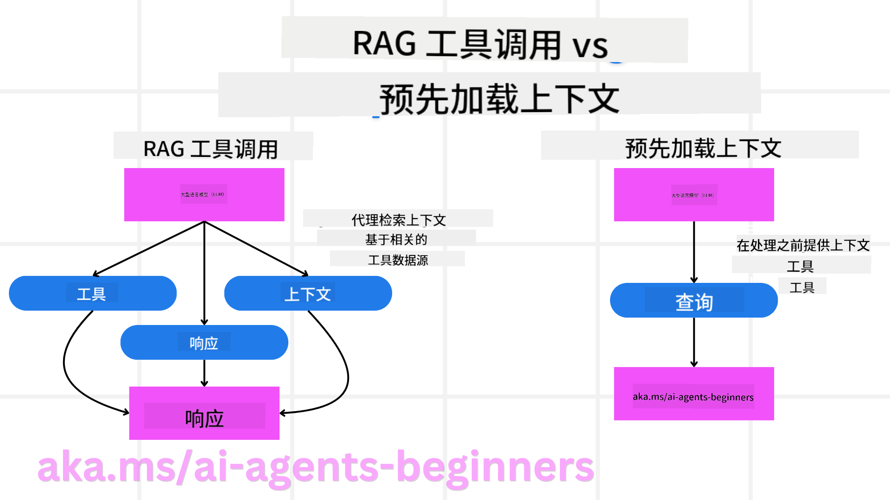

### 检索增强生成（RAG

RAG将检索系统与生成模型结合。当提出查询时，检索系统从外部来源获取相关文档或数据，这些检索到的信息用于增强生成模型的输入，从而帮助模型生成更准确且上下文相关的响应。

在RAG系统中，智能体从知识库中检索相关信息，并利用这些信息生成适当的响应或行动。

### 修正型RAG方法

修正型RAG方法专注于利用RAG技术纠正错误并提高AI智能体的准确性。这包括：

1. **提示技术**：使用特定提示引导智能体检索相关信息。
2. **工具**：实施算法和机制，使智能体能够评估检索信息的相关性并生成准确的响应。
3. **评估**：持续评估智能体的表现，并进行调整以提高其准确性和效率。

#### 示例：搜索智能体中的修正型RA

考虑一个从网络中检索信息以回答用户查询的搜索智能体。修正型RAG方法可能包括：

1. **提示技术**：根据用户输入制定搜索查询。
2. **工具**：使用自然语言处理和机器学习算法对搜索结果进行排序和过滤。
3. **评估**：分析用户反馈以识别并纠正检索信息中的不准确之处。

### 修正型RAG在旅行助手中的应用

修正型RAG（检索增强生成）增强了AI在检索和生成信息时纠正不准确性的能力。以下是旅行助手如何利用修正型RAG方法提供更准确和相关的旅行建议。

这包括：

- **提示技术**：使用特定提示引导智能体检索相关信息。
- **工具**：实施算法和机制，使智能体能够评估检索信息的相关性并生成准确的响应。
- **评估**：持续评估智能体的表现，并进行调整以提高其准确性和效率。

#### 在旅行助手中实施修正型RAG的步骤

1. **初始用户交互**
   - 旅行助手收集用户的初始偏好，例如目的地、旅行日期、预算和兴趣。
   - 示例：

```other
preferences = {
    "destination": "Paris",
    "dates": "2025-04-01 to 2025-04-10",
    "budget": "moderate",
    "interests": ["museums", "cuisine"]
}
```

1. **信息检索**
   - 旅行助手根据用户偏好检索有关航班、住宿、景点和餐厅的信息。
   - 示例：

```other
flights = search_flights(preferences)
hotels = search_hotels(preferences)
attractions = search_attractions(preferences)
```

1. **生成初步推荐**
   - 旅行助手利用检索到的信息生成个性化行程。
   - 示例：

```other
itinerary = create_itinerary(flights, hotels, attractions)
print("Suggested Itinerary:", itinerary)
```

1. **收集用户反馈**
   - 旅行助手询问用户对初步推荐的反馈。
   - 示例：

```other
feedback = {
    "liked": ["Louvre Museum"],
    "disliked": ["Eiffel Tower (too crowded)"]
}
```

1. **修正型RAG过程**
   - **提示技术**：旅行助手根据用户反馈制定新的搜索查询。
     - 示例：

```other
if "disliked" in feedback:
    preferences["avoid"] = feedback["disliked"]
```

    - **工具**：旅行助手使用算法对新的搜索结果进行排序和过滤，强调基于用户反馈的相关性。
        - 示例：

```other
new_attractions = search_attractions(preferences)
new_itinerary = create_itinerary(flights, hotels, new_attractions)
print("Updated Itinerary:", new_itinerary)
```

    - **评估**：旅行助手通过分析用户反馈持续评估推荐的相关性和准确性，并进行必要调整。
        - 示例：

```other
def adjust_preferences(preferences, feedback):
    if "liked" in feedback:
        preferences["favorites"] = feedback["liked"]
    if "disliked" in feedback:
        preferences["avoid"] = feedback["disliked"]
    return preferences

preferences = adjust_preferences(preferences, feedback)
```

#### 实际示例

以下是一个结合修正型RAG方法的旅行助手Python代码简化示例：

```other
class Travel_Agent:
    def __init__(self):
        self.user_preferences = {}
        self.experience_data = []

    def gather_preferences(self, preferences):
        self.user_preferences = preferences

    def retrieve_information(self):
        flights = search_flights(self.user_preferences)
        hotels = search_hotels(self.user_preferences)
        attractions = search_attractions(self.user_preferences)
        return flights, hotels, attractions

    def generate_recommendations(self):
        flights, hotels, attractions = self.retrieve_information()
        itinerary = create_itinerary(flights, hotels, attractions)
        return itinerary

    def adjust_based_on_feedback(self, feedback):
        self.experience_data.append(feedback)
        self.user_preferences = adjust_preferences(self.user_preferences, feedback)
        new_itinerary = self.generate_recommendations()
        return new_itinerary

# Example usage
travel_agent = Travel_Agent()
preferences = {
    "destination": "Paris",
    "dates": "2025-04-01 to 2025-04-10",
    "budget": "moderate",
    "interests": ["museums", "cuisine"]
}
travel_agent.gather_preferences(preferences)
itinerary = travel_agent.generate_recommendations()
print("Suggested Itinerary:", itinerary)
feedback = {"liked": ["Louvre Museum"], "disliked": ["Eiffel Tower (too crowded)"]}
new_itinerary = travel_agent.adjust_based_on_feedback(feedback)
print("Updated Itinerary:", new_itinerary)
```

### 预加载上下文

预加载上下文是指在处理查询之前，将相关的背景信息或上下文加载到模型中。这意味着模型从一开始就可以访问这些信息，从而帮助它生成更有依据的响应，而无需在过程中额外检索数据。

以下是一个关于旅行代理应用程序的 Python 示例，展示了预加载上下文的简单实现：

```other
class TravelAgent:
    def __init__(self):
        # Pre-load popular destinations and their information
        self.context = {
            "Paris": {"country": "France", "currency": "Euro", "language": "French", "attractions": ["Eiffel Tower", "Louvre Museum"]},
            "Tokyo": {"country": "Japan", "currency": "Yen", "language": "Japanese", "attractions": ["Tokyo Tower", "Shibuya Crossing"]},
            "New York": {"country": "USA", "currency": "Dollar", "language": "English", "attractions": ["Statue of Liberty", "Times Square"]},
            "Sydney": {"country": "Australia", "currency": "Dollar", "language": "English", "attractions": ["Sydney Opera House", "Bondi Beach"]}
        }

    def get_destination_info(self, destination):
        # Fetch destination information from pre-loaded context
        info = self.context.get(destination)
        if info:
            return f"{destination}:\nCountry: {info['country']}\nCurrency: {info['currency']}\nLanguage: {info['language']}\nAttractions: {', '.join(info['attractions'])}"
        else:
            return f"Sorry, we don't have information on {destination}."

# Example usage
travel_agent = TravelAgent()
print(travel_agent.get_destination_info("Paris"))
print(travel_agent.get_destination_info("Tokyo"))
```

#### 解

1. **初始化 (`__init__` 方法)**：`TravelAgent` 类预加载了一个字典，其中包含关于热门目的地（如巴黎、东京、纽约和悉尼）的信息。这个字典包括每个目的地的国家、货币、语言以及主要景点等详细信息。
2. **检索信息 (`get_destination_info` 方法)**：当用户查询某个特定目的地时，`get_destination_info` 方法会从预加载的上下文字典中获取相关信息。

通过预加载上下文，旅行代理应用程序可以快速响应用户查询，而无需实时从外部来源检索信息。这使得应用程序更加高效和响应迅速。

### 在迭代前以目标启动计划

以目标启动计划是指在开始时明确一个清晰的目标或预期结果。通过提前定义这个目标，模型可以将其作为指导原则贯穿整个迭代过程。这有助于确保每次迭代都更接近实现预期结果，从而使过程更加高效和专注。

以下是一个关于如何在迭代前以目标启动旅行计划的 Python 示例：

### 场景

旅行代理希望为客户制定一个定制化的度假计划。目标是根据客户的偏好和预算创建一个能够最大化客户满意度的旅行行程。

### 步骤

1. 定义客户的偏好和预算。
2. 根据这些偏好启动初始计划。
3. 迭代优化计划，以提高客户满意度。

```other
class TravelAgent:
    def __init__(self, destinations):
        self.destinations = destinations

    def bootstrap_plan(self, preferences, budget):
        plan = []
        total_cost = 0

        for destination in self.destinations:
            if total_cost + destination['cost'] <= budget and self.match_preferences(destination, preferences):
                plan.append(destination)
                total_cost += destination['cost']

        return plan

    def match_preferences(self, destination, preferences):
        for key, value in preferences.items():
            if destination.get(key) != value:
                return False
        return True

    def iterate_plan(self, plan, preferences, budget):
        for i in range(len(plan)):
            for destination in self.destinations:
                if destination not in plan and self.match_preferences(destination, preferences) and self.calculate_cost(plan, destination) <= budget:
                    plan[i] = destination
                    break
        return plan

    def calculate_cost(self, plan, new_destination):
        return sum(destination['cost'] for destination in plan) + new_destination['cost']

# Example usage
destinations = [
    {"name": "Paris", "cost": 1000, "activity": "sightseeing"},
    {"name": "Tokyo", "cost": 1200, "activity": "shopping"},
    {"name": "New York", "cost": 900, "activity": "sightseeing"},
    {"name": "Sydney", "cost": 1100, "activity": "beach"},
]

preferences = {"activity": "sightseeing"}
budget = 2000

travel_agent = TravelAgent(destinations)
initial_plan = travel_agent.bootstrap_plan(preferences, budget)
print("Initial Plan:", initial_plan)

refined_plan = travel_agent.iterate_plan(initial_plan, preferences, budget)
print("Refined Plan:", refined_plan)
```

#### 代码解释

1. **初始化 (`__init__` 方法)**：`TravelAgent` 类通过一个潜在目的地列表进行初始化，每个目的地都有名称、费用和活动类型等属性。
2. **启动计划 (`bootstrap_plan` 方法)**：此方法根据客户的偏好和预算创建初始旅行计划。它会遍历目的地列表，并将符合客户偏好且预算范围内的目的地添加到计划中。
3. **匹配偏好 (`match_preferences` 方法)**：此方法检查某个目的地是否符合客户的偏好。
4. **迭代计划 (`iterate_plan` 方法)**：此方法通过尝试用更符合客户偏好和预算的目的地替换计划中的每个目的地来优化初始计划。
5. **计算费用 (`calculate_cost` 方法)**：此方法计算当前计划的总费用，包括潜在的新目的地。

#### 示例用法

- **初始计划**：旅行代理根据客户对观光的偏好和2000美元的预算创建初始计划。
- **优化计划**：旅行代理迭代优化计划，以更好地符合客户的偏好和预算。

通过以明确目标（例如最大化客户满意度）启动计划并迭代优化计划，旅行代理可以为客户创建一个定制化且优化的旅行行程。这种方法确保旅行计划从一开始就符合客户的偏好和预算，并在每次迭代中不断改进。

### 利用LLM进行重新排序和评分

大型语言模型（LLM）可以通过评估检索到的文档或生成的响应的相关性和质量来进行重新排序和评分。以下是其工作原理：

**检索**：初始检索步骤根据查询获取一组候选文档或响应。

**重新排序**：LLM评估这些候选项，并根据其相关性和质量对它们进行重新排序。此步骤确保最相关和高质量的信息优先呈现。

**评分**：LLM为每个候选项分配分数，反映其相关性和质量。这有助于选择最佳的响应或文档提供给用户。

通过利用LLM进行重新排序和评分，系统可以提供更准确和上下文相关的信息，从而改善整体用户体验。

以下是一个旅行代理如何使用大型语言模型（LLM）根据用户偏好对旅行目的地进行重新排序和评分的 Python 示例：

#### 场景 - 基于偏好的旅行

旅行代理希望根据客户的偏好推荐最佳旅行目的地。LLM将帮助重新排序和评分目的地，以确保呈现最相关的选项。

#### 步骤：

1. 收集用户偏好。
2. 检索潜在旅行目的地列表。
3. 使用LLM根据用户偏好对目的地进行重新排序和评分。

以下是如何使用Azure OpenAI服务更新之前的示例：

#### 要求

1. 您需要拥有一个Azure订阅。
2. 创建一个Azure OpenAI资源并获取您的API密钥。

#### 示例Python代码

```other
import requests
import json

class TravelAgent:
    def __init__(self, destinations):
        self.destinations = destinations

    def get_recommendations(self, preferences, api_key, endpoint):
        # Generate a prompt for the Azure OpenAI
        prompt = self.generate_prompt(preferences)

        # Define headers and payload for the request
        headers = {
            'Content-Type': 'application/json',
            'Authorization': f'Bearer {api_key}'
        }
        payload = {
            "prompt": prompt,
            "max_tokens": 150,
            "temperature": 0.7
        }

        # Call the Azure OpenAI API to get the re-ranked and scored destinations
        response = requests.post(endpoint, headers=headers, json=payload)
        response_data = response.json()

        # Extract and return the recommendations
        recommendations = response_data['choices'][0]['text'].strip().split('\n')
        return recommendations

    def generate_prompt(self, preferences):
        prompt = "Here are the travel destinations ranked and scored based on the following user preferences:\n"
        for key, value in preferences.items():
            prompt += f"{key}: {value}\n"
        prompt += "\nDestinations:\n"
        for destination in self.destinations:
            prompt += f"- {destination['name']}: {destination['description']}\n"
        return prompt

# Example usage
destinations = [
    {"name": "Paris", "description": "City of lights, known for its art, fashion, and culture."},
    {"name": "Tokyo", "description": "Vibrant city, famous for its modernity and traditional temples."},
    {"name": "New York", "description": "The city that never sleeps, with iconic landmarks and diverse culture."},
    {"name": "Sydney", "description": "Beautiful harbour city, known for its opera house and stunning beaches."},
]

preferences = {"activity": "sightseeing", "culture": "diverse"}
api_key = 'your_azure_openai_api_key'
endpoint = 'https://your-endpoint.com/openai/deployments/your-deployment-name/completions?api-version=2022-12-01'

travel_agent = TravelAgent(destinations)
recommendations = travel_agent.get_recommendations(preferences, api_key, endpoint)
print("Recommended Destinations:")
for rec in recommendations:
    print(rec)
```

#### 代码解释 - 偏好推荐

1. **初始化**：`TravelAgent` 类通过一个潜在旅行目的地列表进行初始化，每个目的地都有名称和描述等属性。
2. **获取推荐 (`get_recommendations` 方法)**：此方法根据用户偏好生成一个Azure OpenAI服务的提示，并向Azure OpenAI API发送HTTP POST请求以获取重新排序和评分的目的地。
3. **生成提示 (`generate_prompt` 方法)**：此方法构建一个Azure OpenAI的提示，包括用户偏好和目的地列表。提示引导模型根据提供的偏好对目的地进行重新排序和评分。
4. **API调用**：使用`requests`库向Azure OpenAI API端点发送HTTP POST请求。响应包含重新排序和评分的目的地。
5. **示例用法**：旅行代理收集用户偏好（例如对观光和多元文化的兴趣），并使用Azure OpenAI服务获取重新排序和评分的旅行目的地推荐。

请确保将`your_azure_openai_api_key`替换为您的实际Azure OpenAI API密钥，并将`https://your-endpoint.com/...`替换为您的Azure OpenAI部署的实际端点URL。

通过利用LLM进行重新排序和评分，旅行代理可以为客户提供更个性化和相关的旅行推荐，从而提升整体体验。

### RAG：提示技术与工具

检索增强生成（RAG）既可以作为一种提示技术，也可以作为开发AI代理的工具。理解两者之间的区别可以帮助您更有效地在项目中利用RAG。

#### RAG作为提示技术

**是什么？**

- 作为提示技术，RAG涉及制定特定的查询或提示，以指导从大型语料库或数据库中检索相关信息。然后使用这些信息生成响应或执行操作。

**如何工作：**

1. **制定提示**：根据任务或用户输入创建结构良好的提示或查询。
2. **检索信息**：使用提示从预先存在的知识库或数据集中搜索相关数据。
3. **生成响应**：结合检索到的信息与生成式AI模型，生成全面且连贯的响应。

**旅行代理中的示例**：

- 用户输入：“我想参观巴黎的博物馆。”
- 提示：“寻找巴黎的顶级博物馆。”
- 检索信息：关于卢浮宫、奥赛博物馆等的详细信息。
- 生成响应：“以下是巴黎的一些顶级博物馆：卢浮宫、奥赛博物馆和蓬皮杜中心。”

#### RAG作为工具

**是什么？**

- 作为工具，RAG是一个集成系统，可以自动化检索和生成过程，使开发者无需为每个查询手动编写提示即可实现复杂的AI功能。

**如何工作：**

1. **集成**：将RAG嵌入AI代理的架构中，使其能够自动处理检索和生成任务。
2. **自动化**：工具管理整个过程，从接收用户输入到生成最终响应，无需为每一步显式编写提示。
3. **高效**：通过简化检索和生成过程，提高代理的性能，提供更快、更准确的响应。

**旅行代理中的示例**：

- 用户输入：“我想参观巴黎的博物馆。”
- RAG工具：自动检索博物馆信息并生成响应。
- 生成响应：“以下是巴黎的一些顶级博物馆：卢浮宫、奥赛博物馆和蓬皮杜中心。”

### 比较

| **方面**         | **提示技术**               | **工具**                   |
| ---------------- | -------------------------- | -------------------------- |
| **手动与自动化** | 每个查询手动制定提示。     | 检索和生成过程自动化。     |
| **控制**         | 提供对检索过程的更多控制。 | 简化并自动化检索和生成。   |
| **灵活性**       | 可根据具体需求定制提示。   | 更适合大规模实现。         |
| **复杂性**       | 需要编写和调整提示。       | 更易于集成到AI代理架构中。 |

### 实际示例

**提示技术示例：**

```other
def search_museums_in_paris():
    prompt = "Find top museums in Paris"
    search_results = search_web(prompt)
    return search_results

museums = search_museums_in_paris()
print("Top Museums in Paris:", museums)
```

**工具示例：**

```other
class Travel_Agent:
    def __init__(self):
        self.rag_tool = RAGTool()

    def get_museums_in_paris(self):
        user_input = "I want to visit museums in Paris."
        response = self.rag_tool.retrieve_and_generate(user_input)
        return response

travel_agent = Travel_Agent()
museums = travel_agent.get_museums_in_paris()
print("Top Museums in Paris:", museums)
```

### 评估相关

评估相关性是AI代理性能的关键方面。它确保代理检索和生成的信息对用户来说是适当、准确且有用的。让我们探讨如何评估AI代理的相关性，包括实际示例和技术。

#### 评估相关性的关键概

1. **上下文意识**：
   - 代理必须理解用户查询的上下文，以检索和生成相关信息。
   - 示例：如果用户询问“巴黎最好的餐厅”，代理应考虑用户的偏好，例如菜系类型和预算。
2. **准确性**：
   - 代理提供的信息应是事实正确且最新的。
   - 示例：推荐当前营业且评价良好的餐厅，而不是过时或已关闭的选项。
3. **用户意图**：
   - 代理应推断用户查询背后的意图，以提供最相关的信息。
   - 示例：如果用户询问“经济型酒店”，代理应优先推荐价格实惠的选项。
4. **反馈循环**：
   - 持续收集和分析用户反馈有助于代理优化其相关性评估过程。
   - 示例：结合用户对之前推荐的评分和反馈，以改进未来的响应。

#### 评估相关性的实际技

1. **相关性评分**：
   - 根据与用户查询和偏好的匹配程度，为每个检索项分配相关性分数。
   - 示例：

```other
def relevance_score(item, query):
    score = 0
    if item['category'] in query['interests']:
        score += 1
    if item['price'] <= query['budget']:
        score += 1
    if item['location'] == query['destination']:
        score += 1
    return score
```

1. **过滤和排序**：
   - 过滤掉不相关的项，并根据相关性分数对剩余项进行排序。
   - 示例：

```other
def filter_and_rank(items, query):
    ranked_items = sorted(items, key=lambda item: relevance_score(item, query), reverse=True)
    return ranked_items[:10]  # Return top 10 relevant items
```

1. **自然语言处理 (NLP)**：
   - 使用NLP技术理解用户查询并检索相关信息。
   - 示例：

```other
def process_query(query):
    # Use NLP to extract key information from the user's query
    processed_query = nlp(query)
    return processed_query
```

1. **用户反馈集成**：
   - 收集用户对推荐的反馈，并利用这些反馈调整未来的相关性评估。
   - 示例：

```other
def adjust_based_on_feedback(feedback, items):
    for item in items:
        if item['name'] in feedback['liked']:
            item['relevance'] += 1
        if item['name'] in feedback['disliked']:
            item['relevance'] -= 1
    return items
```

#### 示例：旅行代理中的相关性评估

以下是旅行代理如何评估旅行推荐相关性的实际示例：

```other
class Travel_Agent:
    def __init__(self):
        self.user_preferences = {}
        self.experience_data = []

    def gather_preferences(self, preferences):
        self.user_preferences = preferences

    def retrieve_information(self):
        flights = search_flights(self.user_preferences)
        hotels = search_hotels(self.user_preferences)
        attractions = search_attractions(self.user_preferences)
        return flights, hotels, attractions

    def generate_recommendations(self):
        flights, hotels, attractions = self.retrieve_information()
        ranked_hotels = self.filter_and_rank(hotels, self.user_preferences)
        itinerary = create_itinerary(flights, ranked_hotels, attractions)
        return itinerary

    def filter_and_rank(self, items, query):
        ranked_items = sorted(items, key=lambda item: self.relevance_score(item, query), reverse=True)
        return ranked_items[:10]  # Return top 10 relevant items

    def relevance_score(self, item, query):
        score = 0
        if item['category'] in query['interests']:
            score += 1
        if item['price'] <= query['budget']:
            score += 1
        if item['location'] == query['destination']:
            score += 1
        return score

    def adjust_based_on_feedback(self, feedback, items):
        for item in items:
            if item['name'] in feedback['liked']:
                item['relevance'] += 1
            if item['name'] in feedback['disliked']:
                item['relevance'] -= 1
        return items

# Example usage
travel_agent = Travel_Agent()
preferences = {
    "destination": "Paris",
    "dates": "2025-04-01 to 2025-04-10",
    "budget": "moderate",
    "interests": ["museums", "cuisine"]
}
travel_agent.gather_preferences(preferences)
itinerary = travel_agent.generate_recommendations()
print("Suggested Itinerary:", itinerary)
feedback = {"liked": ["Louvre Museum"], "disliked": ["Eiffel Tower (too crowded)"]}
updated_items = travel_agent.adjust_based_on_feedback(feedback, itinerary['hotels'])
print("Updated Itinerary with Feedback:", updated_items)
```

### 基于意图的搜索

基于意图的搜索是指理解和解释用户查询背后的实际目的或目标，以检索和生成最相关且有用的信息。这种方法超越了简单的关键词匹配，专注于把握用户的实际需求和上下文。

#### 基于意图的搜索关键概

1. **理解用户意图**：
   - 用户意图可以分为三种主要类型：信息型、导航型和交易型。
     - **信息型意图**：用户寻求关于某个主题的信息（例如：“巴黎最好的博物馆有哪些？”）。
     - **导航型意图**：用户希望导航到特定网站或页面（例如：“卢浮宫官网”）。
     - **交易型意图**：用户希望执行某项交易，例如预订航班或购买商品（例如：“预订飞往巴黎的航班”）。
2. **上下文意识**：
   - 分析用户查询的上下文有助于准确识别其意图。这包括考虑之前的交互、用户偏好以及当前查询的具体细节。
3. **自然语言处理 (NLP)**：
   - 使用NLP技术理解和解释用户提供的自然语言查询。这包括实体识别、情感分析和查询解析等任务。
4. **个性化**：
   - 根据用户的历史记录、偏好和反馈个性化搜索结果，提升检索信息的相关性。

     #### 实践示例：在旅行代理中基于意图进行搜索

让我们以旅行代理为例，看看如何实现基于意图的搜索。

1. **收集用户偏好**

```other
class Travel_Agent:
    def __init__(self):
        self.user_preferences = {}

    def gather_preferences(self, preferences):
        self.user_preferences = preferences
```

1. **理解用户意图**

```other
def identify_intent(query):
    if "book" in query or "purchase" in query:
        return "transactional"
    elif "website" in query or "official" in query:
        return "navigational"
    else:
        return "informational"
```

上下文感知

```other
def analyze_context(query, user_history):
    # Combine current query with user history to understand context
    context = {
        "current_query": query,
        "user_history": user_history
    }
    return context
```

1. **搜索并个性化结果**

```other
def search_with_intent(query, preferences, user_history):
    intent = identify_intent(query)
    context = analyze_context(query, user_history)
    if intent == "informational":
        search_results = search_information(query, preferences)
    elif intent == "navigational":
        search_results = search_navigation(query)
    elif intent == "transactional":
        search_results = search_transaction(query, preferences)
    personalized_results = personalize_results(search_results, user_history)
    return personalized_results

def search_information(query, preferences):
    # Example search logic for informational intent
    results = search_web(f"best {preferences['interests']} in {preferences['destination']}")
    return results

def search_navigation(query):
    # Example search logic for navigational intent
    results = search_web(query)
    return results

def search_transaction(query, preferences):
    # Example search logic for transactional intent
    results = search_web(f"book {query} to {preferences['destination']}")
    return results

def personalize_results(results, user_history):
    # Example personalization logic
    personalized = [result for result in results if result not in user_history]
    return personalized[:10]  # Return top 10 personalized results
```

1. **示例使用**

```other
travel_agent = Travel_Agent()
preferences = {
    "destination": "Paris",
    "interests": ["museums", "cuisine"]
}
travel_agent.gather_preferences(preferences)
user_history = ["Louvre Museum website", "Book flight to Paris"]
query = "best museums in Paris"
results = search_with_intent(query, preferences, user_history)
print("Search Results:", results)
```

---

### 4. 作为工具生成代码

代码生成代理使用AI模型编写和执行代码，解决复杂问题并自动化任务。

### 代码生成代理

代码生成代理使用生成式AI模型编写和执行代码。这些代理可以解决复杂问题、自动化任务，并通过生成和运行各种编程语言的代码提供有价值的洞察。

#### 实际应用

1. **自动代码生成**：为特定任务生成代码片段，例如数据分析、网络爬取或机器学习。
2. **SQL作为RAG**：使用SQL查询从数据库中检索和操作数据。
3. **问题解决**：创建并执行代码以解决特定问题，例如优化算法或分析数据。

#### 示例：用于数据分析的代码生成代理

假设你正在设计一个代码生成代理。以下是它的工作方式：

1. **任务**：分析数据集以识别趋势和模式。
2. **步骤**：
   - 将数据集加载到数据分析工具中。
   - 生成SQL查询以过滤和聚合数据。
   - 执行查询并检索结果。
   - 使用结果生成可视化和洞察。
3. **所需资源**：访问数据集、数据分析工具和SQL功能。
4. **经验**：利用过去的分析结果提高未来分析的准确性和相关性。

### 示例：用于旅行代理的代码生成代理

在此示例中，我们将设计一个代码生成代理“旅行代理”，通过生成和执行代码来协助用户规划旅行。该代理可以处理诸如获取旅行选项、过滤结果以及使用生成式AI编制行程等任务。

#### 代码生成代理概述

1. **收集用户偏好**：收集用户输入，例如目的地、旅行日期、预算和兴趣。
2. **生成代码以获取数据**：生成代码片段以检索有关航班、酒店和景点的数据。
3. **执行生成的代码**：运行生成的代码以获取实时信息。
4. **生成行程**：将获取的数据编制成个性化的旅行计划。
5. **根据反馈调整**：接收用户反馈并重新生成代码以优化结果。

#### 分步实施

1. **收集用户偏好**

```other
class Travel_Agent:
    def __init__(self):
        self.user_preferences = {}

    def gather_preferences(self, preferences):
        self.user_preferences = preferences
```

1. **生成代码以获取数据**

```other
def generate_code_to_fetch_data(preferences):
    # Example: Generate code to search for flights based on user preferences
    code = f"""
    def search_flights():
        import requests
        response = requests.get('https://api.example.com/flights', params={preferences})
        return response.json()
    """
    return code

def generate_code_to_fetch_hotels(preferences):
    # Example: Generate code to search for hotels
    code = f"""
    def search_hotels():
        import requests
        response = requests.get('https://api.example.com/hotels', params={preferences})
        return response.json()
    """
    return code
```

1. **执行生成的代码**

```other
def execute_code(code):
    # Execute the generated code using exec
    exec(code)
    result = locals()
    return result

travel_agent = Travel_Agent()
preferences = {
    "destination": "Paris",
    "dates": "2025-04-01 to 2025-04-10",
    "budget": "moderate",
    "interests": ["museums", "cuisine"]
}
travel_agent.gather_preferences(preferences)

flight_code = generate_code_to_fetch_data(preferences)
hotel_code = generate_code_to_fetch_hotels(preferences)

flights = execute_code(flight_code)
hotels = execute_code(hotel_code)

print("Flight Options:", flights)
print("Hotel Options:", hotels)
```

1. **生成行程**

```other
def generate_itinerary(flights, hotels, attractions):
    itinerary = {
        "flights": flights,
        "hotels": hotels,
        "attractions": attractions
    }
    return itinerary

attractions = search_attractions(preferences)
itinerary = generate_itinerary(flights, hotels, attractions)
print("Suggested Itinerary:", itinerary)
```

1. **根据反馈调整**

```other
def adjust_based_on_feedback(feedback, preferences):
    # Adjust preferences based on user feedback
    if "liked" in feedback:
        preferences["favorites"] = feedback["liked"]
    if "disliked" in feedback:
        preferences["avoid"] = feedback["disliked"]
    return preferences

feedback = {"liked": ["Louvre Museum"], "disliked": ["Eiffel Tower (too crowded)"]}
updated_preferences = adjust_based_on_feedback(feedback, preferences)

# Regenerate and execute code with updated preferences
updated_flight_code = generate_code_to_fetch_data(updated_preferences)
updated_hotel_code = generate_code_to_fetch_hotels(updated_preferences)

updated_flights = execute_code(updated_flight_code)
updated_hotels = execute_code(updated_hotel_code)

updated_itinerary = generate_itinerary(updated_flights, updated_hotels, attractions)
print("Updated Itinerary:", updated_itinerary)
```

### 利用环境感知和推理

基于表的模式确实可以通过利用环境感知和推理来增强查询生成过程。

以下是如何实现的示例：

1. **理解模式**：系统将理解表的模式，并利用这些信息来指导查询生成。
2. **根据反馈调整**：系统将根据反馈调整用户偏好，并推理需要更新模式中的哪些字段。
3. **生成和执行查询**：系统将生成并执行查询，以根据新的偏好获取更新的航班和酒店数据。

以下是一个包含这些概念的更新版Python代码示例：

```other
def adjust_based_on_feedback(feedback, preferences, schema):
    # Adjust preferences based on user feedback
    if "liked" in feedback:
        preferences["favorites"] = feedback["liked"]
    if "disliked" in feedback:
        preferences["avoid"] = feedback["disliked"]
    # Reasoning based on schema to adjust other related preferences
    for field in schema:
        if field in preferences:
            preferences[field] = adjust_based_on_environment(feedback, field, schema)
    return preferences

def adjust_based_on_environment(feedback, field, schema):
    # Custom logic to adjust preferences based on schema and feedback
    if field in feedback["liked"]:
        return schema[field]["positive_adjustment"]
    elif field in feedback["disliked"]:
        return schema[field]["negative_adjustment"]
    return schema[field]["default"]

def generate_code_to_fetch_data(preferences):
    # Generate code to fetch flight data based on updated preferences
    return f"fetch_flights(preferences={preferences})"

def generate_code_to_fetch_hotels(preferences):
    # Generate code to fetch hotel data based on updated preferences
    return f"fetch_hotels(preferences={preferences})"

def execute_code(code):
    # Simulate execution of code and return mock data
    return {"data": f"Executed: {code}"}

def generate_itinerary(flights, hotels, attractions):
    # Generate itinerary based on flights, hotels, and attractions
    return {"flights": flights, "hotels": hotels, "attractions": attractions}

# Example schema
schema = {
    "favorites": {"positive_adjustment": "increase", "negative_adjustment": "decrease", "default": "neutral"},
    "avoid": {"positive_adjustment": "decrease", "negative_adjustment": "increase", "default": "neutral"}
}

# Example usage
preferences = {"favorites": "sightseeing", "avoid": "crowded places"}
feedback = {"liked": ["Louvre Museum"], "disliked": ["Eiffel Tower (too crowded)"]}
updated_preferences = adjust_based_on_feedback(feedback, preferences, schema)

# Regenerate and execute code with updated preferences
updated_flight_code = generate_code_to_fetch_data(updated_preferences)
updated_hotel_code = generate_code_to_fetch_hotels(updated_preferences)

updated_flights = execute_code(updated_flight_code)
updated_hotels = execute_code(updated_hotel_code)

updated_itinerary = generate_itinerary(updated_flights, updated_hotels, feedback["liked"])
print("Updated Itinerary:", updated_itinerary)
```

#### 解释 - 基于反馈的预订

1. **模式感知**：`schema`字典定义了如何根据反馈调整偏好。它包括诸如`favorites`和`avoid`等字段及相应的调整。
2. **调整偏好（`adjust_based_on_feedback`方法）**：此方法根据用户反馈和模式调整偏好。
3. **基于环境的调整（`adjust_based_on_environment`方法）**：此方法根据模式和反馈定制调整。
4. **生成和执行查询**：系统生成代码以根据调整后的偏好获取更新的航班和酒店数据，并模拟执行这些查询。
5. **生成行程**：系统根据新的航班、酒店和景点数据创建更新的行程。

通过使系统具备环境感知能力并基于模式进行推理，它可以生成更准确和相关的查询，从而提供更好的旅行推荐和更个性化的用户体验。

### 使用SQL作为检索增强生成（RAG）技术

SQL（结构化查询语言）是与数据库交互的强大工具。当作为检索增强生成（RAG）方法的一部分使用时，SQL可以从数据库中检索相关数据，以为AI代理生成响应或采取行动提供信息。让我们探讨如何在旅行代理的背景下使用SQL作为RAG技术。

#### 关键概念

1. **数据库交互**：
   - 使用SQL查询数据库，检索相关信息并操作数据。
   - 示例：从旅行数据库中获取航班详情、酒店信息和景点。
2. **与RAG集成**：
   - 根据用户输入和偏好生成SQL查询。
   - 然后使用检索到的数据生成个性化推荐或行动。
3. **动态查询生成**：
   - AI代理根据上下文和用户需求生成动态SQL查询。
   - 示例：定制SQL查询以根据预算、日期和兴趣过滤结果。

#### 应用

- **自动代码生成**：为特定任务生成代码片段。
- **SQL作为RAG**：使用SQL查询操作数据。
- **问题解决**：创建并执行代码以解决问题。

**示例**： 一个数据分析代理：

1. **任务**：分析数据集以发现趋势。
2. **步骤**：
   - 加载数据集。
   - 生成SQL查询以过滤数据。
   - 执行查询并检索结果。
   - 生成可视化和洞察。
3. **资源**：数据集访问、SQL功能。
4. **经验**：利用过去的结果提高未来分析。

#### 实践示例：在旅行代理中使用SQL

1. **收集用户偏好**

```other
class Travel_Agent:
    def __init__(self):
        self.user_preferences = {}

    def gather_preferences(self, preferences):
        self.user_preferences = preferences
```

1. **生成SQL查询**

```other
def generate_sql_query(table, preferences):
    query = f"SELECT * FROM {table} WHERE "
    conditions = []
    for key, value in preferences.items():
        conditions.append(f"{key}='{value}'")
    query += " AND ".join(conditions)
    return query
```

1. **执行SQL查询**

```other
import sqlite3

def execute_sql_query(query, database="travel.db"):
    connection = sqlite3.connect(database)
    cursor = connection.cursor()
    cursor.execute(query)
    results = cursor.fetchall()
    connection.close()
    return results
```

1. **生成推荐**

```other
def generate_recommendations(preferences):
    flight_query = generate_sql_query("flights", preferences)
    hotel_query = generate_sql_query("hotels", preferences)
    attraction_query = generate_sql_query("attractions", preferences)

    flights = execute_sql_query(flight_query)
    hotels = execute_sql_query(hotel_query)
    attractions = execute_sql_query(attraction_query)

    itinerary = {
        "flights": flights,
        "hotels": hotels,
        "attractions": attractions
    }
    return itinerary

travel_agent = Travel_Agent()
preferences = {
    "destination": "Paris",
    "dates": "2025-04-01 to 2025-04-10",
    "budget": "moderate",
    "interests": ["museums", "cuisine"]
}
travel_agent.gather_preferences(preferences)
itinerary = generate_recommendations(preferences)
print("Suggested Itinerary:", itinerary)
```

#### 示例SQL查询

1. **航班查询**

```other
SELECT * FROM flights WHERE destination='Paris' AND dates='2025-04-01 to 2025-04-10' AND budget='moderate';
```

1. **酒店查询**

```other
SELECT * FROM hotels WHERE destination='Paris' AND budget='moderate';
```

1. **景点查询**

```other
SELECT * FROM attractions WHERE destination='Paris' AND interests='museums, cuisine';
```

通过将SQL作为检索增强生成（RAG）技术的一部分，像旅行代理这样的AI代理可以动态检索和利用相关数据，提供准确且个性化的推荐。

### 元认知示例

为了展示元认知的实现，让我们创建一个简单的代理，它在解决问题时“反思其决策过程”。在这个示例中，我们将构建一个系统，代理尝试优化酒店选择，但在做出错误或次优选择时评估自己的推理并调整策略。

我们将通过一个基本示例模拟这一过程，代理根据价格和质量的组合选择酒店，但它会“反思”自己的决策并进行调整。

#### 如何体现元认知：

1. **初始决策**：代理会选择最便宜的酒店，而不考虑质量影响。
2. **反思与评估**：在初次选择后，代理会检查酒店是否是一个“糟糕”的选择，利用用户反馈。如果发现酒店质量过低，它会反思自己的推理。
3. **调整策略**：代理根据反思调整策略，从“最便宜”切换到“最高质量”，从而在未来迭代中改进决策过程。

以下是一个示例：

```other
class HotelRecommendationAgent:
    def __init__(self):
        self.previous_choices = []  # Stores the hotels chosen previously
        self.corrected_choices = []  # Stores the corrected choices
        self.recommendation_strategies = ['cheapest', 'highest_quality']  # Available strategies

    def recommend_hotel(self, hotels, strategy):
        """
        Recommend a hotel based on the chosen strategy.
        The strategy can either be 'cheapest' or 'highest_quality'.
        """
        if strategy == 'cheapest':
            recommended = min(hotels, key=lambda x: x['price'])
        elif strategy == 'highest_quality':
            recommended = max(hotels, key=lambda x: x['quality'])
        else:
            recommended = None
        self.previous_choices.append((strategy, recommended))
        return recommended

    def reflect_on_choice(self):
        """
        Reflect on the last choice made and decide if the agent should adjust its strategy.
        The agent considers if the previous choice led to a poor outcome.
        """
        if not self.previous_choices:
            return "No choices made yet."

        last_choice_strategy, last_choice = self.previous_choices[-1]
        # Let's assume we have some user feedback that tells us whether the last choice was good or not
        user_feedback = self.get_user_feedback(last_choice)

        if user_feedback == "bad":
            # Adjust strategy if the previous choice was unsatisfactory
            new_strategy = 'highest_quality' if last_choice_strategy == 'cheapest' else 'cheapest'
            self.corrected_choices.append((new_strategy, last_choice))
            return f"Reflecting on choice. Adjusting strategy to {new_strategy}."
        else:
            return "The choice was good. No need to adjust."

    def get_user_feedback(self, hotel):
        """
        Simulate user feedback based on hotel attributes.
        For simplicity, assume if the hotel is too cheap, the feedback is "bad".
        If the hotel has quality less than 7, feedback is "bad".
        """
        if hotel['price'] < 100 or hotel['quality'] < 7:
            return "bad"
        return "good"

# Simulate a list of hotels (price and quality)
hotels = [
    {'name': 'Budget Inn', 'price': 80, 'quality': 6},
    {'name': 'Comfort Suites', 'price': 120, 'quality': 8},
    {'name': 'Luxury Stay', 'price': 200, 'quality': 9}
]

# Create an agent
agent = HotelRecommendationAgent()

# Step 1: The agent recommends a hotel using the "cheapest" strategy
recommended_hotel = agent.recommend_hotel(hotels, 'cheapest')
print(f"Recommended hotel (cheapest): {recommended_hotel['name']}")

# Step 2: The agent reflects on the choice and adjusts strategy if necessary
reflection_result = agent.reflect_on_choice()
print(reflection_result)

# Step 3: The agent recommends again, this time using the adjusted strategy
adjusted_recommendation = agent.recommend_hotel(hotels, 'highest_quality')
print(f"Adjusted hotel recommendation (highest_quality): {adjusted_recommendation['name']}")
```

#### 代理的元认知能力

关键在于代理能够：

- 评估其之前的选择和决策过程。
- 根据反思调整策略，即元认知的实际应用。

这是元认知的一种简单形式，系统能够根据内部反馈调整其推理过程。

### 结论

元认知是一种强大的工具，可以显著增强AI代理的能力。通过引入元认知过程，你可以设计出更智能、更适应性强、更高效的代理。利用额外资源进一步探索AI代理中元认知的迷人世界。

## 十一.AI代理的生产应用(评估)

当 AI Agent 从实验性原型转向实际应用时，理解其行为、监控其性能以及系统性地评估其输出的能力变得尤为重要。

### 基本概念-Trace 和 Span

可观测性工具（如 [Langfuse](https://langfuse.com/) 或 [Azure AI Foundry](https://learn.microsoft.com/en-us/azure/ai-foundry/what-is-azure-ai-foundry)）通常将 Agent 的运行表示为 Trace 和 Span。

- **Trace** 表示从开始到结束的完整 Agent 任务（例如处理用户查询）。
- **Span** 是 Trace 中的单个步骤（例如调用语言模型或检索数据）。

.png)

没有可观测性时，AI Agent 就像一个“黑箱”——其内部状态和推理过程不透明，难以诊断问题或优化性能。有了可观测性，Agent 就变成了“玻璃箱”，提供了透明性，这对建立信任和确保其按预期运行至关重要。

### 为什么可观测性在生产环境中很重要

将 AI Agent 转移到生产环境会带来一系列新的挑战和需求。此时，可观测性不再是“可有可无”的功能，而是关键能力：

- **调试与根因分析**：当 Agent 失败或产生意外输出时，可观测性工具提供的 Trace 能帮助定位错误来源。这在涉及多个 LLM 调用、工具交互和条件逻辑的复杂 Agent 中尤为重要。
- **延迟与成本管理**：AI Agent 通常依赖于按 token 或调用计费的 LLM 和其他外部 API。可观测性可以精确跟踪这些调用，帮助识别过慢或过于昂贵的操作，从而优化提示词、选择更高效的模型或重新设计工作流，以管理运营成本并确保良好的用户体验。
- **信任、安全与合规**：在许多应用中，确保 Agent 的行为安全且符合伦理非常重要。可观测性提供了 Agent 行为和决策的审计记录，可用于检测和缓解诸如提示注入、生成有害内容或误处理个人身份信息（PII）等问题。例如，您可以通过回顾 Trace 来了解 Agent 为什么提供某个响应或使用某个工具。
- **持续改进循环**：可观测性数据是迭代开发过程的基础。通过监控 Agent 在实际环境中的表现，团队可以识别改进领域、收集数据以微调模型并验证更改的影响。这创造了一个反馈循环，在线评估的生产洞察可以为离线实验和优化提供信息，从而逐步提升 Agent 的性能。

### 需要跟踪的关键指标

为了监控和理解 Agent 的行为，需要跟踪一系列指标和信号。尽管具体指标可能因 Agent 的用途而异，但有些指标是普遍重要的。

以下是可观测性工具通常监控的一些常见指标：

**延迟：** Agent 响应的速度如何？长时间等待会对用户体验产生负面影响。您应该通过跟踪 Agent 的运行来测量任务和单个步骤的延迟。例如，一个在所有模型调用上耗时 20 秒的 Agent 可以通过使用更快的模型或并行运行模型调用来加速。

**成本：** 每次 Agent 运行的费用是多少？AI Agent 依赖于按 token 计费的 LLM 调用或外部 API。频繁的工具使用或多次提示可能会迅速增加成本。例如，如果一个 Agent 为了微小的质量提升调用 LLM 五次，您需要评估这种成本是否值得，或者是否可以减少调用次数或使用更便宜的模型。实时监控还可以帮助识别意外的成本激增（例如，由于错误导致的过多 API 循环）。

**请求错误：** Agent 失败的请求有多少？这可能包括 API 错误或工具调用失败。为了使 Agent 在生产中更具鲁棒性，您可以设置备用方案或重试机制。例如，如果 LLM 提供商 A 宕机，您可以切换到 LLM 提供商 B 作为备份。

**用户反馈：** 实施直接的用户评价可以提供宝贵的见解。这可以包括显式评分（👍/👎，⭐1-5 星）或文本评论。持续的负面反馈应引起警觉，因为这表明 Agent 未按预期工作。

**隐式用户反馈：** 用户行为即使没有显式评分也能提供间接反馈。这可能包括立即重新措辞问题、重复查询或点击重试按钮。例如，如果您发现用户反复提出相同的问题，这表明 Agent 未按预期工作。

**准确性：** Agent 生成正确或期望输出的频率如何？准确性的定义可能不同（例如，解决问题的正确性、信息检索的准确性、用户满意度）。第一步是定义成功对 Agent 的意义。您可以通过自动检查、评估分数或任务完成标签来跟踪准确性。例如，将 Trace 标记为“成功”或“失败”。

**自动评估指标：** 您还可以设置自动评估。例如，您可以使用 LLM 对 Agent 的输出进行评分，例如是否有帮助、准确或无害。还有一些开源库可以帮助您评估 Agent 的不同方面。例如，[RAGAS](https://docs.ragas.io/) 用于 RAG Agent，[LLM Guard](https://llm-guard.com/) 用于检测有害语言或提示注入。

实际上，这些指标的组合可以最好地覆盖 AI Agent 的健康状况。在本章的[示例笔记本](https://microsoft.github.io/ai-agents-for-beginners/translations/zh/10-ai-agents-production/code_samples/10_autogen_evaluation.ipynb)中，我们将展示这些指标在实际案例中的表现，但首先，我们将学习一个典型的评估工作流程。

### 为 Agent 添加监控

为了收集 Trace 数据，您需要为代码添加监控。目标是为 Agent 代码添加监控，使其能够生成 Trace 和指标，这些数据可以被可观测性平台捕获、处理和可视化。

**OpenTelemetry (OTel)：** [OpenTelemetry](https://opentelemetry.io/) 已成为 LLM 可观测性的行业标准。它提供了一套 API、SDK 和工具，用于生成、收集和导出遥测数据。

有许多监控库可以包装现有的 Agent 框架，并使其能够轻松地将 OpenTelemetry 的 Span 导出到可观测性工具。以下是使用 [OpenLit 监控库](https://github.com/openlit/openlit) 为 AutoGen Agent 添加监控的示例：

```other
import openlit

openlit.init(tracer = langfuse._otel_tracer, disable_batch = True)
```

本章的[示例笔记本](https://github.com/microsoft/ai-agents-for-beginners/blob/main/10-ai-agents-production/code_samples/10_autogen_evaluation.ipynb)将演示如何为 AutoGen Agent 添加监控。

**手动创建 Span：** 尽管监控库提供了良好的基础，但在某些情况下可能需要更详细或自定义的信息。您可以手动创建 Span 来添加自定义应用逻辑。更重要的是，您可以通过自定义属性（也称为标签或元数据）丰富自动或手动创建的 Span。这些属性可以包括业务特定数据、中间计算或任何可能对调试或分析有用的上下文，例如 `user_id`、`session_id` 或 `model_version`。

以下是使用 [Langfuse Python SDK](https://langfuse.com/docs/sdk/python/sdk-v3) 手动创建 Trace 和 Span 的示例：

```other
from langfuse import get_client

langfuse = get_client() 
span = langfuse.start_span(name="my-span") 
span.end()
```

### Agent 评估

可观测性为我们提供了指标，而评估则是分析这些数据（并进行测试）以确定 AI Agent 的表现如何以及如何改进的过程。换句话说，一旦您拥有了这些 Trace 和指标，如何利用它们来评估 Agent 并做出决策？

定期评估很重要，因为 AI Agent 通常是非确定性的，并且可能会随着更新或模型行为的漂移而演变——如果没有评估，您无法知道您的“智能 Agent”是否真的在做好工作，或者是否出现了性能退化。

AI Agent 的评估分为两类：**离线评估**和**在线评估**。两者都很有价值，且相辅相成。我们通常从离线评估开始，因为这是部署任何 Agent 前的最低必要步骤。

### 离线评估

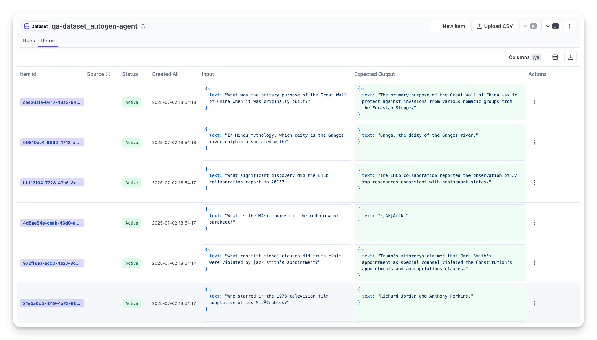

离线评估是在受控环境中评估 Agent，通常使用测试数据集，而不是实时用户查询。您使用经过精心挑选的数据集，这些数据集中您知道期望的输出或正确的行为，然后让 Agent 在这些数据集上运行。

例如，如果您构建了一个数学文字题 Agent，您可能会有一个包含已知答案的 [测试数据集](https://huggingface.co/datasets/gsm8k)，其中有 100 道题目。离线评估通常在开发过程中进行（并且可以成为 CI/CD 流水线的一部分），以检查改进或防止性能退化。其优点是**可重复，并且由于有标准答案，您可以获得明确的准确性指标**。您还可以模拟用户查询，并将 Agent 的响应与理想答案进行比较，或者使用上述的自动化指标。

离线评估的关键挑战在于确保测试数据集全面且保持相关性——Agent 可能在固定测试集上表现良好，但在生产中遇到完全不同的查询。因此，您应不断更新测试集，加入新的边界情况和反映真实场景的示例。混合使用小型“冒烟测试”案例和大型评估集是有用的：小型集用于快速检查，大型集用于更广泛的性能指标。

### 在线评估

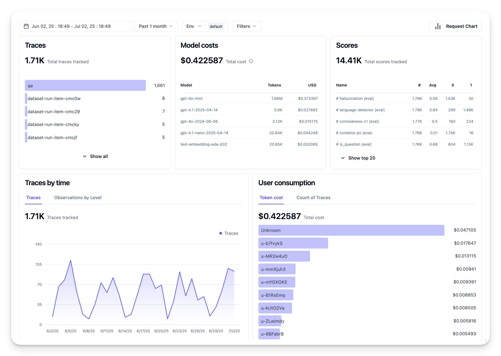

在线评估是指在实时、真实环境中评估 Agent，即在生产中实际使用时进行评估。在线评估涉及监控 Agent 在真实用户交互中的表现，并持续分析结果。

例如，您可能会跟踪成功率、用户满意度评分或其他实时流量指标。在线评估的优势在于它**捕捉到实验室环境中可能无法预见的情况**——您可以观察到模型随时间的漂移（例如，随着输入模式的变化，Agent 的效果是否下降），并发现测试数据中未包含的意外查询或情况。它提供了 Agent 在实际环境中表现的真实画面。

在线评估通常涉及收集隐式和显式用户反馈（如前所述），并可能运行影子测试或 A/B 测试（即新版本的 Agent 与旧版本并行运行以进行比较）。挑战在于为实时交互获取可靠的标签或评分可能很棘手——您可能需要依赖用户反馈或下游指标（例如用户是否点击了结果）。

### 两者结合

在线评估和离线评估并非互斥，而是高度互补的。在线监控中的洞察（例如 Agent 在某些新类型用户查询中的表现不佳）可以用来扩充和改进离线测试数据集。反之，在离线测试中表现良好的 Agent 可以更有信心地部署并进行在线监控。

事实上，许多团队采用一个循环：

*离线评估 -> 部署 -> 在线监控 -> 收集新的失败案例 -> 添加到离线数据集 -> 优化 Agent -> 重复*。

### 常见问题

在将 AI Agent 部署到生产环境时，您可能会遇到各种挑战。以下是一些常见问题及其潜在解决方案：

| **问题**                    | **潜在解决方案**                                                                                        |
| --------------------------- | ------------------------------------------------------------------------------------------------------- |
| AI Agent 无法一致地完成任务 | \- 优化提供给 AI Agent 的提示词；明确目标。<br/>- 确定是否可以将任务分解为子任务，并由多个 Agent 处理。 |
| AI Agent 陷入连续循环       | \- 确保您设置了明确的终止条件，以便 Agent 知道何时停止流程。                                            |

- 对于需要复杂推理和规划的任务，使用专门针对推理任务优化的大型模型。

    | AI代理工具调用表现不佳 | - 在代理系统外测试并验证工具的输出。

  - 优化定义的参数、提示词以及工具的命名。 |

    | 多代理系统表现不一致 | - 优化分配给每个代理的提示词，确保它们具体且彼此区分明确。

  - 构建一个分层系统，使用“路由”或控制器代理来确定哪个代理是正确的选择。 |

通过引入可观测性，许多问题可以更有效地被识别。我们之前讨论的跟踪和指标可以精确定位代理工作流中问题发生的位置，从而使调试和优化更加高效。

### 成本管理

以下是一些管理将AI代理部署到生产环境成本的策略：

**使用较小的模型：** 小型语言模型（SLM）在某些代理任务中表现良好，并能显著降低成本。如前所述，构建一个评估系统来比较小型模型与大型模型的性能是了解SLM在您的用例中表现的最佳方式。可以考虑将SLM用于较简单的任务，例如意图分类或参数提取，而将大型模型保留用于复杂推理任务。

**使用路由模型：** 类似的策略是使用多样化的模型和规模。您可以使用LLM/SLM或无服务器函数根据复杂性将请求路由到最合适的模型。这不仅能降低成本，还能确保在正确的任务上获得良好的性能。例如，将简单查询路由到较小、更快的模型，而仅在复杂推理任务中使用昂贵的大型模型。

**缓存响应：** 识别常见请求和任务，并在它们进入代理系统之前提供响应，是减少类似请求量的好方法。您甚至可以实现一个流程，使用更基础的AI模型来识别请求与缓存请求的相似度。这种策略可以显著降低针对常见问题或工作流的成本。

### 实践中的应用

在[本节的示例笔记本](https://github.com/microsoft/ai-agents-for-beginners/blob/main/10-ai-agents-production/code_samples/10_autogen_evaluation.ipynb)中，我们将看到如何使用可观测性工具来监控和评估代理的示例。

## 十二.代理协议

随着 AI 代理的使用不断增长，对确保标准化、安全性以及支持开放创新的协议需求也随之增加。在本课程中，我们将介绍三个旨在满足这些需求的协议——模型上下文协议 (MCP)、代理对代理 (A2A) 和自然语言网络 (NLWeb)。

### 1.模型上下文协议

**模型上下文协议 (MCP)** 是一种开放标准，为应用程序提供了一种标准化方式，以向 LLM 提供上下文和工具。这使得 AI 代理能够以一致的方式连接到不同的数据源和工具，充当“通用适配器”。

让我们来看看 MCP 的组成部分、与直接 API 使用相比的优势，以及 AI 代理如何使用 MCP 服务器的示例。

#### MCP 核心组件

MCP 基于**客户端-服务器架构**，其核心组件包括：

- **主机**：LLM 应用程序（例如代码编辑器 VSCode），负责启动与 MCP 服务器的连接。
- **客户端**：主机应用程序中的组件，维护与服务器的一对一连接。
- **服务器**：轻量级程序，提供特定功能。

协议中包含三个核心原语，即 MCP 服务器的功能：

- **工具**：这些是 AI 代理可以调用以执行操作的离散动作或功能。例如，天气服务可能提供“获取天气”工具，或电商服务器可能提供“购买产品”工具。MCP 服务器会在其功能列表中宣传每个工具的名称、描述和输入/输出模式。
- **资源**：这些是只读数据项或文档，MCP 服务器可以提供，客户端可以按需检索。例如文件内容、数据库记录或日志文件。资源可以是文本（如代码或 JSON）或二进制（如图像或 PDF）。
- **提示**：这些是预定义模板，提供建议的提示，支持更复杂的工作流程。

#### MCP 的优势

MCP 为 AI 代理提供了显著优势：

- **动态工具发现**：代理可以动态接收服务器提供的工具列表及其功能描述。这与传统 API 需要静态编码集成形成对比，任何 API 更改都需要更新代码。MCP 提供了一种“一次集成”的方法，具有更高的适应性。
- **跨 LLM 的互操作性**：MCP 可在不同的 LLM 上运行，提供灵活性以切换核心模型以评估更好的性能。
- **标准化安全性**：MCP 包括标准认证方法，简化了添加访问其他 MCP 服务器的过程。这比管理不同传统 API 的密钥和认证类型更简单。

#### MCP 示例

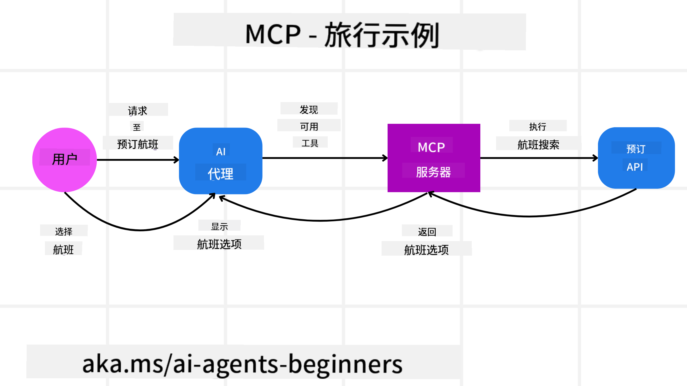

假设用户希望使用 MCP 驱动的 AI 助手预订航班。

1. **连接**：AI 助手（MCP 客户端）连接到航空公司提供的 MCP 服务器。
2. **工具发现**：客户端询问航空公司的 MCP 服务器，“你有哪些工具可用？”服务器回复提供“搜索航班”和“预订航班”等工具。
3. **工具调用**：用户向 AI 助手提出请求：“请搜索从波特兰到檀香山的航班。”AI 助手使用其 LLM 确定需要调用“搜索航班”工具，并将相关参数（出发地、目的地）传递给 MCP 服务器。
4. **执行与响应**：MCP 服务器作为包装器，实际调用航空公司的内部预订 API。然后接收航班信息（例如 JSON 数据），并将其发送回 AI 助手。
5. **进一步交互**：AI 助手展示航班选项。一旦用户选择航班，助手可能会调用同一 MCP 服务器上的“预订航班”工具，完成预订。

### 2.代理对代理协议 (A2A)

虽然 MCP 专注于连接 LLM 和工具，**代理对代理协议 (A2A)** 更进一步，实现不同 AI 代理之间的通信与协作。A2A 连接不同组织、环境和技术栈中的 AI 代理，以完成共享任务。

我们将探讨 A2A 的组成部分和优势，以及它在旅行应用中的应用示例。

#### A2A 核心组件

A2A 专注于代理之间的通信，使它们协作完成用户的子任务。协议的每个组件都为此贡献力量：

#### 代理卡片

类似于 MCP 服务器共享工具列表，代理卡片包含：     ◦ 代理的名称。     ◦ **代理完成的一般任务描述**。     ◦ **具体技能列表**及其描述，帮助其他代理（甚至人类用户）了解何时以及为何调用该代理。     ◦ 代理的**当前端点 URL**。     ◦ 代理的**版本**和**功能**，例如流式响应和推送通知。

#### 代理执行器

代理执行器负责**将用户聊天的上下文传递给远程代理**，远程代理需要这些信息来理解需要完成的任务。在 A2A 服务器中，代理使用其自己的大型语言模型 (LLM) 来解析传入请求，并使用其内部工具执行任务。

#### 工件

远程代理完成请求任务后，其工作成果会作为工件创建。工件**包含代理工作的结果**、**完成内容的描述**以及通过协议发送的**文本上下文**。工件发送后，与远程代理的连接会关闭，直到再次需要时重新建立。

#### 事件队列

此组件用于**处理更新和传递消息**。在生产环境中，它特别重要，以防止代理之间的连接在任务完成前关闭，尤其是当任务完成时间较长时。

#### A2A 的优势

- **增强协作**：它使来自不同供应商和平台的代理能够交互、共享上下文并协作工作，促进传统上分离系统之间的无缝自动化。
- **模型选择灵活性**：每个 A2A 代理可以决定使用哪个 LLM 来处理请求，允许每个代理优化或微调模型，而不像某些 MCP 场景中只有单一 LLM 连接。
- **内置认证**：认证直接集成到 A2A 协议中，为代理交互提供了强大的安全框架。

#### A2A 示例

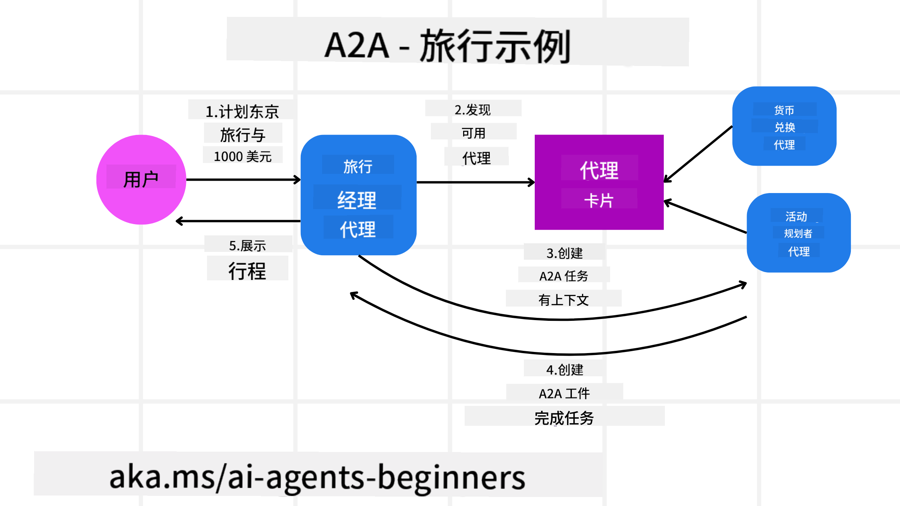

让我们扩展旅行预订场景，这次使用 A2A。

1. **用户请求多代理**：用户与“旅行代理” A2A 客户端/代理互动，例如说：“请为下周安排一次去檀香山的完整旅行，包括航班、酒店和租车。”
2. **旅行代理的编排**：旅行代理收到这个复杂请求。它使用其 LLM 推理任务，并确定需要与其他专业代理互动。
3. **代理间通信**：旅行代理使用 A2A 协议连接到下游代理，例如“航空代理”、“酒店代理”和“租车代理”，这些代理由不同公司创建。
4. **委派任务执行**：旅行代理向这些专业代理发送具体任务（例如“查找檀香山航班”、“预订酒店”、“租车”）。每个专业代理运行自己的 LLM，并使用自己的工具（可能是 MCP 服务器），完成其特定部分的预订。
5. **整合响应**：所有下游代理完成任务后，旅行代理汇总结果（航班详情、酒店确认、租车预订），并以综合聊天形式回复用户。

### 3.自然语言网络 (NLWeb)

网站长期以来一直是用户访问互联网信息和数据的主要方式。

让我们看看 NLWeb 的不同组件、优势，以及通过旅行应用示例了解其工作原理。

#### NLWeb 的组件

- **NLWeb 应用程序（核心服务代码）**：处理自然语言问题的系统。它连接平台的不同部分以生成响应。可以将其视为网站自然语言功能的**引擎**。
- **NLWeb 协议**：这是与网站进行自然语言交互的一**基本规则集**。它以 JSON 格式返回响应（通常使用 Schema.org）。其目的是为“AI 网络”创建一个简单的基础，就像 HTML 使在线共享文档成为可能一样。
- **MCP 服务器（模型上下文协议端点）**：每个 NLWeb 设置也充当**MCP 服务器**。这意味着它可以**共享工具（如“ask”方法）和数据**给其他 AI 系统。实际上，这使网站的内容和功能可被 AI 代理使用，使网站成为更广泛“代理生态系统”的一部分。
- **嵌入模型**：这些模型用于**将网站内容转换为称为向量的数值表示**（嵌入）。这些向量以计算机可以比较和搜索的方式捕捉意义。它们存储在一个特殊的数据库中，用户可以选择使用哪种嵌入模型。
- **向量数据库（检索机制）**：此数据库**存储网站内容的嵌入**。当有人提出问题时，NLWeb 会检查向量数据库以快速找到最相关的信息。它提供一个快速的可能答案列表，并按相似度排序。NLWeb 支持不同的向量存储系统，例如 Qdrant、Snowflake、Milvus、Azure AI Search 和 Elasticsearch。

#### NLWeb 示例

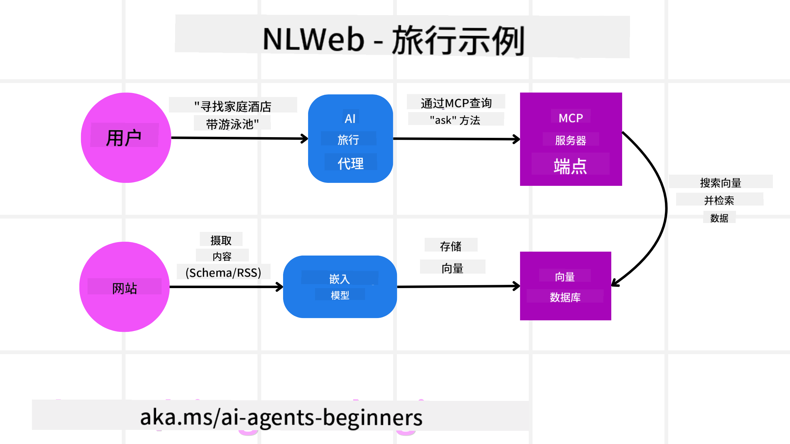

考虑我们的旅行预订网站，这次由 NLWeb 驱动。

1. **数据摄取**：旅行网站现有的产品目录（例如航班列表、酒店描述、旅游套餐）使用 Schema.org 格式化或通过 RSS 提供。NLWeb 的工具摄取这些结构化数据，创建嵌入，并将其存储在本地或远程向量数据库中。
2. **自然语言查询（用户）**：用户访问网站，而不是浏览菜单，而是在聊天界面中输入：“帮我找一个下周在檀香山适合家庭入住并带泳池的酒店。”
3. **NLWeb 处理**：NLWeb 应用程序接收此查询。它将查询发送到 LLM 以理解，同时搜索其向量数据库以找到相关的酒店列表。
4. **准确结果**：LLM 帮助解释数据库的搜索结果，根据“适合家庭”、“泳池”和“檀香山”标准识别最佳匹配项，然后格式化自然语言响应。关键是，响应引用了网站目录中的实际酒店，避免了虚构信息。
5. **AI 代理交互**：由于 NLWeb 充当 MCP 服务器，外部 AI 旅行代理也可以连接到该网站的 NLWeb 实例。AI 代理可以使用 `ask` MCP 方法直接查询网站：`ask("酒店推荐的檀香山地区是否有素食餐厅？")`。NLWeb 实例会处理此请求，利用其餐厅信息数据库（如果已加载），并返回结构化的 JSON 响应。

## 十三.为 AI 代理进行上下文工程

理解您为其构建 AI 代理的应用程序的复杂性，对于创建一个可靠的代理至关重要。我们需要构建能够有效管理信息的 AI 代理，以满足超越提示工程的复杂需求。

## 什么是上下文工程？

对于 AI 代理来说，上下文是驱动其规划采取特定行动的核心。上下文工程是确保 AI 代理拥有完成任务下一步所需正确信息的实践。由于上下文窗口的大小有限，作为代理构建者，我们需要设计系统和流程来管理上下文窗口中的信息添加、移除和压缩。

### 提示工程与上下文工程

提示工程专注于一组静态指令，用以通过规则有效引导 AI 代理。而上下文工程则是管理动态信息集（包括初始提示）的过程，以确保 AI 代理在整个过程中拥有所需的信息。上下文工程的核心理念是使这一过程可重复且可靠。

### 上下文的类型

.png)

需要记住的是，上下文并非单一的事物。AI 代理所需的信息可能来自多种不同来源，而我们需要确保代理能够访问这些来源：

AI 代理可能需要管理的上下文类型包括：

- **指令：** 这些类似于代理的“规则”——提示、系统消息、少样本示例（向 AI 展示如何完成某项任务）以及其可用工具的描述。这是提示工程与上下文工程结合的地方。
- **知识：** 包括事实、从数据库中检索的信息或代理积累的长期记忆。这可能涉及集成检索增强生成 (RAG) 系统，以便代理访问不同的知识库和数据库。
- **工具：** 包括代理可以调用的外部函数、API 和 MCP 服务器的定义，以及使用这些工具后获得的反馈（结果）。
- **对话历史：** 与用户的持续对话。随着时间推移，这些对话会变得越来越长、越来越复杂，占据更多的上下文窗口空间。
- **用户偏好：** 随时间积累的用户喜好或厌恶信息。这些信息可以在做出关键决策时调用，以更好地帮助用户。

## 有效上下文工程的策略

### 规划策略

.png)

良好的上下文工程始于良好的规划。以下是帮助您开始思考如何应用上下文工程概念的方法：

1. **定义清晰的结果** - AI 代理将被分配的任务结果应清晰定义。回答这个问题——“当 AI 代理完成任务时，世界会是什么样子？”换句话说，用户在与 AI 代理交互后应获得什么样的变化、信息或响应。
2. **绘制上下文图** - 一旦定义了 AI 代理的任务结果，您需要回答“AI 代理需要什么信息来完成这项任务？”这样，您可以开始绘制这些信息的来源。
3. **创建上下文管道** - 知道信息来源后，您需要回答“代理将如何获取这些信息？”这可以通过多种方式实现，包括 RAG、使用 MCP 服务器和其他工具。

### 实用策略

规划很重要，但一旦信息开始流入代理的上下文窗口，我们需要有实际的管理策略：

#### 管理上下文

虽然某些信息会自动添加到上下文窗口中，但上下文工程需要对这些信息采取更主动的管理方式，可以通过以下几种策略实现：

1. **代理便笺本**

允许 AI 代理在单次会话中记录当前任务和用户交互的相关信息。这些信息应存储在上下文窗口之外，例如文件或运行时对象中，以便代理在需要时检索。

1. **记忆**

便笺本适用于管理单次会话上下文窗口之外的信息，而记忆则使代理能够跨多个会话存储和检索相关信息。这可能包括摘要、用户偏好和未来改进的反馈。

1. **压缩上下文**

当上下文窗口增长并接近其限制时，可以使用摘要和修剪等技术。这包括仅保留最相关的信息或移除较旧的消息。

1. **多代理系统**

开发多代理系统是一种上下文工程形式，因为每个代理都有自己的上下文窗口。在构建这些系统时，需要规划如何共享和传递上下文。

1. **沙盒环境**

如果代理需要运行一些代码或处理文档中的大量信息，这可能会占用大量令牌来处理结果。代理可以使用沙盒环境运行代码，仅读取结果和其他相关信息，而不是将所有内容存储在上下文窗口中。

1. **运行时状态对象**

通过创建信息容器来管理代理需要访问某些信息的情况。对于复杂任务，这使代理能够逐步存储每个子任务的结果，从而使上下文仅与特定子任务保持关联。

### 上下文工程示例

假设我们希望一个 AI 代理 **“帮我预订去巴黎的旅行。”**

- 一个仅使用提示工程的简单代理可能只会回答：**“好的，您想什么时候去巴黎？”** 它只处理了用户在提问时的直接问题。
- 一个使用本课中提到的上下文工程策略的代理会做得更多。在回答之前，它的系统可能会：

  ◦ **检查您的日历** 以获取可用日期（实时数据检索）。

  ◦ **回忆过去的旅行偏好**（来自长期记忆），例如您喜欢的航空公司、预算或是否偏好直飞航班。

  ◦ **识别可用工具** 用于预订航班和酒店。

- 然后，一个示例响应可能是：

    “您好 [您的名字]！我看到您在十月的第一周有空。我是否可以帮您查找 [您喜欢的航空公司] 的直飞巴黎航班，预算控制在 [预算] 内？”

    这种更丰富、更具上下文感知的响应展示了上下文工程的强大之处。

## 常见的上下文问题

### 上下文污

**问题描述：** 当 LLM 生成的幻觉（虚假信息）或错误进入上下文并被反复引用时，可能导致代理追求不可能的目标或制定无意义的策略。

**解决方法：** 实施 **上下文验证** 和 **隔离**。在将信息添加到长期记忆之前进行验证。如果检测到潜在污染，启动新的上下文线程以防止错误信息传播。

**旅行预订示例：** 您的代理虚构了一个 **从小型地方机场直飞远程国际城市** 的航班，而实际上该机场并不提供国际航班。这一不存在的航班信息被保存到上下文中。之后，当您要求代理预订时，它不断尝试为这一不可能的航线寻找票务，导致重复错误。

**解决方案：** 添加一个步骤，通过实时 API 验证航班的存在和航线 *在* 将航班信息添加到代理的工作上下文之前。如果验证失败，则将错误信息“隔离”，不再进一步使用。

### 上下文干扰

**问题描述：** 当上下文变得过于庞大时，模型可能过于关注累积的历史，而忽略了训练中学到的内容，导致重复或无用的行为。甚至在上下文窗口填满之前，模型就可能开始犯错。

**解决方法：** 使用 **上下文摘要**。定期将累积信息压缩为更短的摘要，保留重要细节，同时移除冗余历史。这有助于“重置”模型的关注点。

**旅行预订示例：** 您长时间讨论了各种梦想旅行目的地，包括详细回忆两年前的背包旅行。当您最终要求 **“帮我找下个月的便宜航班”** 时，代理因旧的、不相关的细节而分心，不断询问您的背包装备或过去的行程，而忽略了当前的请求。

**解决方案：** 在一定轮次后或上下文过大时，代理应 **总结最近且相关的对话部分**——专注于当前的旅行日期和目的地——并使用该压缩摘要进行下一次 LLM 调用，丢弃不相关的历史聊天。

### 上下文混淆

**问题描述：** 当上下文中存在过多不必要的信息（通常是过多的可用工具）时，模型可能生成错误的响应或调用无关的工具。小型模型尤其容易出现这种问题。

**解决方法：** 使用 **工具加载管理** 和 RAG 技术。将工具描述存储在向量数据库中，并为每个特定任务选择 *仅* 最相关的工具。研究表明，将工具选择限制在 30 个以下效果更佳。

**旅行预订示例：** 您的代理可以访问几十种工具：`book_flight`、`book_hotel`、`rent_car`、`find_tours`、`currency_converter`、`weather_forecast`、`restaurant_reservations` 等。您询问 **“在巴黎最好的出行方式是什么？”** 由于工具数量过多，代理可能会混淆，尝试在巴黎内部调用 `book_flight`，或者调用 `rent_car`，尽管您更喜欢公共交通，因为工具描述可能存在重叠，或者代理无法分辨最佳选择。

**解决方案：** 使用 **RAG 技术筛选工具描述**。当您询问巴黎的出行方式时，系统动态检索 *仅* 最相关的工具，如 `rent_car` 或 `public_transport_info`，为 LLM 提供一个精简的“工具加载”。

### 上下文冲突

**问题描述：** 当上下文中存在冲突信息时，可能导致推理不一致或生成错误的最终响应。这通常发生在信息分阶段到达时，早期的错误假设仍保留在上下文中。

**解决方法：** 使用 **上下文修剪** 和 **卸载**。修剪是指在新信息到达时移除过时或冲突的信息。卸载则为模型提供一个单独的“便笺本”工作区，以便处理信息而不干扰主上下文。

**旅行预订示例：** 您最初告诉代理 **“我想坐经济舱。”** 后来在对话中改变主意，说 **“其实这次我想坐商务舱。”** 如果两条指令都保留在上下文中，代理可能会收到冲突的搜索结果，或者在优先处理哪条指令时感到困惑。

**解决方案：** 实施 **上下文修剪**。当新指令与旧指令冲突时，移除旧指令或明确覆盖旧指令。或者，代理可以使用 **便笺本** 来协调冲突的偏好，确保最终只有一致的指令指导其行动。

## 十四.AI代理的记忆

在讨论创建AI代理的独特优势时，主要涉及两个方面：调用工具完成任务的能力以及随着时间推移不断改进的能力。记忆是创建能够自我改进的代理的基础，这种代理可以为用户提供更好的体验。

## 理解AI代理的记忆

从本质上讲，**AI代理的记忆指的是使其能够保留和回忆信息的机制**。这些信息可以是关于对话的具体细节、用户偏好、过去的操作，甚至是学习到的模式。

没有记忆的AI应用通常是无状态的，这意味着每次交互都从头开始。这会导致重复且令人沮丧的用户体验，因为代理会“忘记”之前的上下文或偏好。

### 为什么记忆很重要？

代理的智能与其回忆和利用过去信息的能力密切相关。记忆使代理能够：

- **反思**：从过去的行为和结果中学习。
- **互动**：在持续的对话中保持上下文。
- **主动和被动**：根据历史数据预测需求或做出适当反应。
- **自主**：通过调用存储的知识更独立地运行。

实现记忆的目标是让代理变得更加**可靠和有能力**。

### 记忆的类型

#### 工作记忆

可以将其视为代理在单个任务或思考过程中使用的一张便签纸。它保存完成下一步所需的即时信息。

对于AI代理，工作记忆通常捕捉对话中最相关的信息，即使完整的聊天记录很长或被截断。它专注于提取关键元素，如需求、提议、决策和行动。

**工作记忆示例**

在一个旅行预订代理中，工作记忆可能会捕捉用户当前的请求，例如“我想预订去巴黎的旅行”。这一具体需求会保存在代理的即时上下文中，以指导当前的交互。

#### 短期记忆

这种记忆在单次对话或会话期间保留信息。它是当前聊天的上下文，使代理能够回顾对话中的前几轮内容。

**短期记忆示例**

如果用户问“去巴黎的航班多少钱？”然后接着问“那里的住宿怎么样？”，短期记忆确保代理知道“那里”指的是“巴黎”，并保持对话的连贯性。

#### 长期记忆

这种记忆在多个对话或会话中持续存在。它使代理能够记住用户偏好、历史交互或长期的通用知识。这对于个性化非常重要。

**长期记忆示例**

长期记忆可能存储“Ben喜欢滑雪和户外活动，喜欢带有山景的咖啡，并因过去的受伤而避免高级滑雪道”。这些信息从之前的交互中学习而来，在未来的旅行规划中提供高度个性化的推荐。

#### 角色记忆

这种特殊的记忆类型帮助代理形成一致的“个性”或“角色”。它使代理能够记住关于自身或其预期角色的细节，从而使交互更加流畅和专注。

**角色记忆示例**

如果旅行代理被设计为“滑雪规划专家”，角色记忆可能会强化这一角色，使其响应更符合专家的语气和知识。

#### 工作流/情节记忆

这种记忆存储代理在执行复杂任务时采取的步骤，包括成功和失败。它类似于记住特定的“情节”或过去的经验，以便从中学习。

**情节记忆示例**

如果代理尝试预订某个航班但因不可用而失败，情节记忆可以记录这一失败，使代理在后续尝试中选择替代航班或更有针对性地告知用户问题。

#### 实体记忆

这种记忆涉及从对话中提取并记住特定的实体（如人物、地点或事物）和事件。它使代理能够构建对讨论的关键元素的结构化理解。

**实体记忆示例**

从关于过去旅行的对话中，代理可能提取“巴黎”、“埃菲尔铁塔”和“在Le Chat Noir餐厅的晚餐”作为实体。在未来的交互中，代理可以回忆起“Le Chat Noir”，并提供新的预订建议。

#### 结构化RAG（检索增强生成）

虽然RAG是一种更广泛的技术，“结构化RAG”被强调为一种强大的记忆技术。它从各种来源（对话、电子邮件、图像）中提取密集的结构化信息，并用来提高响应的精确性、召回率和速度。与仅依赖语义相似性的经典RAG不同，结构化RAG利用信息的内在结构。

**结构化RAG示例**

与仅匹配关键词不同，结构化RAG可以解析电子邮件中的航班详情（目的地、日期、时间、航空公司）并以结构化方式存储。这使得查询“我周二预订的去巴黎的航班是什么？”变得更加精确。

## 实现和存储记忆

为AI代理实现记忆涉及**记忆管理**的系统化过程，包括生成、存储、检索、整合、更新，甚至“遗忘”（或删除）信息。检索是其中一个特别关键的方面。

### 专用记忆工具

存储和管理代理记忆的一种方法是使用专用工具，如Mem0。Mem0作为一个持久记忆层，使代理能够回忆相关交互、存储用户偏好和事实上下文，并随着时间推移从成功和失败中学习。其核心理念是将无状态代理转变为有状态代理。

它通过**两阶段记忆管道：提取和更新**来工作。首先，添加到代理线程的消息会发送到Mem0服务，该服务使用大型语言模型（LLM）总结对话历史并提取新的记忆。随后，LLM驱动的更新阶段决定是否添加、修改或删除这些记忆，并将其存储在混合数据存储中，包括向量、图形和键值数据库。该系统还支持各种记忆类型，并可以结合图形记忆来管理实体之间的关系。

### 使用RAG存储记忆

除了像Mem0这样的专用记忆工具，您还可以利用强大的搜索服务，如**Azure AI Search**，作为存储和检索记忆的后端，特别是用于结构化RAG。

这使您能够用自己的数据为代理的响应提供依据，确保更相关和准确的答案。Azure AI Search可以用于存储用户特定的旅行记忆、产品目录或任何其他领域的知识。

Azure AI Search支持诸如**结构化RAG**的功能，它擅长从大型数据集（如对话历史、电子邮件或图像）中提取和检索密集的结构化信息。与传统的文本分块和嵌入方法相比，这提供了“超人级的精确性和召回率”。

## 让AI代理自我改进

一种常见的自我改进代理模式是引入一个**“知识代理”**。这个独立的代理观察用户与主代理之间的主要对话。其角色包括：

1. **识别有价值的信息**：确定对话中的哪些部分值得保存为通用知识或特定用户偏好。
2. **提取和总结**：从对话中提炼出关键的学习或偏好。
3. **存储到知识库**：将提取的信息持久化，通常存储在向量数据库中，以便后续检索。
4. **增强未来查询**：当用户发起新查询时，知识代理检索相关的存储信息并将其附加到用户的提示中，为主代理提供关键上下文（类似于RAG）。

### 记忆优化

- **延迟管理**：为了避免降低用户交互速度，可以初步使用更便宜、更快的模型快速检查信息是否值得存储或检索，仅在必要时调用更复杂的提取/检索过程。
- **知识库维护**：对于不断增长的知识库，较少使用的信息可以移至“冷存储”以管理成本。