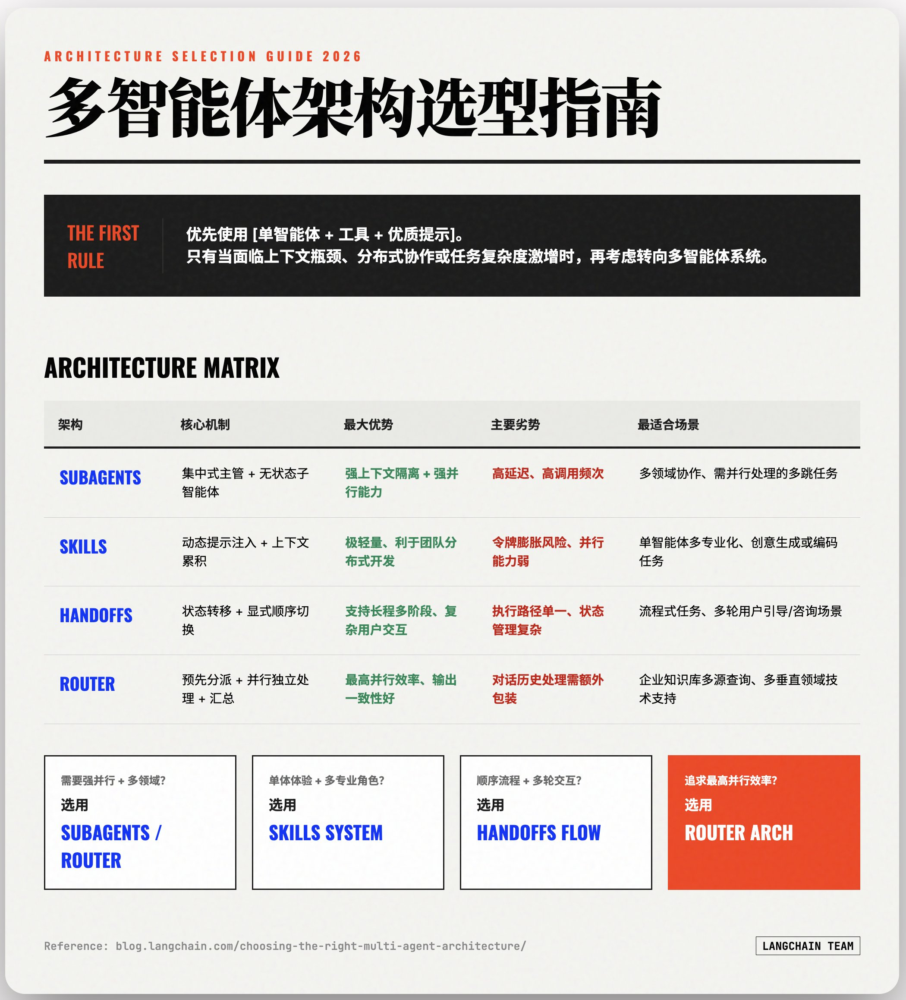

> > 自主 Agent / 上下文工程资料索引和个人的一些点评，基本以工程为主。学术界普遍集中在 Agent RL 上，这里不进行展开。

<!--more-->

- > > [Building effective agents](https://www.anthropic.com/engineering/building-effective-agents) by Anthropic
  - > > > 【可选】24年12月的文章，比较鲜明的将 Workflow 和 Autonomous Agent 拆分，并着重在未来 Agent 的发展。
- > > [How we built our multi-agent research system](https://www.anthropic.com/engineering/multi-agent-research-system) by Anthropic
  - > > > 【**必读**】Anthropic 的博客文章，核心解析 **Claude Deep Research** 的技术框架，介绍了 SubAgent（Agent as Tool）、Todo tools 等方法。
- > > [Effective context engineering for AI agents](https://www.anthropic.com/engineering/effective-context-engineering-for-ai-agents) by Anthropic
  - > > > 【**必读**】Anthropic 上下文工程标志性文章，包括上下文压缩、SubAgent、Agentic Memory 等方法的介绍。
- > > [Introducing advanced tool use on the Claude Developer Platform](https://www.anthropic.com/engineering/advanced-tool-use) by Anthropic
  - > > > 【**必读**】介绍**Tool Search Tool**（工具搜索工具）、**Programmatic Tool Calling**（程序化工具调用）、**Tool Use Examples**（工具示例）三种范式，虽然实现细节被隐藏到 Claude API 之后，但不难复刻。
  - > > > 相关文章：
    - > > > > [Code execution with MCP: Building more efficient agents](https://www.anthropic.com/engineering/code-execution-with-mcp) Programmatic Tool Calling 范式的首次介绍。
- > > [Equipping agents for the real world with Agent Skills](https://www.anthropic.com/engineering/equipping-agents-for-the-real-world-with-agent-skills) by Anthropic
  - > > > 【**必读**】介绍 **Agent Skills** 范式，Skills 目前是最优雅的 Agent 垂直能力注入方式，强烈建议采用。
- > > [Beyond permission prompts: making Claude Code more secure and autonomous](https://www.anthropic.com/engineering/claude-code-sandboxing) Anthropic
  - > > > 【可选】Claude Code Sandbox 机制的介绍，同时有开源实现 [sandbox-runtime](https://github.com/anthropic-experimental/sandbox-runtime) 供参考，是比较轻量级的 Sandbox 实现。还可以通过 Container 来进行较重的实现。
- > > [Writing effective tools for agents — with agents](https://www.anthropic.com/engineering/writing-tools-for-agents) by Anthropic
  - > > > 【**必读**】如何为 Agent 设计更有效的工具，不是把接口封装到 MCP Server 那么简单，参数、返回值、描述和错误信息都需要优化。
- > > [Claude Code: Best practices for agentic coding](https://www.anthropic.com/engineering/claude-code-best-practices) by Anthropic
  - > > > 【可选】跨时代的产品： Claude Code 的发布文章。
  - > > > 相关资料
    - > > > > [Claude Code Changelog](https://github.com/marckrenn/claude-code-changelog)：追踪 Claude Code 的系统提示词的变化，能学到很多 Agent 设计技巧。
- > > [Building agents with the Claude Agent SDK](https://www.anthropic.com/engineering/building-agents-with-the-claude-agent-sdk) by Anthropic
  - > > > 【**必读**】使用 Claude Agent SDK 开发自主 Agent，虽然效果依然最佳，但 Agent SDK 的底层是闭源的 Claude Code，谨慎使用。
- > > [Effective harnesses for long-running agents](https://www.anthropic.com/engineering/effective-harnesses-for-long-running-agents) by Anthropic
  - > > > 【**必读**】讲设计长时运行 Agent 的一些经验，内容不多但有较大价值。
- > > [Context Engineering for Agents](https://rlancemartin.github.io/2025/06/23/context_engineering/) by Lance Martion and Langchain
  - > > > 【**必读**】上下文工程的另一个介绍，图主要来自于 Langchain 的 blog。
- > > [Context Engineering in Manus](https://rlancemartin.github.io/2025/10/15/manus/) by Manus
  - > > > 【**必读**】Manus 的上下文工程的实践经验，虽然 Manus 争议很大，但他们在自主 Agent 领域至少和 Anthropic 一样走在行业前列。提到了上下文 Offload、Reduce和Isolate 等方法。此外自25年3月到10月，Manus 已经重构了 5 次，切记一点，Agent 处在架构和模型迅猛变更的环境中。
  - > > > 相关资料：[视频](https://www.youtube.com/watch?v=6_BcCthVvb8) [PPT](https://drive.google.com/file/d/1QGJ-BrdiTGslS71sYH4OJoidsry3Ps9g/view) [文字稿](https://www.bestblogs.dev/video/087a1f3)
- > > [Measuring AI Ability to Complete Long Tasks](https://metr.org/blog/2025-03-19-measuring-ai-ability-to-complete-long-tasks/) by METR
  - > > > 【可选】我经常引用的评测结果：自主Agent 能够完成的等效人类任务时长每7个月翻一番。
- > > [Kimi CLI Agent](https://github.com/MoonshotAI/kimi-cli) by Kimi
  - > > > 【**必读**】设计良好，代码非常优雅的 CLI Agent 开源项目。
- > > [DeepAgents](https://github.com/langchain-ai/deepagents) by Langchain
  - > > > 【**必读**】LangChain 的自主 Agent 实现，借鉴了 LangGraph 的成功经验，提出的 Middleware 机制对上下文工程来说是非常不错的抽象。更新很快，Skills等均已经得到支持。还提供一个不错的 UI 界面。
- > > [Agents 2.0: From Shallow Loops to Deep Agents](https://www.philschmid.de/agents-2.0-deep-agents) by Philschmid
  - > > > 【可选】提出了 Agent 2.0 的概念，算是个总结。
- > > [Learning the Bitter Lesson](https://rlancemartin.github.io/2025/07/30/bitter_lesson/) by Lance Martin
  - > > > 【可选】把 Bitter Lesson 和目前的 Agent 结合，也是我最近引用的一种思想。
- > > [rLLM SDK: Training Any Agentic Program without Code Changes](https://rllm-project.com/post.html?post=sdk.md) by rLLM
  - > > > 【可选】有很多 Agent RL Training 的库，尝试了一圈，还是 rLLM 更可靠，更新更快。ART、agent-lightning 等项目都有各自的问题。
- > > [The Hitchhikers Guide to LLM Agent](https://saurabhalone.com/blog/agent) by Saurabhalone
  - > > > 【**必读**】作者从头搭建了一个 Coding Agent，这是他的经验，最近比较好的文章之一。
- > > [Skills vs Dynamic MCP Loadouts](https://lucumr.pocoo.org/2025/12/13/skills-vs-mcp/) by Armin Ronachers
  - > > > 【可选】很简单的一件事，**使用 Skills 替代 MCP，** 这也是我的实践。
- > > [Beyond Pipelines: A Survey of the Paradigm Shift toward Model-Native Agentic AI](https://arxiv.org/abs/2510.16720)
  - > > > 【可选】一篇综述文章，介绍从Pipeline（Workflow）到自主 Agent 的范式转移。

> > 

+ #### 多智能体选购指南(LangChain博文)

  > > 优先用单智能体 + 工具 + 好提示，只有在明确遇到上下文窗口限制、分布式开发需求或复杂任务拆分必要时，才转向多智能体系统。

  > > 多智能体系统的必要性来自： 

  > > · 上下文管理：单一提示无法容纳所有专业化知识，由于上下文窗口的有限性和延迟考虑，需要策略性地选择性呈现信息。 

  > > · 分布式开发：不同团队独立维护能力，使得单一智能体提示难以跨团队管理。 

  > > · 复杂任务处理：研究显示，多智能体系统通过分布工作负载至独立上下文窗口的智能体，能够实现并行推理，从而优于单一智能体。 

  > > 而多智能体系统架构的选择基于：

  > >  · 需要强并行 + 多领域 → Subagents 或 Router 

  > > · 想保持单智能体体验 + 多专业化 → Skills

  > > · 需要顺序流程 + 用户多轮交互 → Handoffs 

  > > · 追求最高并行效率 + 多源合成 → Router

[Choosing the Right Multi-Agent Architecture](https://www.blog.langchain.com/choosing-the-right-multi-agent-architecture/)

+ #### How to save a new template

[Templates](https://support.craft.do/hc/en-us/articles/4869505333393-Templates#h_01FYPGQX5QN8M03S8SF93RX275)

+ #### Tips & Tricks
  - *Click and hold for a few seconds to drag the view tab*
  - *Use “Configure Collection" in the Collection's 3 dot menu to rearrange columns*
  - *Using Filter, Sort, Group, and Show/Hide Fields to custom a new Wiew of the Collection*
+ 开源的Agent的UI框架
  1. Agno开源的AgentUI：[https://github.com/agno-agi/agent-ui/tree/main](https://github.com/agno-agi/agent-ui/tree/main)