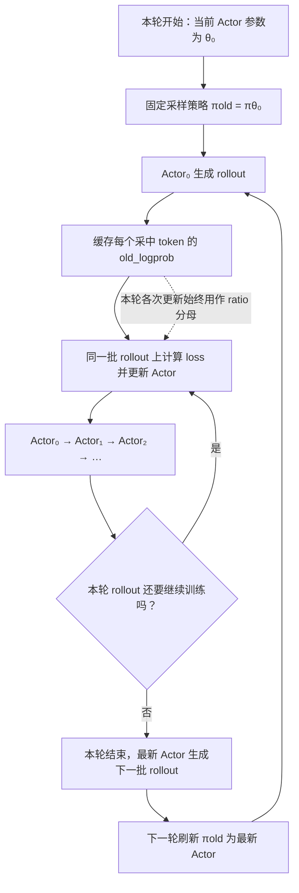

> 从直觉与建模出发，依次讲解全局闭环、模型角色、Rollout 数据、奖励与优势、从 Policy Gradient 到 PPO-Clip 的推导、两个 loss、训练层级、代码映射与排错。

## 阅读说明

本文以经典 RLHF 中的 **PPO-Clip + Actor-Critic** 训练为主线。不同项目在 KL 估计、奖励分配、loss 聚合、Actor 与 Critic 是否共享骨干等方面会有差异，文中会标出常见做法与实现选择，这些位置应以你所用框架的代码为准。

阅读顺序：

1. 先建立直觉，并分清两个不同的约束（第 1 节）。
2. 再看完整闭环与各模型角色（第 2–4 节）。
3. 然后讲清 rollout 里存了什么、奖励与优势怎么算（第 5–8 节）。
4. 接着回答"ratio 和 clip 从哪来"（第 9 节）。
5. 最后落到 loss、训练层级、代码与排错（第 10–14 节）。

**符号约定**：

| 符号                 | 含义                        |
|:--------------------:|:---------------------------:|
| $x$                  | prompt                      |
| $y=(y_1,\ldots,y_T)$ | 回答                        |
| $T$                  | 回答的生成长度              |
| $L$                  | prompt 与回答拼接后的总长度 |
| $\epsilon$           | PPO 的裁剪半径              |
| $\gamma$             | 折扣因子                    |
| $\lambda$            | GAE 参数                    |

---

## 1. 定位与直觉

### 1.1 PPO 在后训练流水线中的位置

经典 RLHF 分为三个阶段：

```text
预训练模型 → ① SFT（监督微调）→ ② 训练 Reward Model（偏好数据）→ ③ PPO 强化学习
```

- **阶段 ①**：用示范数据把预训练模型微调成会"按指令回答"的 SFT 模型。
- **阶段 ②**：用"同一 prompt 下更优/更差回答"的偏好对训练 Reward Model（RM），让它给整条回答打分。
- **阶段 ③**（本文主题）：用 RM 的分数作为信号，通过 PPO 继续优化 SFT 模型。

PPO 阶段的几个模型通常这样初始化：

| 模型         | 常见初始化                                          |
|:------------:|:---------------------------------------------------:|
| Actor        | 从 SFT 模型出发，是被训练的对象                     |
| Reference    | SFT 模型的冻结副本                                  |
| Reward Model | 阶段 ② 训练得到，冻结                               |
| Critic       | 常见做法是用 RM 或 SFT 加一个标量 value head 初始化 |

注意：RM 给**完整回答**打分，Critic 给**每个前缀**估计未来回报，两者角色不同（见第 6.2 节），不要混淆。

### 1.2 后训练中PPO 的意义

把 LLM 的回答看成一串动作。模型看到 prompt 后依次生成 token，每生成一个 token，前缀变长，模型再根据新前缀选择下一个 token。PPO 后训练的目标是：让模型更倾向于生成能带来较高奖励的 token 序列，同时**控制更新幅度**，也**不让策略无限偏离参考模型**。

### 1.3 两条缰绳：PPO 里有两个不同的约束

上面这句话里其实包含两个不同的约束，对照对象和手段都不同，后文所有关于 old / ref 的混淆都可以回扣到这张表：

| 约束     | 对照对象                            | 手段         | 管什么                  |
|:--------:|:-----------------------------------:|:------------:|:-----------------------:|
| 近端约束 | $\pi_{\rm old}$（本轮采样时的策略） | ratio + clip | 一轮 rollout 内别走太远 |
| 参考约束 | $\pi_{\rm ref}$（冻结的 SFT 模型）  | KL 惩罚      | 整个训练过程别偏离太远  |

PPO 的 clip 管的是 Actor 对 Old 的距离，KL 惩罚管的是 Actor 对 Reference 的距离，二者互不替代。

### 1.4 三个时间尺度

- **生成尺度**：Actor 按 token 逐步采样；工程上通常由 rollout 引擎一次调用生成整条回答。
- **损失尺度**：回答中每个有效生成 token 各有一个概率比、advantage 和损失项。
- **参数更新尺度**：多个 token 的损失聚合为 mini-batch loss 后，才执行一次 optimizer step。

所以，**逐 token 计算损失不等于逐 token 更新参数**。第 12 节会给出完整的训练层级。

---

## 2. 把文本生成写成强化学习问题

给定 prompt $x$，模型生成回答 $y=(y_1,\ldots,y_T)$。定义第 $t$ 个决策时的状态为此前缀，动作是新生成的 token：

$$
s_t=(x,y_{<t}), \qquad a_t=y_t, \qquad \pi_\theta(a_t\mid s_t).
$$

其中 $\pi_\theta$ 是参数为 $\theta$ 的语言模型策略。回答的序列概率分解为：

$$
\pi_\theta(y\mid x)=\prod_{t=1}^{T}\pi_\theta(y_t\mid x,y_{<t}).
$$

这个 RL 问题有一个特点：**环境转移是确定的**（给定前缀和新 token，下一个状态就是两者拼接），但**状态的分布由策略决定**——策略不同，会走到的前缀就不同。因此，策略一旦更新，之前采样得到的数据就不再严格代表"新策略会遇到的状态"。这正是 PPO 要求"用当前策略附近的数据训练"、并限制每轮更新幅度的根本原因（第 9 节展开）。

回答以 EOS 结束是真正的终止；回答因达到最大长度被强行截断时，回答其实没有结束，两者在 GAE 中的处理不同（第 8.1 节）。

---

## 3. 全局闭环

先看一轮训练的整体流程，后面每一节都是这张图中某一环的展开：

```text
开始一轮
  ├─ 当前 Actor 作为 πold，采样回答并记录 old_logprob            （第 4、5 节）
  ├─ Critic 对每个生成前缀预测 old_value                        （第 6 节）
  ├─ Reference 提供参考 logprob，Reward Model 对完整回答评分      （第 7 节）
  ├─ 合成逐 token rewards                                       （第 7 节）
  ├─ GAE 计算 advantages 与 value targets                       （第 8 节）
  ├─ 切分 mini-batch，对每个 mini-batch：                       （第 10–12 节）
  │    ├─ 当前 Actor 重算 new_logprob → ratio → Policy loss
  │    ├─ 当前 Critic 重算 value → Value loss
  │    └─ mask、聚合、反向传播、optimizer step
  ├─ 同一 rollout 可按配置进行多个 epoch 的 mini-batch 更新
  └─ rollout 用完，更新后的 Actor 生成下一轮新数据
```

可以压缩成一条公式链：

$$
\text{采样 }(s_t,a_t)
\rightarrow r_t,\,V_{\rm old}(s_t)
\rightarrow (\hat A_t,\,V^{\rm tgt}_t)
\rightarrow (L_{\rm policy},L_{\rm value})
\rightarrow \text{mini-batch optimizer step}.
$$

---

## 4. PPO-RLHF 中的模型

| 角色                        | 输入                | 输出                      | 主要用途                         | 常见更新方式          |
|:---------------------------:|:-------------------:|:-------------------------:|:--------------------------------:|:---------------------:|
| Actor / Policy $\pi_\theta$ | prompt 与已生成前缀 | 词表上的下一个 token 分布 | 生成回答，接受 Policy loss 更新  | 每个 mini-batch 更新  |
| Old Policy $\pi_{\rm old}$  | 同一前缀            | 采样时动作概率            | 为 PPO ratio 提供分母            | 本轮 rollout 期间固定 |
| Reference $\pi_{\rm ref}$   | 同一前缀            | 参考分布或动作 logprob    | 构造相对参考策略的 KL 约束       | RL 阶段通常冻结       |
| Reward Model                | 完整 prompt 与回答  | 回答质量分 $R(x,y)$       | 提供任务奖励                     | RL 阶段通常冻结       |
| Critic / Value $V_\phi$     | 每个生成前缀        | 未来累计回报估计          | 提供 baseline、GAE 与 Value loss | 每个 mini-batch 更新  |

"五个角色"不一定是五份独立权重：

- Actor 与 Critic 可以共享 Transformer 主干，也可以是两个完全独立的模型（后者在 LLM 场景中很常见，见第 11.3 节）。
- Old Policy 在工程中可以是一份冻结权重，也可以只缓存采样时的 token logprob。
- Reference 与 Reward Model 通常是独立的冻结模型。

### 4.1 Actor 与 Old Policy：同一个策略的两个时间点

Actor 和 Old Policy 不是两个职责不同的模型，而是**同一个策略在两个时间点的版本**：Actor 是正在训练、参数会变化的版本；Old Policy 是生成当前这批回答时的固定版本。PPO 用 Old Policy 记录的概率作参照，衡量 Actor 更新后对**同一个已采样 token**的概率改变了多少。



两者的关系用概率比（ratio）表示：

$$
\rho_t(\theta)=\frac{\pi_\theta(a_t\mid s_t)}{\pi_{\rm old}(a_t\mid s_t)}
=\exp\left(\log\pi_\theta(a_t\mid s_t)-\log\pi_{\rm old}(a_t\mid s_t)\right).
$$

在**本轮的第一个 optimizer step 之前**，当前 Actor 与采样 Actor 参数相同，理论上 $\rho_t=1$。第一次 optimizer step 之后 Actor 已经改变，同一 epoch 内后续的 mini-batch 起，ratio 就不再恒为 1。

> **工程提醒**：若 old_logprob 来自推理引擎（如 vLLM 等），而训练使用另一套前向实现，两者的数值差异会使"第一步的 ratio"也不等于 1。常见做法是在训练引擎中用 $\theta_0$ 重新前向计算 old_logprob，而不是直接使用推理引擎返回的值。

ratio 为什么要这样定义、为什么要 clip，见第 9 节。

---

## 5. Rollout Buffer：一条回答的训练记录

Rollout Buffer 是一批回答及其训练记录。概念上，单条回答中以下量都按生成位置对齐。先定义两个长度：$T$ 是回答的生成长度，$L$ 是 prompt 与回答拼接后的总长度（$L\ge T$）。

| 保存项                   | 单条形状示意     | 用途                                                              |
|:------------------------ |:---------------- |:----------------------------------------------------------------- |
| prompt 与 response token | 长度 $L$         | 重建前缀，供 Actor/Critic 前向计算                                |
| attention mask           | $[L]$            | 标记有效序列位置，参与模型注意力                                  |
| response/loss mask       | $[L]$ 或 $[T]$   | 标记哪些回答 token 进入 loss                                      |
| old logprob              | $[T]$            | PPO ratio 的固定分母                                              |
| old value                | $[T]$ 或 $[T+1]$ | GAE 所需的 Critic 预测；$[T+1]$ 布局多出的一项是 bootstrap 边界值 |
| reward                   | $[T]$            | 任务奖励与 KL 项合成后的逐 token 即时奖励                         |
| advantage                | $[T]$            | Actor Policy loss 的权重                                          |
| returns / value target   | $[T]$            | Critic Value loss 的监督目标                                      |
| 终止/截断信息            | 每条回答一个标记 | 决定 GAE 是否 bootstrap（第 8.1 节）                              |

另有两个**中间量**：Reference 的 logprob 与 Reward Model 的回答分。它们只用于合成 reward，**合成之后在 PPO 更新阶段通常不再需要**，所以没有出现在"更新时读取"的清单里。

实际批处理会把不同长度序列 padding 到统一长度，张量经常是 $[B,L]$。有的实现把 prompt 与 response 拼在一起保存，有的分别保存；old value 也可能保存 $T$ 个动作位置的值加一个额外的边界值。**以实际张量的 token 对齐约定为准。**

保存的顺序通常是：先在采样时记录 token、mask、old logprob、old value 和终止信息；完整回答出来后再补充 RM 分数、Reference logprob、合成 rewards；接着 GAE 生成 advantages 和 value targets。后两者通常在本轮 PPO 更新中保持固定。

### 5.1 Padding、Prompt 与 token 对齐

Attention mask 和 response mask 用途不同：

- **Attention mask**：告诉 Transformer 哪些序列位置有效。
- **Response mask**：告诉 loss 哪些目标 token 参与优化。

Prompt 通常作为上下文进入模型，但不作为 PPO 的生成动作计入 loss；PAD 既不参与注意力也不参与 loss。

语言模型的因果预测有一个位置 shift：**位置 $t-1$ 的 logits 预测目标 token $y_t$**。因此 new_logprob、old_logprob、advantage、return 和 response mask 必须对应**同一个被采样 token**。EOS 是否计入 loss、长度截断如何处理，应在采样、奖励、GAE 和 loss 四处保持一致。

---

## 6. 概念：Reward、Return、Value 与 Advantage

### 6.1 四个容易混淆的概念

| 概念            | 含义                                           | 粒度                     |
|:--------------- |:---------------------------------------------- |:------------------------ |
| Reward $r_t$    | 第 $t$ 个动作位置即时收到的奖励或惩罚          | 每步一个值               |
| Return $G_t$    | 从第 $t$ 步开始未来 reward 的折扣累计          | 每个位置一个累计值       |
| Value $V(s_t)$  | 在状态 $s_t$ 按当前策略继续行动时的期望 return | Critic 对每个前缀的预测  |
| Advantage $A_t$ | 这次动作之后的结果相对该状态预期好多少         | 每个动作位置一个相对信号 |

折扣 return 的定义为：

$$
G_t=\sum_{k=t}^{T}\gamma^{k-t}r_k.
$$

若有准确的价值函数，动作价值与优势可写成：

$$
Q(s_t,a_t)=\mathbb{E}[G_t\mid s_t,a_t], \qquad A(s_t,a_t)=Q(s_t,a_t)-V(s_t).
$$

因此：Reward 是输入的即时反馈；Return 是把后续反馈累积起来；Value 是对 Return 的预测；Advantage 是结果相对预测基准的差。

**典型取值**：LLM-RLHF 中常用 $\gamma=1$、$\lambda\approx0.95$。取 $\gamma=1$ 的理由是：回答长度有限、回合必然结束，且序列中每个 token 对最终回答质量同等重要，不需要用折扣偏向近处的奖励。

### 6.2 Critic 预测什么，如何与 Actor 区分

Critic 预测的是从前缀继续生成的**未来累计回报**，不是下一步即时奖励：

$$
V_\phi(s_t)\approx\mathbb{E}_{\pi}\left[\sum_{k=t}^{T}\gamma^{k-t}r_k\mid s_t\right].
$$

| 对比     | Actor                                      | Critic                     |
|:-------- |:------------------------------------------ |:-------------------------- |
| 预测对象 | 下一个 token 的概率分布                    | 当前前缀的未来回报标量     |
| 输出示意 | $\pi_\theta(\cdot\mid s_t)$                | $V_\phi(s_t)$              |
| 训练信号 | ratio 与 advantage                         | value target               |
| 目标     | 提升高优势动作的概率，降低低优势动作的概率 | 让价值预测接近实际回报目标 |

Critic 不直接给 Actor 指定"正确 token"。它提供一个基准预测，GAE 把实际反馈与基准结合，得到 advantage，Actor 再据此更新。

Critic 和 Reward Model 也要区分：**RM 对完整回答一次性打分**，是外部的任务信号；**Critic 对每个前缀估计"还能拿多少回报"**，是为降方差而训练的内部基准。

---

## 7. 逐 token reward 的构造

常见 RLHF 配置中，任务分是**回答级**的：Reward Model 等整条回答生成完成后，输出 $R(x,y)$。一种常用做法是把它放在终止位置：

$$
r_t^{\rm task}=\begin{cases}
0, & t<T,\\
R(x,y), & t=T.
\end{cases}
$$

此外，对每个生成 token 加入 KL 惩罚。一个常见的采样动作级项为：

$$
k_t=\log\pi_{\rm old}(a_t\mid s_t)-\log\pi_{\rm ref}(a_t\mid s_t),
$$

$$
r_t=r_t^{\rm task}-\beta k_t.
$$

于是：中间位置的 $r_t$ 主要是 KL 惩罚；终止位置同时包含回答级任务分与 KL 项。

几点说明：

- **为什么用 $\pi_{\rm old}$ 而不是 $\pi_\theta$**：这批样本本来就是从 $\pi_{\rm old}$ 采出来的，$k_t$ 正是 $\mathrm{KL}(\pi_{\rm old}\,\Vert\,\pi_{\rm ref})$ 的单样本估计（常称 k1 估计）。
- 单个 token 的 $k_t$ 可以为负；只有对采样取期望后才反映两个分布之间的 KL（非负）。
- 不同系统可能采用其他 KL 估计器（例如方差更低的 k3），或把 KL 直接写成独立的 loss 项而不是并入 reward。
- Reward Model 不必每生成一个 token 都重新打分。过程奖励、规则奖励等设计，也可以在中间位置提供任务 reward。

---

## 8. GAE：从奖励和价值序列到优势序列

### 8.1 终止与截断

回答以 EOS 结束是真正的终止，记 $d_T=1$，不再 bootstrap（后面没有未来回报）。若因长度上限被截断，回答其实没有结束，严格做法是用 $V(s_{T+1})$ 继续 bootstrap。许多实现为了简单直接按终止处理，代价是 Critic 对未完成回答的价值估计会偏低。

这也解释了为什么 old value 有时会保存 $[T+1]$ 的布局：多出来的一项就是 bootstrap 用的边界值。无论采用哪种处理，采样、奖励、GAE、loss 四处必须保持一致。

### 8.2 GAE 公式

先为每个时间步计算 TD 残差：

$$
\delta_t=r_t+\gamma(1-d_t)V_{\rm old}(s_{t+1})-V_{\rm old}(s_t),
$$

其中 $d_t=1$ 表示真实终止，终止后不再 bootstrap。GAE 从回答末尾向前递推：

$$
\hat A_t=\delta_t+\gamma\lambda(1-d_t)\hat A_{t+1}.
$$

等价展开形式为：

$$
\hat A_t=\sum_{l=0}^{T-t}(\gamma\lambda)^l\delta_{t+l}.
$$

$\lambda=0$ 时只使用当前一步 TD 残差（低方差、偏差较大，依赖 Critic 的准确度）；$\lambda=1$ 时在完整终止轨迹上等价于 Monte Carlo return 减去 $V(s_t)$（无偏、方差较大）；中间值在方差与偏差之间折中。详见 [GAE 原论文](https://arxiv.org/abs/1506.02438)。

### 8.3 Value target 是 λ-return，不是 Monte Carlo return

Critic 的训练目标通常取未标准化的：

$$
V^{\rm tgt}_t=\hat A_t+V_{\rm old}(s_t).
$$

当 $\lambda<1$ 时，它是 **λ-return**，即"部分依赖实际回报、部分依赖 Critic 自身估计"的混合目标；只有 $\lambda=1$ 时它才等于 Monte Carlo return $G_t$。下面的手算例会直接展示三者的差别。

### 8.4 手算例一：Critic 低估，三个 advantage 都为正

取 $\gamma=1,\lambda=0.8$。假设每 token 的 KL 成本是 $-0.02$，Reward Model 给回答 $+1.00$，回答分放在最后一个 token。则：

$$
r=[-0.02,-0.02,0.98], \qquad V_{\rm old}=[0.40,0.50,0.60], \qquad V(s_4)=0.
$$

从末尾向前计算：$\delta_3=0.38$，$\hat A_3=0.38$；$\delta_2=0.08$，$\hat A_2=0.08+0.8\times0.38=0.384$；$\delta_1=0.08$，$\hat A_1=0.08+0.8\times0.384=0.3872$。

| 位置    | TD 残差 | GAE advantage | value target |
|:------- | -------:| -------------:| ------------:|
| token 1 | $0.08$  | $0.3872$      | $0.7872$     |
| token 2 | $0.08$  | $0.384$       | $0.884$      |
| token 3 | $0.38$  | $0.38$        | $0.98$       |

终止位置 reward 为 $0.98$，因为 $+1.00$ 的任务分与 $-0.02$ 的 KL 惩罚相加。

以 token 1 的 value target 为例，三种取法对比如下：

| 取法                              | token 1 的 target | 说明                                         |
|:--------------------------------- | -----------------:|:-------------------------------------------- |
| $\lambda=1$（Monte Carlo return） | $0.94$            | $-0.02-0.02+0.98$，完全不依赖 Critic         |
| $\lambda=0.8$（本例）             | $0.7872$          | 部分依赖实际回报，部分依赖 Critic            |
| $\lambda=0$（一步 TD）            | $0.48$            | $-0.02+V(s_2)=-0.02+0.50$，几乎只依赖 Critic |

### 8.5 手算例二：Critic 高估，advantage 为负

只看正 advantage 容易误以为 advantage 就是"回答分"。再看一个相反的例子：Critic 对三个前缀都估了 $0.9$（过于乐观），而这次回答质量一般，Reward Model 给 $0.0$。则：

$$
r=[-0.02,-0.02,-0.02], \qquad V_{\rm old}=[0.90,0.90,0.90], \qquad V(s_4)=0,\quad \gamma=1,\ \lambda=0.8.
$$

- $\delta_3=-0.02+0-0.90=-0.92$，$\hat A_3=-0.92$。
- $\delta_2=-0.02+0.90-0.90=-0.02$，$\hat A_2=-0.02+0.8\times(-0.92)=-0.756$。
- $\delta_1=-0.02$，$\hat A_1=-0.02+0.8\times(-0.756)=-0.6248$。

| 位置    | TD 残差 | GAE advantage | value target |
|:------- | -------:| -------------:| ------------:|
| token 1 | $-0.02$ | $-0.6248$     | $0.2752$     |
| token 2 | $-0.02$ | $-0.756$      | $0.144$      |
| token 3 | $-0.92$ | $-0.92$       | $-0.02$      |

这个例子说明两件事：

1. **Advantage 是"相对 Critic 预期"的差**。结果不及预期，advantage 即为负，该回答中的 token 概率会被压低；Critic 也会被推着把价值估计往下修（target 低于原估计）。
2. **终局信号通过 $\gamma\lambda$ 逐步衰减地回传给前面的 token**：token 3 拿到 $-0.92$，token 2 拿到 $-0.756$，token 1 拿到 $-0.6248$。真实回答有几百个 token，即使 $\lambda=0.95$，经过 100 步后 $0.95^{100}\approx0.006$，终局奖励对很靠前的 token 几乎没有"直接"影响。靠前 token 的信用分配更多依赖 **Critic 的价值估计在各前缀之间的变化**——这也是 Critic 质量对 PPO 如此关键的原因。

上述两个例子均已用代码验证（见第 13.1 节）。

---

## 9. 从 Policy Gradient 到 PPO-Clip：ratio 和 clip 从哪来

这一节回答一个关键问题：为什么 PPO 的目标里会出现 $\rho_t$ 与 clip。

### 9.1 起点：策略梯度

最基本的策略梯度为：

$$
\nabla_\theta J(\theta)=\mathbb{E}_{\pi_\theta}\left[\sum_t\nabla_\theta\log\pi_\theta(a_t\mid s_t)\,\hat A_t\right].
$$

直觉：若 $\hat A_t>0$，沿 $\nabla\log\pi$ 上升会增大该 token 的概率；若 $\hat A_t<0$，则减小。Critic 在这里的作用，是提供 baseline（$A=Q-V$），在不改变梯度期望的前提下**降低方差**。

### 9.2 问题：采样很贵，想复用数据

LLM 训练里，生成回答是最慢、最昂贵的一步。如果一批数据只更新一次就丢弃，代价极高，所以希望**同一批 rollout 多次更新**。

但更新一次后，策略已变成 $\pi_\theta\neq\pi_{\rm old}$，这批数据其实是**旧策略**产生的，不再满足上式里"数据来自当前策略"的要求。

### 9.3 重要性采样：用 ratio 修正

用重要性采样把期望换到旧策略下：

$$
\mathbb{E}_{a\sim\pi_\theta}[f(a)]=\mathbb{E}_{a\sim\pi_{\rm old}}\left[\frac{\pi_\theta(a\mid s)}{\pi_{\rm old}(a\mid s)}f(a)\right]=\mathbb{E}_{a\sim\pi_{\rm old}}[\rho\, f(a)].
$$

于是得到可在旧数据上重复计算的代理目标（surrogate objective）：

$$
L^{\rm PG}(\theta)=\mathbb{E}_{\pi_{\rm old}}\left[\rho_t(\theta)\,\hat A_t\right].
$$

它的合理性可以用一个等式检验：由 $\nabla_\theta\rho_t=\rho_t\nabla_\theta\log\pi_\theta$，在 $\theta=\theta_{\rm old}$ 处 $\rho_t=1$，此时

$$
\nabla_\theta L^{\rm PG}\Big|_{\theta=\theta_{\rm old}}=\mathbb{E}\left[\nabla_\theta\log\pi_\theta(a_t\mid s_t)\,\hat A_t\right],
$$

恰好还原 9.1 的策略梯度。

### 9.4 新问题：ratio 偏离 1 后，修正会失真

这个代理目标只在 $\pi_\theta$ 靠近 $\pi_{\rm old}$ 时可信，原因有两个：

- 重要性权重 $\rho$ 偏离 1 越远，估计方差越大。
- 这里只对每个 token 的动作概率做了修正，却忽略了"状态分布也随策略改变"（第 2 节）。只有两个策略足够接近，这个近似才成立。

如果不加约束，直接最大化 $L^{\rm PG}$ 会让 $\rho$ 被推到很远的地方，得到一个在旧数据上看似很好、实际已经不可信的更新。

### 9.5 PPO-Clip：把可信区域外的"收益"砍掉

PPO-Clip 的做法是：当某个 token 的 ratio 已经朝着对目标有利的方向走出 $[1-\epsilon,1+\epsilon]$ 之外，就**不再给它额外的收益**：

$$
J_t^{\rm clip}(\theta)=
\min\left(
\rho_t\hat A_t,\;
\operatorname{clip}(\rho_t,1-\epsilon,1+\epsilon)\hat A_t
\right).
$$

这样，目标函数自己给策略的单轮更新幅度画了一个"信任区域"，而不需要像 TRPO 那样求解带 KL 约束的二阶问题。第 10 节从梯度角度细看它的行为。

> **补充**：严格说，序列级的 ratio 是各 token ratio 的连乘。PPO 在 LLM 里通常**逐 token** 计算并 clip，是对序列级 ratio 的一种实用近似。

---

## 10. Policy loss：advantage、old/new logprob 与 clip 如何结合

### 10.1 逐 token 的计算流程

对已采样的动作 $a_t$，本轮 rollout 缓存：

$$
\ell_t^{\rm old}=\log\pi_{\rm old}(a_t\mid s_t).
$$

每个优化 mini-batch 中，当前 Actor 在**相同前缀和相同 token** 上重新前向计算：

$$
\ell_t^{\rm new}=\log\pi_\theta(a_t\mid s_t), \qquad
\rho_t=\exp(\ell_t^{\rm new}-\ell_t^{\rm old}).
$$

更新时不重新生成回答，而是把旧回答当作固定训练样本，重算其 token 概率。

深度学习优化器通常最小化目标，所以代码里的 Policy loss 带负号：

$$
L_{\rm policy}=-\frac{\sum_{b,t}m_{b,t}J_{b,t}^{\rm clip}}{\sum_{b,t}m_{b,t}}.
$$

$m_{b,t}$ 是 response/loss mask，只让有效回答 token 参与聚合。聚合方式的差别见第 10.4 节。

### 10.2 Advantage 正负时 clip 的效果

设 $\epsilon=0.2$，裁剪区间为 $[0.8,1.2]$。下表给出要**最大化**的 $J_t^{\rm clip}$ 及该 token 是否还有梯度：

| $\hat A_t$ | $\rho_t$ | 原始项  | 裁剪项  | min 选择                    | 该 token 梯度 |
| ----------:| --------:| -------:| -------:|:--------------------------- |:------------- |
| $+0.5$     | $1.3$    | $0.65$  | $0.60$  | $0.60$（正向增益封顶）      | **为 0**      |
| $+0.5$     | $0.7$    | $0.35$  | $0.40$  | $0.35$（反向偏移仍可纠正）  | 非 0          |
| $-0.5$     | $0.7$    | $-0.35$ | $-0.40$ | $-0.40$（负向增益封顶）     | **为 0**      |
| $-0.5$     | $1.3$    | $-0.65$ | $-0.60$ | $-0.65$（反向偏移仍可纠正） | 非 0          |

> 一句话记忆：**已经朝有利方向走够了，就不再给梯度；走错了方向，则照常纠正。**

由于负数乘法会反转大小关系，$\min$ 在正、负 advantage 时选中的分支不同，这正是表中四种情形的来源。

### 10.3 梯度视角：clip 实际是怎么起作用的

被选中的未裁剪分支的梯度是 $\rho_t\hat A_t\nabla_\theta\log\pi_\theta(a_t\mid s_t)$；被选中裁剪分支时，常数项无梯度。所以：

> **当 $\hat A_t>0$ 且 $\rho_t>1+\epsilon$，或 $\hat A_t<0$ 且 $\rho_t<1-\epsilon$ 时，该 token 的梯度为 0。**

由此得到几个重要结论：

1. **Clip 不是把 ratio 硬性截断在区间内，也不是 KL 上界**。它只是让"已经有利走远"的 token 不再贡献梯度。多个 epoch 之后，由于参数共享，其他 token 的梯度仍可能把这些 token 的 ratio 继续推出区间。因此实践中还要监控 approx_kl，必要时**提前停止**本轮的剩余更新。
2. **Clip fraction 的含义**：通常统计的是 $|\rho_t-1|>\epsilon$ 的 token 比例。它会同时包含"梯度已为 0"和"仍在纠正方向"的 token，只能作为"更新是否激进"的粗略指标。
3. **Dual-clip**：当 $\hat A_t<0$ 且 $\rho_t$ 很大时，上述 $\min$ 并不限制损失的大小，$\rho_t\hat A_t$ 可以无界地负下去，带来不稳定。Dual-clip（[Ye et al.](https://arxiv.org/abs/1912.09729)）对这种情形再加一层下界：

$$
J_t^{\rm dual}=\max\Big(\min\big(\rho_t\hat A_t,\ \operatorname{clip}(\rho_t,1-\epsilon,1+\epsilon)\hat A_t\big),\ c\,\hat A_t\Big),\quad \hat A_t<0,\ c>1,
$$

其中 $c$ 为常数（常见取 3 左右）。部分框架支持这一选项。

### 10.4 Loss 聚合：token-mean 与 seq-mean

"有效 token 上取平均"有两种常见形式，会让不同长度回答的权重不同：

| 聚合方式                               | 做法                                          | 效果                                                |
|:-------------------------------------- |:--------------------------------------------- |:--------------------------------------------------- |
| token-mean                             | 整个 batch 的有效 token 一起取平均            | 每个 token 权重相同，长回答总权重更大               |
| seq-mean（先回答内平均，再回答间平均） | 每条回答先对自身 token 取平均，再对回答取平均 | 每条回答权重相同，**长回答中单个 token 的权重更小** |

后者会带来长度偏置：对负 advantage 的长回答，单个 token 受到的惩罚被稀释，对错误的长回答"罚得更轻"，可能助长回答变长。已有对 GRPO 的分析指出了类似的长度偏置来源。具体选用哪种，应以框架配置为准，并结合第 14.3 节的"回答越来越长"一起观察。

---

## 11. Value loss 与总 loss

### 11.1 Value loss：Critic 如何学习

Critic 在更新阶段重算当前价值 $V_\phi(s_t)$，与固定的 value target 比较。常见的 masked MSE 是：

$$
L_{\rm value}=
\frac{\sum_{b,t}m_{b,t}\left(V_\phi(s_{b,t})-V^{\rm tgt}_{b,t}\right)^2}
{\sum_{b,t}m_{b,t}}.
$$

rollout 时的 $V_{\rm old}$ 用来计算 GAE 与 target；更新时的 $V_\phi$ 随 Critic 参数变化。

### 11.2 Value clipping（可选）

部分实现对 Critic 也做裁剪，动机与 PPO-Clip 类似：**防止 Critic 在一个更新步内变化过大**。常见形式是让 $V_\phi$ 不要偏离 $V_{\rm old}$ 太远：

$$
L_{\rm value}^{\rm clip}=\max\Big(\big(V_\phi-V^{\rm tgt}\big)^2,\ \big(\operatorname{clip}(V_\phi,V_{\rm old}-\epsilon_V,V_{\rm old}+\epsilon_V)-V^{\rm tgt}\big)^2\Big).
$$

注意，这是一种实现选择；一些研究和实现认为它对效果的帮助有限，是否开启需要具体评估。

### 11.3 总 loss：共享骨干 vs 独立模型

Actor 与 Critic 的组织方式决定 loss 如何组合，必须区分：

**情形 A：共享骨干（一个模型，两个输出头）。** 两个 loss 相加，一次反向传播、一个 optimizer：

$$
L_{\rm total}=L_{\rm policy}+c_VL_{\rm value}-c_HH(\pi_\theta).
$$

$c_V$ 为价值损失权重；$H$ 为策略熵，前面的负号表示**最大化**熵（鼓励探索）。此时要警惕 value loss 的量级压过 policy loss，因为它们会同时更新同一套骨干。

**情形 B：Actor 与 Critic 是独立模型（LLM 场景中很常见）。** 两个 loss **不需要相加**，各自反传、各自 optimizer：

$$
L_{\rm actor}=L_{\rm policy}-c_HH(\pi_\theta),\qquad L_{\rm critic}=L_{\rm value}.
$$

此时 $c_V$ 只影响 Critic 的有效学习率，Critic 通常还会有单独的学习率与梯度裁剪。

不是所有实现都加入熵项。KL 可能被并入 reward，再经 GAE 影响 Policy loss；也可能单独加入 loss。应检查代码的计算路径，**避免同一个 KL 约束被重复应用**。

---

## 12. 训练层级：rollout、epoch、mini-batch 与 micro-batch

"逐 token 计算 loss"与"一次参数更新"之间还隔着几层，必须分清：

| 层级          | 含义                                | 与参数更新的关系                            |
|:------------- |:----------------------------------- |:------------------------------------------- |
| rollout batch | 一轮采样得到的 $N$ 条回答           | 一轮 rollout 对应多次 optimizer step        |
| PPO epoch     | 对同一批 rollout 完整遍历一次       | 共 $K$ 个 epoch                             |
| mini-batch    | rollout batch 的一个子集，大小 $M$  | **每个 mini-batch 对应一次 optimizer step** |
| micro-batch   | mini-batch 内因显存限制再切出的小块 | 只做前向与反向，梯度累积，不单独 step       |
| token         | 回答中的一个有效位置                | 只贡献 loss 项，不触发更新                  |

一轮 rollout 的 optimizer step 总数为：

$$
\text{steps}=K\times\frac{N}{M}.
$$

例如 $N=512,\ M=128,\ K=2$，则一轮 rollout 共执行 $2\times 4=8$ 次 optimizer step。

### 12.1 更新期间，哪些量固定、哪些重算

| 数学量             | 常见张量                | 什么时候得到     | 更新期间是否固定 |
|:------------------ |:----------------------- |:---------------- |:---------------- |
| 采样动作 $a_t$     | response token / labels | rollout 采样     | 固定             |
| $\ell_t^{\rm old}$ | old_logprobs            | rollout 采样     | 固定             |
| $V_{\rm old}(s_t)$ | old_values              | rollout 估值     | 固定             |
| $r_t$              | rewards                 | reward/KL 计算   | 固定             |
| $\hat A_t$         | advantages              | GAE              | 通常固定         |
| $V^{\rm tgt}_t$    | returns / value_targets | GAE              | 通常固定         |
| $\ell_t^{\rm new}$ | new_logprobs            | 当前 Actor 前向  | 每个更新步重算   |
| $V_\phi(s_t)$      | values                  | 当前 Critic 前向 | 每个更新步重算   |
| $m_t$              | response_mask           | 序列准备         | 固定             |

### 12.2 一个 optimizer step 的逻辑

1. 读取固定的 token、old_logprob、advantage、returns 和 mask。
2. 当前 Actor 前向计算 new_logprob。
3. 计算 ratio 与逐 token PPO-Clip policy loss。
4. 当前 Critic 前向计算 value，与 returns 计算 value loss。
5. mask 掉 prompt、padding 和其他无效位置。
6. 聚合 token loss，反向传播并执行一次 optimizer step。

mini-batch 内 token 的前向和损失项可并行计算；参数更新发生在这些梯度汇总之后。若训练多个 PPO epoch，当前 Actor/Critic 会继续变化，old_logprob 与 advantage/returns 通常保持固定；rollout 用完才进入新一轮采样。

---

## 13. 数学量与训练代码的对应

下面是简化的 PyTorch 风格代码，展示数学量与张量的对应。模型包装接口（`actor.logprob_of_sampled_tokens` 等）因项目而异，仅作示意。

### 13.1 辅助函数与 GAE（可直接运行并核对手算结果）

这段代码是自包含的，用来与第 8.4、8.5 节的手算结果互相验证，同时展示了右 padding 的处理方式。`last_value` 在 EOS 终止时取 0，在截断时取 $V(s_{T+1})$（第 8.1 节）。

```python
# toy_gae.py
import torch


def masked_mean(x, mask, eps=1e-8):
    """在有效位置上求均值；mask 为 1/0 的浮点张量。"""
    return (x * mask).sum() / (mask.sum() + eps)


def masked_whiten(x, mask, eps=1e-8):
    """在有效位置上标准化（减均值、除标准差），无效位置置 0。"""
    mean = masked_mean(x, mask)
    var = masked_mean((x - mean) ** 2, mask)
    return (x - mean) * torch.rsqrt(var + eps) * mask


@torch.no_grad()
def compute_gae(rewards, values, mask, last_value=None, gamma=1.0, lam=0.95):
    """
    rewards, values, mask: [B, T]，右 padding；mask 中 1 表示有效 token。
    last_value: [B]，每条回答之后的 bootstrap 价值 V(s_{T+1})。
                EOS 真实终止取 0；长度截断且希望 bootstrap 时取 Critic 估值。
    返回 advantages, returns（returns 即 value target，未标准化）。
    """
    B, T = rewards.shape
    if last_value is None:
        last_value = torch.zeros(B)
    advantages = torch.zeros_like(rewards)
    last_gae = torch.zeros(B)
    for t in reversed(range(T)):
        if t + 1 < T:
            next_mask = mask[:, t + 1]
            # 下一位置有效则用其 value，否则（回答已结束）用 last_value
            next_value = next_mask * values[:, t + 1] + (1 - next_mask) * last_value
        else:
            next_value = last_value
        delta = rewards[:, t] + gamma * next_value - values[:, t]
        # 乘以 mask：无效（padding）位置的 advantage 与递推状态都清零
        last_gae = (delta + gamma * lam * last_gae) * mask[:, t]
        advantages[:, t] = last_gae
    returns = (advantages + values) * mask
    return advantages, returns


if __name__ == "__main__":
    ones = torch.ones(1, 3)

    # 例一（第 8.4 节）：Critic 低估
    r = torch.tensor([[-0.02, -0.02, 0.98]])
    v = torch.tensor([[0.4, 0.5, 0.6]])
    adv, ret = compute_gae(r, v, ones, gamma=1.0, lam=0.8)
    assert torch.allclose(adv, torch.tensor([[0.3872, 0.384, 0.38]]), atol=1e-5)
    assert torch.allclose(ret, torch.tensor([[0.7872, 0.884, 0.98]]), atol=1e-5)

    # 例二（第 8.5 节）：Critic 高估，advantage 为负
    r = torch.tensor([[-0.02, -0.02, -0.02]])
    v = torch.tensor([[0.9, 0.9, 0.9]])
    adv, ret = compute_gae(r, v, ones, gamma=1.0, lam=0.8)
    assert torch.allclose(adv, torch.tensor([[-0.6248, -0.756, -0.92]]), atol=1e-5)
    assert torch.allclose(ret, torch.tensor([[0.2752, 0.144, -0.02]]), atol=1e-5)

    # λ=1 时 returns 等于 Monte Carlo return（第 8.4 节对比表）
    r = torch.tensor([[-0.02, -0.02, 0.98]])
    v = torch.tensor([[0.4, 0.5, 0.6]])
    _, ret = compute_gae(r, v, ones, gamma=1.0, lam=1.0)
    assert torch.allclose(ret[0, 0], torch.tensor(0.94), atol=1e-5)
    # λ=0 时 returns 为一步 TD target：-0.02 + V(s_2) = 0.48
    _, ret = compute_gae(r, v, ones, gamma=1.0, lam=0.0)
    assert torch.allclose(ret[0, 0], torch.tensor(0.48), atol=1e-5)

    # padding：长度 2 的回答 pad 到 3，padding 位置的值是无关的"垃圾"
    r = torch.tensor([[-0.02, 0.98, 0.0]])
    v = torch.tensor([[0.5, 0.6, 9.9]])
    m = torch.tensor([[1.0, 1.0, 0.0]])
    adv, _ = compute_gae(r, v, m, gamma=1.0, lam=0.8)
    assert torch.allclose(adv, torch.tensor([[0.384, 0.38, 0.0]]), atol=1e-5)

    print("all checks passed")
```

### 13.2 Rollout 阶段

```python
def build_rewards(task_scores, old_logprobs, ref_logprobs, mask, beta):
    """逐 token KL 惩罚 + 回答分放在最后一个有效 token（假设右 padding）。"""
    rewards = -beta * (old_logprobs - ref_logprobs) * mask
    last_idx = mask.sum(dim=1).long() - 1
    rewards[torch.arange(rewards.size(0)), last_idx] += task_scores
    return rewards


with torch.no_grad():
    responses = rollout_engine.generate(prompts)
    # 用训练引擎重算 old_logprob，避免与推理引擎的数值差异（第 4.1 节）
    old_logprobs = actor.logprob_of_sampled_tokens(prompts, responses)
    old_values = critic.value_of_prefixes(prompts, responses)
    ref_logprobs = reference.logprob_of_sampled_tokens(prompts, responses)
    task_scores = reward_model.score(prompts, responses)

    rewards = build_rewards(task_scores, old_logprobs, ref_logprobs, mask, beta)
    advantages, returns = compute_gae(
        rewards, old_values, mask, last_value=bootstrap_values,  # EOS 终止则为 0
        gamma=1.0, lam=0.95,
    )
    # advantage 标准化只用于 Policy loss；returns 必须在标准化之前由未标准化的 GAE 得到
    advantages = masked_whiten(advantages, mask)
```

### 13.3 PPO 更新阶段：epoch、mini-batch、micro-batch

下面以"Actor 与 Critic 是两个独立模型、各有 optimizer"为例（第 11.3 节情形 B）。若共享骨干，则改为 `loss = policy_loss + value_coef * value_loss`，单个 optimizer。

```python
def ppo_update(actor, critic, actor_opt, critic_opt, buf, cfg):
    N = buf.size
    for epoch in range(cfg.ppo_epochs):                       # K 个 epoch
        perm = torch.randperm(N)
        for start in range(0, N, cfg.mini_batch_size):         # 每个 mini-batch 一次 optimizer step
            mb_idx = perm[start:start + cfg.mini_batch_size]
            mb_tokens = buf.mask[mb_idx].sum()                 # 整个 mini-batch 的有效 token 数
            actor_opt.zero_grad()
            critic_opt.zero_grad()
            kl_sum = 0.0

            for micro_idx in mb_idx.split(cfg.micro_batch_size):   # 梯度累积
                b = buf[micro_idx]
                # 乘以 micro 内 token 数 / mini-batch token 数，使累积结果等价于整个 mini-batch 的 token-mean
                weight = b.mask.sum() / mb_tokens

                # --- Actor ---
                new_logprobs = actor.logprob_of_sampled_tokens(b.prompts, b.responses)
                log_ratio = new_logprobs - b.old_logprobs
                ratio = torch.exp(log_ratio)
                unclipped = ratio * b.advantages
                clipped = torch.clamp(ratio, 1 - cfg.clip_eps, 1 + cfg.clip_eps) * b.advantages
                policy_loss = masked_mean(-torch.minimum(unclipped, clipped), b.mask)
                (policy_loss * weight).backward()

                # --- Critic ---
                values = critic.value_of_prefixes(b.prompts, b.responses)
                value_loss = masked_mean((values - b.returns) ** 2, b.mask)
                (cfg.value_coef * value_loss * weight).backward()

                # --- 监控：approx_kl（k3 估计）---
                with torch.no_grad():
                    approx_kl = masked_mean((ratio - 1) - log_ratio, b.mask)
                    kl_sum += approx_kl.item() * weight.item()

            torch.nn.utils.clip_grad_norm_(actor.parameters(), cfg.max_grad_norm)
            torch.nn.utils.clip_grad_norm_(critic.parameters(), cfg.max_grad_norm)
            actor_opt.step()
            critic_opt.step()

            # 若策略相对 πold 已走得太远，提前结束本轮剩余更新
            if cfg.target_kl is not None and kl_sum > 1.5 * cfg.target_kl:
                return
```

这里 `actor.parameters()` 与 `critic.parameters()` 即各自的可训练参数。若只训练 LoRA 等部分参数，则只传入这些参数。

### 13.4 代码省略了什么，以及几个必须注意的对齐问题

这段代码省略了 EOS/截断细节、熵项、value clipping、dual-clip、KL 变体、混合精度和分布式。需要特别注意：

- **因果 shift**：`logprob_of_sampled_tokens` 内部要保证位置 $t-1$ 的 logits 对应目标 token $y_t$，并与 advantage、return、mask 对齐到同一个被采样 token（第 5.1 节）。
- **采样变换与 ratio**：若生成时用了 temperature、top-p、top-k 等采样变换，训练时缓存和比较的 logprob 必须与所定义的**行为策略**一致。通常的做法是训练前向使用相同的 temperature 缩放；top-p / top-k 会截断分布，使行为策略偏离 $\pi_\theta$，需要避免，或在训练前向里做同样的处理。否则，即使参数没有更新，ratio 也未必恰好是 1。
- **标准化的位置**：advantage 标准化在 GAE 之后、更新之前完成一次（第 14.1 节）；returns 不受其影响。

---

## 14. 稳定性、监控与排错

### 14.1 四种"保险"各管什么

| 手段             | 直接作用对象                  | 作用或观察点                                               |
|:---------------- |:----------------------------- |:---------------------------------------------------------- |
| Advantage 标准化 | $\hat A_t$                    | 稳定梯度权重的尺度；统计时需用 mask 排除 prompt 与 padding |
| PPO clip         | surrogate objective           | 限制采样数据上"有利方向"的代理目标增益                     |
| 梯度裁剪         | 参数梯度                      | 限制单次更新的梯度范数，不直接限制策略变化                 |
| KL 惩罚          | Actor 与 Reference 的输出分布 | 抑制策略偏离参考策略                                       |

它们作用于不同对象，**彼此不能代替**。

**Advantage 标准化。** 在有效 response token 上计算均值与标准差：

$$
\hat A'_t=\frac{\hat A_t-\mu_A}{\sigma_A+\eta},
$$

其中 $\eta$ 是一个很小的常数（如 $10^{-8}$），避免与裁剪半径 $\epsilon$ 混淆。标准化后，某些 token 的正负号可能变化，因为它表示的是"相对本批优势均值的位置"。实现可能按整个 batch 或按回答分别标准化。Critic 的 value target 要先由未标准化的 GAE 得到，再单独对 advantage 做标准化。

**梯度裁剪。** 若所有可训练参数的梯度合并为向量 $g$，全局范数裁剪执行：

$$
g\leftarrow g\cdot\min\left(1,\frac{c}{\lVert g\rVert_2}\right),
$$

其中 $c$ 是最大梯度范数。它限制的是单次更新的梯度大小，不会裁剪 ratio，也不直接约束 Actor 与 Reference 的 KL。

**KL 系数。** 若 KL 惩罚通过奖励项 $-\beta k_t$ 加入，$\beta$ 越大，偏离 Reference 的代价通常越大。部分系统根据观测 KL 与目标区间自适应调节 $\beta$：KL 持续偏高就提高惩罚，偏低则降低。具体控制器、统计粒度和更新频率是实现选择。

### 14.2 常用监控指标

| 指标                            | 含义                                        | 读法                                                                                                                                          |
|:------------------------------- |:------------------------------------------- |:--------------------------------------------------------------------------------------------------------------------------------------------- |
| KL(Actor‖Ref)                   | 策略偏离参考模型的程度                      | 对应"参考约束"，应缓慢上升并受 $\beta$ 控制                                                                                                   |
| approx_kl(Actor‖Old)            | 本轮内策略相对采样策略的变化                | 对应"近端约束"，应保持很小；过大需缩小 lr 或减少 epoch                                                                                        |
| Clip fraction                   | $\lvert\rho-1\rvert>\epsilon$ 的 token 比例 | 粗略反映更新激进程度（第 10.3 节）                                                                                                            |
| Entropy                         | Actor 输出分布的熵                          | 观察分布是否过早集中                                                                                                                          |
| Value loss / explained variance | Critic 拟合质量                             | explained variance 常定义为 $1-\operatorname{Var}(V^{\rm tgt}-V_\phi)/\operatorname{Var}(V^{\rm tgt})$，越接近 1 越好；不能单凭它判定策略质量 |
| Reward 与回答长度               | 生成结果                                    | 一起检查奖励投机、长度偏移与真实质量                                                                                                          |

**务必确认日志里的 KL 是 Actor-Reference 还是 Actor-Old 的比较**，二者含义完全不同（第 1.3 节）。

### 14.3 症状 → 常见原因 → 排查方向

| 症状                             | 常见原因                                                               | 排查方向                                                               |
|:-------------------------------- |:---------------------------------------------------------------------- |:---------------------------------------------------------------------- |
| reward 上升但 KL(Actor‖Ref) 飙升 | $\beta$ 偏小，或出现 reward hacking（钻 RM 的空子）                    | 提高 $\beta$ 或用自适应 KL；抽样人工检查高分回答                       |
| 回答越来越长                     | RM 偏好长回答；或 seq-mean 聚合带来长度偏置（第 10.4 节）              | 对比长度与 reward 的相关性；改用 token-mean；加长度惩罚                |
| entropy 快速塌缩                 | 学习率过大、clip 过松、更新 epoch 过多                                 | 降低 lr；减少 epoch；考虑加熵正则                                      |
| clip fraction 持续很高           | 单轮更新过激                                                           | 减少 epoch 或缩小 lr；检查 old_logprob 是否与训练前向一致（第 4.1 节） |
| 第一步 approx_kl 就明显不为 0    | old_logprob 与训练前向不一致（引擎数值差异、temperature/top-p 不一致） | 用训练引擎重算 old_logprob；统一采样变换（第 13.4 节）                 |
| value loss 不降                  | Critic 初始化差、reward 尺度过大、学习率不合适                         | 考虑 reward 缩放/归一化；单独设置 Critic lr；检查截断处理（第 8.1 节） |
| advantage 的符号与直觉相反       | 例如 mask 错位、标准化统计量未排除 padding                             | 逐项检查 token 对齐与 mask（第 5.1 节）                                |

---

## 15. 常见误解快速澄清

1. **Old Actor 每个 epoch 更新吗？** 同一 rollout 的所有 PPO epoch 中，old 策略不变；只有开始新一轮采样时才刷新。
2. **更新时 ratio 一开始就是 1 吗？** 严格只对本轮第一个 optimizer step 成立；同一 epoch 的后续 mini-batch 起 Actor 已经变了。若 old_logprob 来自另一套推理引擎，连第一步也可能不是 1。
3. **Actor 每个 token 更新吗？** 不会。有效 token 贡献 loss，mini-batch 聚合后才更新一次参数（第 12 节）。
4. **Reward Model 每步都评分吗？** 常见设置是回答结束后给整体分，再分配到终止位置；KL 项才常按 token 计算。
5. **Critic 预测下一步 reward 吗？** 它预测从当前前缀开始的未来累计回报，不是下一个即时 reward。
6. **Advantage 就是 reward 吗？** 不是。它是实际回报相对 Critic 预测的优势估计，GAE 用整条序列计算，可以为负（第 8.5 节）。
7. **Value target 就是 Monte Carlo return 吗？** 只有 $\lambda=1$ 时才是；$\lambda<1$ 时是 λ-return（第 8.3 节）。
8. **Clip 把 ratio 限死在区间内吗？** 不是。它让"已朝有利方向走远"的 token 梯度为 0，不是 ratio 的硬约束，也不是 KL 上界（第 10.3 节）。
9. **KL 惩罚直接约束参数距离吗？** 不是。它约束输出分布，梯度最终作用于产生该分布的参数。
10. **Old Policy 就是 Reference 吗？** 不是。Old 是每轮采样策略的快照，每轮刷新；Reference 通常是长期固定的 SFT 参照。

---

## 16. 与 DPO、GRPO 的关系

理解 PPO 的关键是：训练信号如何产生，以及它们在哪个时间点固定或重算。用同样的问题可以逐项比较后续方法：

| 方法 | 数据来源                         | 是否需要 RM                                         | 是否需要 Critic / GAE                     | KL 约束的位置                      |
|:---- |:-------------------------------- |:--------------------------------------------------- |:----------------------------------------- |:---------------------------------- |
| PPO  | 在线采样                         | 需要显式 RM                                         | 需要                                      | 常并入 reward（逐 token 惩罚）     |
| DPO  | 离线偏好对，不在线采样           | 不需要显式 RM（奖励隐含在策略与参考策略的对数比中） | 不需要                                    | 内嵌于目标（相对参考策略的对数比） |
| GRPO | 在线采样，同一 prompt 采多条回答 | 通常需要 RM 或规则奖励                              | 不需要独立 Critic，用组内相对奖励构造优势 | 原始形式中常作为独立的 loss 项     |

要点：

- **PPO** 显式构造 rollout、Critic、GAE 与 clipped policy update，信用分配靠 Critic。
- **DPO** 直接从偏好对构造策略优化目标，无需在线采样，也没有 PPO 的 Critic/GAE 训练循环。
- **GRPO** 用同一 prompt 下多条回答之间的相对奖励构造优势，从而去掉独立 Critic。具体变体的归一化、KL 放置和采样细节仍需分别阅读相应论文与实现。

PPO 把 KL 放进 reward、GRPO 常把 KL 作为独立 loss 项，这一差别很适合拿来检查"同一个约束到底在哪一环起作用"。

---

## 附录 A：一页速查

**一轮训练的数据流：**

| 阶段                  | 产出                                            | 之后是否变化                 |
|:--------------------- |:----------------------------------------------- |:---------------------------- |
| 采样                  | token、old_logprob、old_value、mask             | 固定                         |
| 打分与参考            | RM 分、ref_logprob → 合成 rewards               | 固定（合成后中间量不再使用） |
| GAE                   | advantages（标准化后用于 Policy loss）、returns | 固定                         |
| 更新（逐 mini-batch） | new_logprob、new_value、两个 loss               | 每个更新步重算               |

**核心公式：**

| 量              | 公式                                                                                            |
|:--------------- |:----------------------------------------------------------------------------------------------- |
| ratio           | $\rho_t=\exp(\ell^{\rm new}_t-\ell^{\rm old}_t)$                                                |
| TD 残差         | $\delta_t=r_t+\gamma(1-d_t)V_{\rm old}(s_{t+1})-V_{\rm old}(s_t)$                               |
| GAE             | $\hat A_t=\delta_t+\gamma\lambda(1-d_t)\hat A_{t+1}$                                            |
| value target    | $V^{\rm tgt}_t=\hat A_t+V_{\rm old}(s_t)$                                                       |
| Policy loss     | $-\operatorname{mean}[\min(\rho_t\hat A_t,\ \operatorname{clip}(\rho_t,1\pm\epsilon)\hat A_t)]$ |
| Value loss      | $\operatorname{mean}[(V_\phi-V^{\rm tgt})^2]$                                                   |
| 逐 token reward | $r_t=r^{\rm task}_t-\beta\,[\log\pi_{\rm old}-\log\pi_{\rm ref}]$                               |

---

## 参考资料

1. Schulman et al., [Proximal Policy Optimization Algorithms](https://arxiv.org/abs/1707.06347), 2017.
2. Schulman et al., [High-Dimensional Continuous Control Using Generalized Advantage Estimation](https://arxiv.org/abs/1506.02438), 2015.
3. Ouyang et al., [Training language models to follow instructions with human feedback](https://arxiv.org/abs/2203.02155), 2022.
4. Ye et al., [Mastering Complex Control in MOBA Games with Deep Reinforcement Learning](https://arxiv.org/abs/1912.09729), 2019（Dual-clip）.
5. Rafailov et al., [Direct Preference Optimization: Your Language Model is Secretly a Reward Model](https://arxiv.org/abs/2305.18290), 2023.
6. Shao et al., [DeepSeekMath: Pushing the Limits of Mathematical Reasoning in Open Language Models](https://arxiv.org/abs/2402.03300), 2024（GRPO）.
