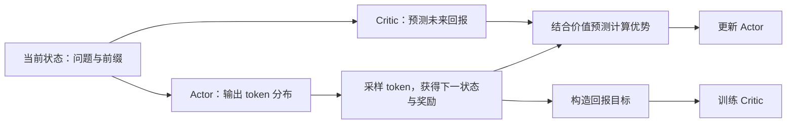

> 学习主线：**最终分数太粗 → 让 Critic 学一条"预期分数曲线" → 曲线的每一步涨跌（TD 误差）就是一步的评价 → 把后面各步的涨跌按 λ 折扣累加，得到 GAE → 交给 TRPO / PPO 去更新策略。**

## 阅读指南

全篇只用**一个三步数学题的故事**：每一节的数字都来自它，所以你可以一路用同一组数字验算。先不引入参考模型、KL 惩罚和 PPO 裁剪。建议分三次阅读：

1. **第 0–3 节**：用故事理解 Critic、优势和 TD(Temporal Difference，时序差分)误差。读完你应该能回答"δ 是什么"。
2. **第 4–6 节**：理解 MC 与 TD 的取舍，掌握 GAE 与 λ，并完成手算。
3. **第 7–10 节**：串起训练流程，检查工程细节和常见误解，做自测题。

学完后，你应该能解释：Critic 的训练标签从哪里来；TD 误差为什么能用于更新策略；λ 调节什么；为什么有了 GAE 仍然需要 TRPO / PPO。

### 符号约定

| 符号                | 含义                                              |
|:-------------------:| ------------------------------------------------- |
| $s_t,a_t,r_t$       | 第 t 步动作前的状态、执行的动作、执行后获得的奖励 |
| $s_{t+1}$           | 执行动作后的下一状态                              |
| $\pi_\theta$        | Actor：参数为 θ 的策略                            |
| $V^\pi,Q^\pi,A^\pi$ | 某个固定策略 π 的真实状态价值、动作价值、优势     |
| $V_\phi$            | Critic：参数为 φ 的状态价值近似                   |
| $\hat A_t$          | 用数据与价值预测构造的优势估计                    |
| $\gamma$            | 奖励折扣因子                                      |
| $\lambda$           | GAE 中控制不同估计长度权重的参数                  |
| $T$                 | 本条完整轨迹的最后一个动作位置                    |

数值例子采用有限回合、γ = 1；通用公式保留 γ。终止状态没有未来奖励，因此其价值为零。除特别说明外，数据由本轮当前策略采集，价值预测在构造本轮目标时固定。

## 0. 先看一个故事

想象一道三步数学题，Actor 要一步步解出来。Critic 像一张**"预期成功率表"**：每做完一步，就根据当前已经写出的内容，更新一次"我现在大概有多大把握做对"。

| 状态                   | 预期成功率 $V$ | 这一步的涨跌 $\delta$ |
|:----------------------:|:--------------:|:---------------------:|
| 开始                   | 0.5            | —                     |
| ① 列出方程             | 0.7            | $+0.2$                |
| ② 计算出错             | 0.2            | $-0.5$                |
| ③ 写出错误答案（终止） | 0              | $-0.2$                |

最终答错了，所以**整个过程中的奖励全是 0**。但 δ 并不是 0。δ 衡量的是：**这一步让前景变好，还是变坏。**这个故事就是本篇的全部直觉：


- Critic 学的是这条**预期分数曲线**。
- 曲线上相邻两点的差，是对一步动作的评价（TD 误差，第 3 节）。
- 把后面各步的涨跌，按 λ 折扣累加到这一步头上，就是 GAE（第 5 节）。

后面各节都是把这几句话讲清楚、算清楚。

## 1. 从 REINFORCE 继续

上一篇最后，我们已经得到带状态 baseline 的更新信号：

$$
\hat A_t=G_t-b(s_t),\qquad
G_t=\sum_{k=t}^{T}\gamma^{k-t}r_k.
$$

在 γ = 1 的有限回合设置下，策略梯度估计写成：

$$
\hat g=\frac1N\sum_{i=1}^{N}\sum_t
\hat A_t^{(i)}\nabla_\theta\log\pi_\theta(a_t^{(i)}\mid s_t^{(i)}).
$$

对语言模型，这里有一个关键特点：**奖励常常只在最后一个 token 之后才给出**（例如整条回答才有一个评分）。此时，除最后一步外所有 $r_k=0$，完整回报对每个位置都是同一个数：

$$
G_1=G_2=\cdots=G_T=R.
$$

也就是说，一条回答里"列对方程"和"算错数"的 token 拿到的信号**完全一样**。这有两个后果：

1. **信号很粗**：分不出哪一步好、哪一步坏。
2. **信号波动大**：同一个前缀，后面随机采样出的结局不同，回报就大不同。

我们需要一个办法，让每一步都能得到**不同的、更稳定的**评价。Actor-Critic 的思路是：另外训练一个 Critic，**学会预测"从这里继续下去，平均能得多少分"**。有了这条预测曲线，我们就能：

- 用当前状态的预测作参照，判断"实际比预期好多少"；
- 用下一状态的预测，代替尚未观察到的遥远回报，少受后续随机性的影响。

Actor-Critic 引入一个价值预测器，分别帮助解决这两个问题：**用当前状态价值作参照，用下一状态价值预测尚未观察到的回报。** 这两种用法相关，但对偏差的影响不同。

### 1.1 一个统一视角：策略梯度的权重如何构造

前面从回报减去 baseline 出发，还可以进一步问：策略梯度前面的权重一定要这样计算吗？将它暂时记作 \(\psi_t\)，就能把不同方法放在同一个框架下理解。网页使用的是小写希腊字母 psi，即 \(\psi_t\)，这里沿用这个记号。它只是“本步更新权重”的统称，并不是另一个需要训练的网络。先保持本篇数值例子的约定：有限回合$\gamma=1$，数据由当前策略采集。此时可以把策略更新写成：

$$
g=\mathbb E\left[\sum_{t=1}^{T}\psi_t
\nabla_\theta\log\pi_\theta(a_t\mid s_t)\right].
$$

其中，logprob 梯度决定怎样调整参数以提高已采样动作的概率，\(\psi_t\) 则决定这个方向应当获得多大的正向或负向权重。**REINFORCE、优势估计与一步 Actor-Critic 的联系，可以从“怎样选择这个权重”来理解。**

下面的对照保留折扣回报的定义，便于与后文连接；关于折扣目标的外层权重，见本节末尾说明。

| 权重的构造       | 表达式                    | 直觉与条件                                                                         |
|:----------------:|:-------------------------:| ---------------------------------------------------------------------------------- |
| 整条轨迹的回报   | \(\psi_t=G_1\)            | 每一步共享最终整体表现；在此处无折扣目标下可用，但混入了当前动作无法影响的过去奖励 |
| 从本步开始的回报 | \(\psi_t=G_t\)            | 去掉过去奖励，只根据当前动作之后的结果更新                                         |
| 回报减去状态基准 | \(\psi_t=G_t-b(s_t)\)     | 比较本次结果与参照，合适的基准可降低梯度方差                                       |
| 动作价值         | \(\psi_t=Q^\pi(s_t,a_t)\) | 用采取该动作后的期望回报代替单次结局；实际需要学习近似值                           |
| 优势             | \(\psi_t=A^\pi(s_t,a_t)\) | 在动作价值上减去状态平均价值，评价该动作相对通常水平的好坏                         |
| 一步 TD 残差     | \(\psi_t=\delta_t\)       | 根据本步奖励与下一状态价值构造局部信号；依赖价值预测的准确性                       |

这几行不是六个可以任意互换的数字。它们成立的依据各不相同：去掉过去奖励利用的是当前动作不能影响过去；减去状态 baseline 利用的是它不依赖当前动作；用真实动作价值替代采样回报利用的是条件期望。价值与优势的定义将在第 2 节展开。

尤其要区分**真实函数**与**学习到的近似**。表中的 \(Q^\pi\)、\(A^\pi\) 是理想的真实量；训练中使用 \(Q_\phi\) 或 \(V_\phi\) 时，误差可能改变梯度估计。对 TD 残差，也只有在价值准确且终止处理正确时，其给定状态、动作的条件期望才等于真实优势；单次残差不等于真实优势。这一点将在第 3 节推导。

### 1.2 把这个统一视角接到 GAE

回到三步数学题：使用最终回报时，三个位置共享同一个结局；使用状态 baseline 后，即使最终回报相同，各位置的权重也可以不同。再进一步使用 TD 残差，权重开始依赖相邻状态之间的价值变化。

因此，前文“各位置拿到的信号相同”准确地说是**原始回报相同**，并不意味着减去不同状态 baseline 后的优势估计仍相同。

本篇后面的内容，就是逐步构造这个权重：

$$
\underbrace{G_t}_{\text{采样回报}}
\quad\longrightarrow\quad
\underbrace{G_t-V_\phi(s_t)}_{\text{蒙特卡洛优势估计}}
\quad\longrightarrow\quad
\underbrace{\delta_t}_{\text{一步 TD 优势估计}}
\quad\longrightarrow\quad
\underbrace{\sum_{l=0}^{T-t}(\gamma\lambda)^l\delta_{t+l}}_{\text{GAE}}.
$$

这是一条理解路线，不意味着越往右越无条件更好。每一步都在改变“实际采样结果”和“价值预测”所占的比例。GAE 同样可以放进统一框架中：取 \(\psi_t=\hat A_t^{\mathrm{GAE}}\)，并在 Actor loss 中把它作为停止梯度的权重：

$$
\mathcal L_\pi=-\sum_t
\operatorname{stopgrad}(\psi_t)\log\pi_\theta(a_t\mid s_t).
$$

这样，第 2 节解释权重里的价值和优势，第 3 节解释 TD 残差，第 4–5 节则说明为什么要混合不同长度的信息。

> **折扣约定：**以上统一梯度与 loss 的直接写法采用 \(\gamma=1\)。若严格优化起点折扣目标 \(J_\gamma=\mathbb E[\sum_t\gamma^{t-1}r_t]\)，使用未来回报、动作价值、优势或 TD 类权重时，完整回合采样公式还需外层 \(\gamma^{t-1}\)。若使用整条折扣回报 \(G_1\) 加权整条轨迹的 logprob 梯度，则已经从原目标直接求导，不再额外乘这层权重。不同采样分布约定下的公式不能机械混用。

本节的统一视角参考[《动手学强化学习》：Actor-Critic 算法，第 10.2 节](https://hrl.boyuai.com/chapter/2/actor-critic%E7%AE%97%E6%B3%95/)，并结合本篇的有限回合约定补充了近似误差、折扣目标及 GAE 的衔接说明。

## 2. Actor 和 Critic 的各自输出

### 2.1 Actor 与 Critic 的分工

Actor 就是已有的策略模型：输入状态，输出动作概率分布。Critic 则输入状态，输出一个标量，预测从这里按照当前策略继续行动的平均回报：

$$
V^\pi(s)=\mathbb E_\pi[G_t\mid s_t=s].
$$

回到故事：

| 前缀状态           | Critic 的预测 | 在最终奖励为 0/1、$\gamma=1$ 时的解释   |
|:------------------:|:-------------:|:---------------------------------------:|
| 已建立正确方程     | 0.7           | 预计按当前策略继续，约有 70% 的概率成功 |
| 已出现关键逻辑错误 | 0.2           | 预计按当前策略继续，约有 20% 的概率成功 |

这种成功率解释仅适用于二元最终奖励；一般的价值可能为负，也可能大于 1。

Critic 预测的是**当前策略的表现**，不是从这个状态出发理论上能达到的最好结果。即使前缀正确，如果当前 Actor 不会继续解题，价值也可能很低。



Actor 与 Critic 可以是两个网络，也可以共享主干、分别连接策略头和价值头。它们是两种职责，不一定对应两份完全独立的模型。

### 2.2 Critic 怎么学？先看最直接的办法

用当前策略采样完整回答，拿到最终评分后，可以算出每个位置的 $G_t$。让价值网络去拟合它：

$$
\mathcal L_V=\frac12\operatorname{mean}_t
\left(V_\phi(s_t)-\operatorname{stopgrad}(G_t)\right)^2.
$$

例如同一个前缀之后，一次回答成功（目标 1），另一次失败（目标 0）。在大量相关样本上做平方误差拟合，网络会趋向预测**条件平均回报**，而不是每次都预言最终结果。

自然语言前缀很少完全重复，价值网络需要借助参数共享，在相似状态之间泛化；这也意味着它可能预测错误。后面第 3 节会给出另一种不必等到最后的标签。

### 2.3 优势：比"平均水平"好多少

状态价值回答"在这里通常能表现多好"；动作价值回答"在这里先做这个动作，再按当前策略继续，能表现多好"：

$$
Q^\pi(s,a)=\mathbb E[r_t+\gamma V^\pi(s_{t+1})\mid s_t=s,a_t=a].
$$

两者之差就是优势：

$$
\boxed{A^\pi(s,a)=Q^\pi(s,a)-V^\pi(s)}.
$$

一个小例子：某状态下，Actor 以 0.75 的概率选 A，以 0.25 的概率选 B，两者真实动作价值分别为 1 和 0。那么：

$$
V^\pi(s)=0.75,\qquad A^\pi(s,A)=0.25,\qquad A^\pi(s,B)=-0.75.
$$

优势衡量的是**相对当前策略平均水平的好坏**，所以同一状态下按当前策略对真实优势求平均，结果为零：

$$
\mathbb E_{a\sim\pi(\cdot\mid s)}[A^\pi(s,a)]=0.
$$

实际训练不知道真实的 $Q$ 和 $V$，只能使用估计。某一条样本的优势为正，表示这条样本给出了提高对应动作概率的信号，不代表已经证明这个动作在所有后续结果下都更好。

<details>
<summary> 进阶：学到 baseline 后，是否已经离开 REINFORCE？</summary>

如果仍然使用：

$$
\hat A_t^{\mathrm{MC}}=G_t-V_\phi(s_t),
$$

那么仍然保留了蒙特卡洛回报。常见教材将其称为"带学习 baseline 的 REINFORCE"；有些实践也宽泛地称为 Actor-Critic。更值得检查的是：**是否用价值预测替代了尚未观察到的回报，即是否进行了自举。**

如果 baseline 是采样前固定、仅依赖状态的函数，且在策略 loss 中停止梯度，那么即使它不准确，减去它也不改变期望策略梯度；它可能改善或恶化方差。若先用同一批动作结果拟合 baseline 再回算权重，则要额外考虑这种样本依赖，不能直接照搬独立 baseline 的无偏证明。

</details>

## 3. 自举与 TD：一步的"涨跌"

### 3.1 不等到最后，也能构造目标

完整回报满足递推式：

$$
G_t=r_t+\gamma G_{t+1}.
$$

如果还没有完整的 $G_{t+1}$，就用 Critic 的预测代替：

$$
\boxed{y_t^{\mathrm{TD}}=r_t+\gamma V_\phi(s_{t+1})}.
$$

“用已有估计构造新的学习目标”称为 **bootstrapping，自举**。终止时下一状态价值置零。

训练 Critic 时，让当前预测接近这个目标：

$$
\mathcal L_V^{\mathrm{TD}}=
\frac12\operatorname{mean}_t
\left(V_\phi(s_t)-\operatorname{stopgrad}(y_t^{\mathrm{TD}})\right)^2.
$$

目标分支停止梯度，这称为半梯度 TD 更新。Critic 起初可能很差，但真实奖励提供锚点，更新逐步传播价值信息；使用神经网络时并不因此获得无条件收敛保证。

### 3.2 TD 误差为何能估计优势？

定义 TD 误差：

$$
\boxed{\delta_t=r_t+\gamma V_\phi(s_{t+1})-V_\phi(s_t)}.
$$

理解：**经历这一步后的“实际奖励 + 剩余预测”，比行动前的预期好多少？**如果 Critic 恰好准确，即 $V_\phi=V^\pi$，那么：

$$
\begin{aligned}
\mathbb E[\delta_t\mid s_t=s,a_t=a]
&=\mathbb E[r_t+\gamma V^\pi(s_{t+1})\mid s,a]-V^\pi(s)\\
&=Q^\pi(s,a)-V^\pi(s)\\
&=A^\pi(s,a).
\end{aligned}
$$

因此，一步 TD 误差可以作为优势的采样估计。单次 δ 不等于真实优势；Critic 不准确时，还可能带来偏差。

用故事算一遍（$\gamma=1$，各步奖励为 0）：

$$
\delta_1=0+0.7-0.5=+0.2,\qquad
\delta_2=0+0.2-0.7=-0.5,\qquad
\delta_3=0+0-0.2=-0.2.
$$

奖励全为 0 时，$\delta_t=V(s_{t+1})-V(s_t)$，正好是价值曲线的相邻差(见0节中的曲线图)。这是理解 TD 误差最直观的方式。

### 3.3 为什么 δ 能当作优势？

如果 Critic 恰好准确，即 $V_\phi=V^\pi$，那么：

$$
\begin{aligned}
\mathbb E[\delta_t\mid s_t=s,a_t=a]
&=\mathbb E[r_t+\gamma V^\pi(s_{t+1})\mid s,a]-V^\pi(s)\\
&=Q^\pi(s,a)-V^\pi(s)\\
&=A^\pi(s,a).
\end{aligned}
$$

因此，**一步 TD 误差可以作为优势的采样估计**。注意：单次 $\delta$ 不等于真实优势；Critic 不准确时，还会带来偏差。

### 3.4 Actor 怎样更新？

在 γ = 1 的设置中，最基础的一步 Actor-Critic 使用：

$$
\mathcal L_\pi=-\frac1N\sum_i\sum_t
\log\pi_\theta(a_t^{(i)}\mid s_t^{(i)})
\operatorname{stopgrad}(\delta_t^{(i)}).
$$

δ 为正时提高对应动作概率，为负时降低。Critic 的预测参与形成权重，但 Actor loss 不应通过该权重反向传播。

在故事里：步骤 ① 的 δ 为正，"列出方程"的概率被提高；步骤 ② 的 δ 为负，"算错"的概率被降低。**在奖励全为 0 的情况下，信号完全来自 Critic 预测的变化。**

> 对严格的起点折扣目标 $J=\mathbb E[\sum_t\gamma^{t-1}r_t]$，逐步策略梯度还带有外层 $\gamma^{t-1}$。采用折扣状态分布时可有不同写法。本篇实际训练示例固定 γ = 1，避免混用目标约定。

## 4. 一步 TD 与完整回报，各自牺牲了什么？

两种优势估计：

| 优势估计 | 公式                                     | 依赖的主要信息         | 主要取舍                                 |
|:--------:|:----------------------------------------:|:----------------------:|:----------------------------------------:|
| 蒙特卡洛 | $G_t-V_\phi(s_t)$                        | 直到终止的采样奖励     | 少依赖未来价值预测，但受长程采样波动影响 |
| 一步 TD  | $r_t+\gamma V_\phi(s_{t+1})-V_\phi(s_t)$ | 一步奖励与下一状态预测 | 通常波动较小，但依赖 Critic 准确性       |

这里的方差趋势不是对所有任务的严格排序。降低方差也不等于改善每一批数据的表现。

### 4.1 一个可以手算的对比

前缀 $s$ 的预期成功率是 0.5。动作 A 把回答带到一个**真实成功率为 0.8** 的状态，所以 A 的真实优势是 $0.8-0.5=0.3$。

| 估计方式                        | 每次得到的值                                     | 平均 | 方差 |
|:------------------------------- |:------------------------------------------------ |:----:|:----:|
| 蒙特卡洛                        | 成功 $+0.5$（概率 80%）／失败 $-0.5$（概率 20%） | 0.3  | 0.16 |
| TD，Critic 准确                 | 恒为 $0.3$                                       | 0.3  | 0    |
| TD，Critic 把下一状态错估为 0.5 | 恒为 $0$                                         | 0    | 0    |

说明：

- **MC 平均下来是对的（无偏），但每次摆动很大**，需要很多样本才能平均出 0.3。
- **TD 很稳，但依赖 Critic**。Critic 准确时又稳又对；Critic 错了，它会**稳定地错**。第三行里，Actor 永远收不到"A 比平均好"的信号。

这就是"偏差—方差取舍"的具体含义。方差趋势不是对所有任务的严格排序，降低方差也不等于改善每一批数据的表现。

### 4.2 一个容易忽略的区别：两种误差，一种能抵消，一种不能

- **baseline 的误差**：MC 优势中的当前状态 baseline 不准，会让单次权重偏离真实优势，但只要 baseline 满足第 2 节进阶框里的条件，这个误差在策略梯度的**期望中会抵消**。
- **自举的误差**：TD 用到的下一状态预测误差，通常**依赖当前动作**，不能同样抵消，所以会造成真正的偏差。

自然的问题是：能不能先看两步、五步，再用预测补上剩余部分？这就是 GAE 要解决的。

## 5. GAE：把后面各步的涨跌累加起来

### 5.1 一个递推式

**GAE（Generalized Advantage Estimation，广义优势估计）** 的核心可以用一句话说清：**每一步的优势 =** **这一步的涨跌 $\delta_t$** + **后面各步的优势，按 $\gamma\lambda$ 打折**。

写成递推式（从回答末尾向前算）：

$$
\boxed{\hat A_t=\delta_t+\gamma\lambda\,\hat A_{t+1}},\qquad \hat A_{T+1}=0.
$$

展开后就是指数加权的 TD 误差之和：

$$
\boxed{
\hat A_t^{\mathrm{GAE}(\gamma,\lambda)}
=\sum_{l=0}^{T-t}(\gamma\lambda)^l\delta_{t+l}
}.
$$

GAE 是**构造策略更新权重的方法**，本身不规定如何约束策略步长。原始工作将指数加权 TD 残差与信赖域优化结合使用。[GAE 原始论文](https://arxiv.org/abs/1506.02438)

### 5.2 λ 的意义

λ 决定"你有多相信**后面发生的事**该算到这一步头上"。用故事里的第 1 步（列出方程）来看：

| λ   | 第 1 步的优势 | 含义                         |
|:---:|:-------------:|:---------------------------- |
| 0   | $+0.2$        | 只看这一步，认为列方程是好的 |
| 0.8 | $-0.328$      | 后面的错误按折扣传回来       |
| 1   | $-0.5$        | 整条回答的结局减去最初预期   |

三种情形分别是：

**λ = 0：一步 TD。** $\hat A_t=\delta_t$。仅使用本步 TD 误差，更多依赖下一状态价值预测。

**λ = 1：沿完整轨迹抵消成蒙特卡洛形式。**

$$
\begin{aligned}
\hat A_t
&=\delta_t+\gamma\delta_{t+1}+\cdots+\gamma^{T-t}\delta_T\\
&=G_t-V_\phi(s_t).
\end{aligned}
$$

这个结论要求确实到达终止、终止价值为零。如果只是采样片段结束，还会留下片段末端的自举价值，并非纯蒙特卡洛回报。

**0 < λ < 1：在不同长度之间折中。** λ 较小通常更依赖价值预测、方差较低；λ 较大通常更依赖采样回报、方差较高。价值误差、奖励结构与数据量都会影响实际结果，不存在适用于所有任务的最佳 λ。

γ 与 λ 的职责不同：γ 决定未来奖励在回报中的权重；λ 在给定回报定义下调节优势估计的长度混合。γ 也会影响方差，但不能把二者当成同一个参数。

### 5.3 为什么是这个形式？

<details>
<summary>▸ 进阶：从 n 步回报推导到 GAE</summary>

**n 步估计。** 定义 n 步回报与相应优势估计：

$$
\hat G_t^{(n)}=\sum_{l=0}^{n-1}\gamma^l r_{t+l}
+\gamma^n V_\phi(s_{t+n}),
\qquad
\hat A_t^{(n)}=\hat G_t^{(n)}-V_\phi(s_t).
$$

到达终止状态时，尾部价值为零。n 小时较早使用 Critic；n 大时更多依赖实际采样。

把连续 TD 误差相加，中间的价值项会抵消：

$$
\begin{aligned}
\delta_t+\gamma\delta_{t+1}
&=r_t+\gamma V_\phi(s_{t+1})-V_\phi(s_t)\\
&\quad+\gamma[r_{t+1}+\gamma V_\phi(s_{t+2})-V_\phi(s_{t+1})]\\
&=r_t+\gamma r_{t+1}+\gamma^2V_\phi(s_{t+2})-V_\phi(s_t)\\
&=\hat A_t^{(2)}.
\end{aligned}
$$

一般地：

$$
\hat A_t^{(n)}=\sum_{l=0}^{n-1}\gamma^l\delta_{t+l}.
$$

**混合多个长度。** 设当前位置距离终止还有 $H=T-t+1$ 个动作，构造加权平均：

$$
\hat A_t^{\mathrm{GAE}}=
(1-\lambda)\sum_{n=1}^{H-1}\lambda^{n-1}\hat A_t^{(n)}
+\lambda^{H-1}\hat A_t^{(H)}.
$$

最后一项接收剩余权重，因此全部权重之和为 1。把 n 步优势展开后，$\delta_t$ 出现在全部估计中，权重为 1；$\gamma\delta_{t+1}$ 出现在长度至少为 2 的估计中，权重为 $\lambda$；后面依此类推。合并后得到 5.1 节的指数加权求和式。

</details>

## 6. 完整手算：一条最终失败的回答

假设某条回答抽象为三个生成步骤，最终奖励为 0。Critic 在各前缀上的固定预测为：

| t   | $r_t$ | $V(s_t)$ | $V(s_{t+1})$ |
|:---:|:-----:|:--------:|:------------:|
| 1   | 0     | 0.5      | 0.7          |
| 2   | 0     | 0.7      | 0.2          |
| 3   | 0     | 0.2      | 0（终止）    |

取 γ = 1，则：

$$
\delta_1=0.2,\qquad\delta_2=-0.5,\qquad\delta_3=-0.2.
$$

第一步使预测前景变好，第二步使其显著变差，最后的失败又低于第三步前的预期。

取 λ = 0.8。最方便的计算方式是从后向前递推：

$$
\boxed{\hat A_t=\delta_t+\gamma\lambda\hat A_{t+1}},
\qquad \hat A_{T+1}=0.
$$

所以：

$$
\hat A_3=-0.2,
$$

$$
\hat A_2=-0.5+0.8\times(-0.2)=-0.66,
$$

$$
\hat A_1=0.2+0.8\times(-0.66)=-0.328.
$$

对比三种 λ：

| 位置 | λ = 0 | λ = 0.8 | λ = 1 |
|:----:|:-----:|:-------:|:-----:|
| 1    | +0.2  | −0.328  | −0.5  |
| 2    | −0.5  | −0.66   | −0.7  |
| 3    | −0.2  | −0.2    | −0.2  |

这个例子揭示了一个重要限制：**GAE 不会保证"正确的中间步骤一定获得正优势"。** 第一步虽然改善了预测前景，但更后面的负面信息传回来后，其 GAE 仍为负（λ = 0.8、1 时）。

优势估计是统计学习信号，不是对某个 token 的因果判决。Critic 也可能误判前景；最终评分不能凭空提供精确的逐步标准答案。

### 6.2 Critic 的训练目标：λ 回报

Critic 需要一个固定的目标。常见做法是：

$$
\hat R_t^\lambda=\hat A_t+V_{\rm old}(s_t).
$$

本例得到 $[0.172,\ 0.04,\ 0]$。它们不同于真实采样回报 $[0,0,0]$，因为 $\lambda<1$ 时混入了自举预测。$\lambda=1$ 且完整终止时，才恢复为采样回报；$\lambda=0$ 时则是一步 TD 目标 $r_t+\gamma V_{\rm old}(s_{t+1})$。

## 7. 一轮 Actor-Critic + GAE 训练怎么串起来？

下面采用完整终止轨迹、γ = 1、Actor 与 Critic 参数分离，并且每批数据只更新 Actor 一次。伪代码刻意保留各个概念对应的位置。

```python
# 1. 用当前 Actor 采集若干完整轨迹；奖励来自环境或评分规则
trajectories = collect_complete_episodes(actor)

# 2. 在更新之前固定本批价值预测，构造 GAE 与价值目标
with no_grad():
    for traj in trajectories:
        # states[t] 是执行 actions[t] 之前的状态
        values = critic(traj.states)       # 长度 T
        next_values = concat(values[1:], [0.0])  # 最后一步真实终止
        deltas = traj.rewards + next_values - values

        advantage_next = 0.0
        advantages = zeros_like(values)
        for t in reversed(range(len(values))):
            advantage_next = deltas[t] + lam * advantage_next
            advantages[t] = advantage_next

        traj.advantages = advantages
        traj.value_targets = advantages + values

# 3. logprob 必须保留对 Actor 的梯度；优势作为固定权重
actor_loss = mean([
    -(actor.logprob(traj.states, traj.actions) * traj.advantages).sum()
    for traj in trajectories
])
actor_optimizer.zero_grad()
actor_loss.backward()
actor_optimizer.step()

# 4. Critic 拟合固定目标；此处对所有有效状态求均方误差
critic_loss = 0.5 * mean_over_valid_states([
    (critic(traj.states) - traj.value_targets) ** 2
    for traj in trajectories
])
critic_optimizer.zero_grad()
critic_loss.backward()
critic_optimizer.step()
```

几点说明：

- 这里先对每条轨迹的 Actor 项求和，再对轨迹平均，与第 0 篇的有限回合目标一致。若改成每条回答先除以自己的长度，会改变不同长度回答的训练权重。
- Critic 使用的是固定的、**未标准化**的优势加旧价值构成的目标。若为了策略优化对优势做标准化，应保存原始优势供价值目标使用；不能把标准化后的优势直接加回价值。
- 实际 LLM 批处理还需要 mask：prompt 不是本例的动作，padding 不是真实状态；真实 EOS 动作通常需要计入。价值位置必须与"生成这个 token 之前的前缀"对齐，不能错一位。

## 8. 真正终止与采样截断，为什么要分开？

到达真正终止状态，未来回报为零。但若任务本来还会继续，只是采样器收集到固定长度就暂停，未来回报并不为零，应保留最后状态的价值预测。

通用实现可以区分两个 mask：

$$
\delta_t=r_t+\gamma b_tV(s_{t+1})-V(s_t),
$$

$$
\hat A_t=\delta_t+\gamma\lambda c_t\hat A_{t+1}.
$$

- $b_t$：是否允许自举。真正终止时为 0，单纯采样截断通常为 1。
- $c_t$：本批数据中是否还有同一轨迹的下一条 TD 残差可接续。终止或片段边界为 0，正常连续位置为 1。

截断时，δ 中可保留下一状态预测，但不能把下一回合的优势串进来。使用自动重置环境时，要取得重置前的最终观察，而不是拿新回合初始状态自举。

对于 LLM 的最大生成长度，必须看任务定义：如果长度上限就是任务结束，并据此结算奖励，可以按终止处理；如果只是暂停一段本可继续的生成，就属于截断。不能只凭“停止生成”判断。

## 9. 与之前的分类，以及 TRPO / PPO 的关系

Actor-Critic 是一种职责分工，不是 on-policy 的同义词。本文学习的是使用当前策略轨迹的 on-policy 状态价值 Critic；DDPG、TD3、SAC 等 off-policy 方法也属于 Actor-Critic 家族，但通常学习动作价值，训练目标与数据处理不同，不能直接套用本文全部公式。

同样，GAE 不是“让任何旧数据都能直接使用”的方法。这里的推导默认后续行为来自要评估的策略。策略更新后，不能把旧数据无限重复当成当前策略样本。

| 组成部分             | 解决的问题                                 |
|:--------------------:|:------------------------------------------:|
| REINFORCE / 策略梯度 | 如何从采样回报形成策略参数的更新方向？     |
| Critic               | 各状态未来的平均回报大约是多少？           |
| GAE                  | 用怎样的优势估计给策略梯度加权？           |
| TRPO                 | 在限制策略分布变化的条件下，怎样执行更新？ |
| PPO                  | 怎样用较易实现的目标控制策略更新？         |

因此，GAE 与 TRPO / PPO 可以组合：**GAE 生成权重，策略优化算法决定如何用权重更新参数。** GAE 本身不限制 KL 散度，也不保证真实回报单调提高。

## 10. 常见误解

| 说法                              | 更准确的理解                                                     |
|:---------------------------------:|:----------------------------------------------------------------:|
| Critic 就是奖励模型               | 奖励模型给行为或结果打分；Critic 预测按当前策略继续的累计回报    |
| 有 Critic 就不需要真实奖励        | Critic 仍需奖励提供训练依据，自举只是补全未观察的未来            |
| TD 误差等于真实优势               | 价值准确时，TD 误差的条件期望等于优势；单次样本仍可能有噪声      |
| baseline 预测错一定让策略梯度有偏 | 固定的状态 baseline 与未来价值自举要区分，前者可在期望梯度中抵消 |
| λ 越小越好                        | 可能减少采样波动，但更加依赖 Critic 的准确性                     |
| λ = 1 总是纯蒙特卡洛              | 完整终止轨迹才成立；截断片段仍可留下自举尾项                     |
| GAE 找出了每个 token 的真实功劳   | 它提供优势估计，无法自动补足奖励中没有的过程信息                 |
| Actor-Critic 必然是 on-policy     | 两类都有，取决于具体算法                                         |

## 一页速查

$$
V^\pi(s)=\mathbb E_\pi[G_t\mid s_t=s]
$$

$$
A^\pi(s,a)=Q^\pi(s,a)-V^\pi(s)
$$

$$
\delta_t=r_t+\gamma V_\phi(s_{t+1})-V_\phi(s_t)
$$

$$
\hat A_t^{\mathrm{GAE}}=\sum_{l=0}^{T-t}(\gamma\lambda)^l\delta_{t+l}
=\delta_t+\gamma\lambda\hat A_{t+1}
$$

$$
\hat R_t^\lambda=\hat A_t^{\mathrm{GAE}}+V_{\mathrm{old}}(s_t)
$$

**本篇闭环：采样回报波动大 → 学习预期回报 → 以 TD 误差评价一步变化 → 混合多步误差形成 GAE → 把优势交给策略优化器。**

## 延伸阅读

- [Schulman 等：High-Dimensional Continuous Control Using Generalized Advantage Estimation](https://arxiv.org/abs/1506.02438)：GAE 的原始工作。建议先完成手算，再读其优势估计推导。
- Sutton 与 Barto，《Reinforcement Learning: An Introduction》，分别用于补充 TD、自举与资格迹、策略梯度及 Actor-Critic 的背景。
