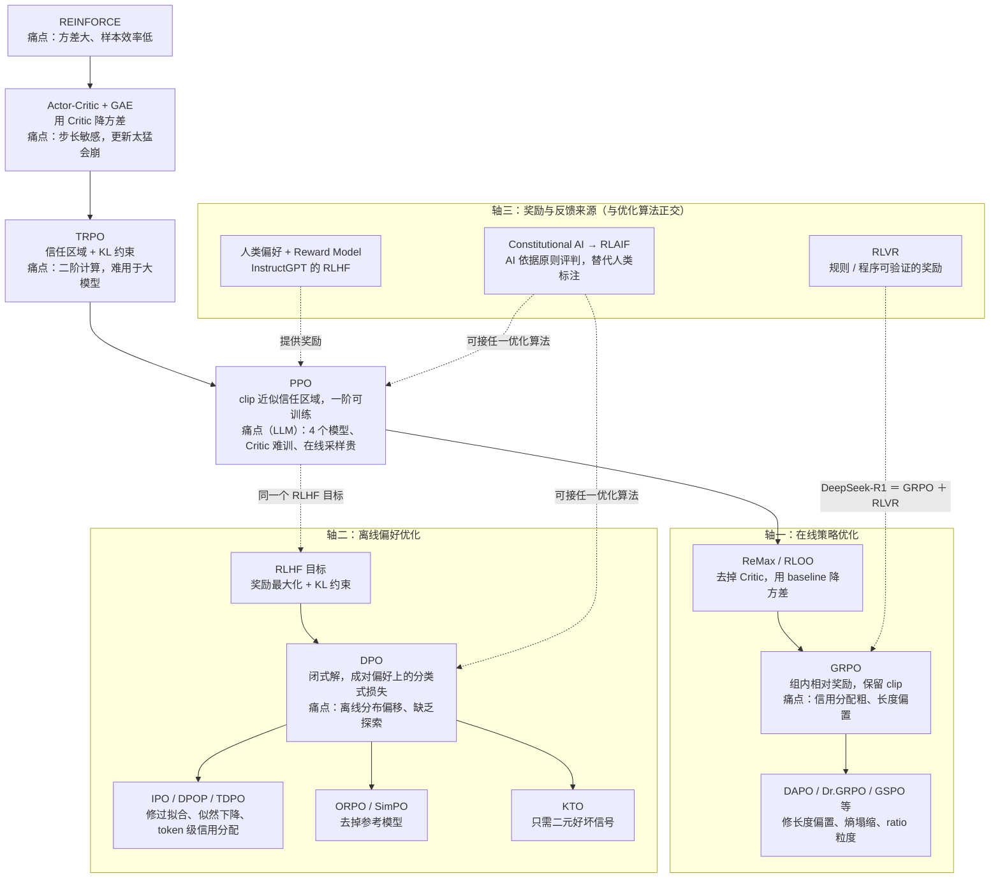

> 主线：**每一种算法都是为了解决上一种算法留下的痛点而出现的。** 本系列不按"算法清单"组织，而按"痛点 → 解法 → 新痛点"的链条组织。

---

## 一、演进路线

**纵向主干是"痛点驱动"的演进，每个节点标出它留下的痛点；PPO 之后分出三条**相互正交**的轴，每个方法只放在它真正改动的那一层：

- **轴一　在线策略优化**：改造 PPO 本身（怎么得到优势、怎么稳定更新）。
- **轴二　离线偏好优化**：直接求解 RLHF 目标，不再在线采样。
- **轴三　奖励与反馈来源**：信号由谁产生（人、AI 还是规则），它可以接在任一优化算法上。

1. **DPO 不是 PPO 的后代。** 两者优化的是同一个带 KL 约束的奖励最大化目标：PPO 用在线采样加策略梯度，DPO 用该目标的闭式解。所以图中用虚线表示"同一目标"，而不是继承关系。
2. **轴三与前两条轴是组合关系。** 例如 DeepSeek-R1 的训练 ＝ 轴一的 GRPO ＋ 轴三的可验证奖励；RLAIF 既可以配 PPO，也可以配 DPO。Constitutional AI（2022）早于 RLAIF（2023），且本身就是 RLAIF 的一种。
3. **DPO 之后不是一条直线。** 它分出三个方向：修正缺陷（IPO、DPOP、TDPO）、去掉参考模型（ORPO、SimPO）、放宽数据形式（KTO）。

### 时间、改动点、文档所在位置

| 时间      | 工作                                                  | 轴   | 解决的问题 / 改动点                            | 教程位置                |
|:---------:|:-----------------------------------------------------:|:----:|:----------------------------------------------:|:-----------------------:|
| 1992      | REINFORCE（Williams）                                 | 主干 | 最基本的策略梯度估计                           | 第 0 篇                 |
| 2002      | Conservative Policy Iteration（Kakade & Langford）    | 主干 | "保守更新、保证改进"的思想，TRPO 的前身        | 第 2 篇                 |
| 2015      | TRPO、GAE（Schulman 等）                              | 主干 | 信任区域保证单调改进；GAE 折中偏差与方差       | 第 1、2 篇              |
| 2016      | A3C / A2C（Mnih 等）                                  | 主干 | Actor-Critic 的规模化与工程化                  | 第 1 篇                 |
| 2017      | PPO（Schulman 等）                                    | 主干 | 用 clip 的一阶方法近似信任区域                 | 第 3 篇                 |
| 2017–2020 | 基于人类偏好的 RL（Christiano、Ziegler、Stiennon 等） | 三   | 把偏好学习与 PPO 结合，用于语言模型            | 第 0 篇                 |
| 2022      | InstructGPT（Ouyang 等）                              | 三   | SFT → RM → PPO 的 RLHF 流水线成为标准范式      | 第 0、3 篇              |
| 2022      | Constitutional AI                                     | 三   | 反馈由 AI 依据原则产生                         | 第 0 篇                 |
| 2023      | DPO（Rafailov 等）                                    | 二   | 闭式解，省掉 RM 与在线采样                     | 第 5 篇                 |
| 2023      | IPO                                                   | 二   | 修正 DPO 的过拟合                              | 第 5 篇末"DPO 家族速览" |
| 2023      | ReMax                                                 | 一   | 用贪心回答作 baseline，去掉 Critic             | 第 4 篇                 |
| 2023      | RLAIF                                                 | 三   | 用 AI 反馈替代人类标注                         | 第 0 篇                 |
| 2024      | RLOO                                                  | 一   | 留一法均值作 baseline                          | 第 4 篇                 |
| 2024      | GRPO（DeepSeekMath）                                  | 一   | 组内相对奖励构造优势，去掉 Critic              | 第 4 篇                 |
| 2024      | DPOP、TDPO                                            | 二   | 修正似然下降；token 级信用分配                 | 第 5 篇末"DPO 家族速览" |
| 2024      | ORPO、SimPO                                           | 二   | 去掉参考模型                                   | 第 5 篇末"DPO 家族速览" |
| 2024      | KTO                                                   | 二   | 只需二元信号，基于前景理论的损失               | 第 5 篇末"DPO 家族速览" |
| 2025      | DeepSeek-R1                                           | 三   | 大规模使用可验证奖励，推动推理模型训练         | 第 6 篇                 |
| 2025      | DAPO、Dr.GRPO、GSPO 等                                | 一   | 针对 GRPO 的长度偏置、熵塌缩、ratio 粒度等问题 | 第 6 篇                 |

> 年份、名称与"改动点"凭记忆整理，尚未逐条核对原文。2025 年的工作发展很快，成文前先检索确认出处与细节；DPOP、TDPO、ORPO、SimPO、KTO 的具体机制写到对应章节前需读原文。TDPO 这个缩写在文献中还有其他含义，引用时注意区分。

---

## 二、系列结构总览

| 篇  | 主题                           | 它回答的核心问题                            |
|:---:|:------------------------------:|:-------------------------------------------:|
| 0   | 基础：MDP、策略梯度、RLHF 全貌 | 为什么用 RL 微调语言模型？                  |
| 1   | Actor-Critic 与 GAE            | 怎么降方差？怎么做信用分配？                |
| 2   | TRPO                           | 为什么更新要有信任区域？                    |
| 3   | PPO 在 LLM 后训练中的应用      | 如何用一阶方法实现信任区域，并落地到 RLHF？ |
| 4   | GRPO 与无 Critic 方法          | 能不能不要 Critic？                         |
| 5   | DPO 与离线偏好优化             | 能不能连在线采样和 RM 都不要？              |
| 6   | RLVR 与前沿变体                | 奖励可验证时怎么训练？各变体修了什么？      |
| 7   | 总对比与选型                   | 什么场景用哪种？                            |

**关于 4 与 5 的顺序**：从发表时间看是 DPO（2023）在先、GRPO（2024）在后；从学习成本看，GRPO 只改"优势怎么来"，与 PPO 衔接更紧。因此上图把它们画成 PPO 之后的**两条并列分支**，章节顺序可以任选，不影响各自内容。我倾向先 GRPO 后 DPO，理由是 GRPO 与 PPO 同属在线框架，DPO 则需要换到偏好对和闭式推导的思路。

---

## 三、整体结构

### 第 0 篇　基础

- **要回答**：语言模型怎样变成 RL 问题；RLHF 三阶段做了什么。
- **核心内容**：MDP 与 token 级建模；REINFORCE 与 baseline；Bradley-Terry 偏好模型与 Reward Model；SFT → RM → RL 的流水线。
- **留下的痛点**：REINFORCE 方差大、必须新采样，更新一次就要丢数据。
- **和其他篇的关系**：Bradley-Terry 会在第 5 篇（DPO）的推导里再次用到。

### 第 1 篇　Actor-Critic 与 GAE

- **继承的痛点**：REINFORCE 方差大。
- **核心思想**：用 Critic 学习 $V(s)$ 作为 baseline，把回报换成优势；用 GAE 在偏差与方差间折中。
- **核心公式**：$A=Q-V$；TD 残差；GAE 递推；value loss。
- **手算例**：三 token 回答的 TD 残差与 GAE（沿用 PPO 篇的例子）。
- **留下的痛点**：Actor 的步长敏感，一次更新太大会让策略崩溃，且崩溃后不易恢复。

### 第 2 篇　TRPO

- **继承的痛点**：步长难选。
- **核心思想**：在旧策略附近构造代理目标，并用 KL 约束限制更新幅度，使更新有"单调改进"的理论保证。
- **核心内容**：重要性采样代理目标；信任区域；自然梯度与 Fisher 矩阵、共轭梯度（讲到够说明问题即可）；线搜索。
- **定位建议**：把它写成"PPO 的动机"，不要求读者掌握全部推导。要点是说明**为什么想要信任区域**，以及**为什么二阶方法在大模型上不实用**。
- **留下的痛点**：计算复杂，难以和大规模并行训练、共享参数结构配合。

### 第 3 篇　PPO

- **继承的痛点**：想要信任区域，但不想算二阶。
- **核心思想**：用 clip 把"可信区域之外的收益"砍掉，只需一阶优化。
- **已有内容**：RLHF 数据流、Rollout Buffer、GAE 手算、Policy / Value loss、训练层级、代码、排错。
- **留下的痛点（LLM 场景）**：需要同时维护 Actor、Critic、Reference、RM 四个模型；Critic 难训；在线采样昂贵；RM 可被钻空子。
- **整合时需要调整**：详见第四节"概念归属表"。

### 第 4 篇　GRPO 与无 Critic 方法

- **继承的痛点**：Critic 占显存、难训练、在长序列上价值估计不准。
- **核心思想**：对同一 prompt 采样一组回答，用组内相对奖励替代 Critic 提供基准。
- **核心公式**：组内标准化优势 $\hat A_i=(r_i-\bar r)/\sigma_r$；沿用 PPO 的 clip 目标；KL 作为独立 loss 项。
- **手算例**：沿用三 token 回答，换成"同一 prompt 的一组回答"，直观看到优势如何由组内比较产生。
- **同类方法**：RLOO（留一法 baseline）、ReMax（贪心回答作 baseline）。
- **留下的痛点**：优势在整条回答的所有 token 上相同，信用分配粗糙；聚合方式带来的长度偏置；需要多次采样。

### 第 5 篇　DPO 与离线偏好优化

- **继承的痛点**：PPO 流程复杂，需要 RM、在线采样与多个模型。
- **核心思想**：带 KL 约束的奖励最大化有闭式最优策略，把奖励用策略与参考策略的对数比表示，代入 Bradley-Terry 后得到对偏好对的二分类式损失。
- **核心公式**：

$$
\mathcal L_{\rm DPO}=-\log\sigma\Big(\beta\big[\log\tfrac{\pi_\theta(y_w|x)}{\pi_{\rm ref}(y_w|x)}-\log\tfrac{\pi_\theta(y_l|x)}{\pi_{\rm ref}(y_l|x)}\big]\Big)
$$

- **手算例**：一对偏好回答（好 / 差），算一次 DPO 梯度的方向。
- **留下的痛点**：离线数据与当前策略存在分布偏移；没有主动探索；对数据质量与长度较敏感。这也引出"在线 / 迭代 DPO"。

### 第 6 篇　RLVR 与前沿变体

- **继承的痛点**：RM 不可靠、容易被钻空子；推理任务的奖励其实可以直接验证（答案对不对、代码是否通过）。
- **核心内容**：可验证奖励；DeepSeek-R1 风格的训练流程；对 GRPO 的各类改进（长度偏置、熵塌缩、序列级与 token 级 ratio 等）。
- **注意**：这一篇时效性最强，成文前先检索最新资料，并逐一核对每个变体的具体修改点，避免凭印象写。

### 第 7 篇　总对比与选型

- 用同一张表对比所有算法（见第五节）。
- 给出"选型决策树"和"常见问题排查速查"。

---

## 四、概念归属

这张表解决"PPO 一章承担了前两章任务"的问题。**每个概念只在一处主讲，其他篇用跨章引用。**

| 概念                           | 主讲篇 | PPO 篇（第 3 篇）里的处理          |
|:------------------------------:|:------:|:----------------------------------:|
| MDP 与 token 级建模            | 0      | 保留 3–5 行复习                    |
| 策略梯度与 baseline            | 0      | 第 9.1 节改为"回顾"，指向第 0 篇   |
| Bradley-Terry 与 RM 训练       | 0      | 第 1.1 节保留简介                  |
| Critic、TD 残差、GAE           | 1      | 第 8 节保留手算例，推导指向第 1 篇 |
| 重要性采样代理目标             | 2      | 第 9.3 节保留结论，推导指向第 2 篇 |
| 信任区域、KL 约束              | 2      | 第 9.4 节只讲"为什么需要"          |
| ratio、clip、dual-clip         | 3      | 主讲                               |
| Rollout Buffer、训练层级、对齐 | 3      | 主讲                               |
| 组内相对优势                   | 4      | —                                  |
| 闭式最优策略与隐式奖励         | 5      | —                                  |
| 可验证奖励                     | 6      | —                                  |

---

## 五、全系列统一的对比维度

| 维度                | Actor-Critic  | TRPO            | PPO                    | GRPO                 | DPO                           |
|:-------------------:|:-------------:|:---------------:|:----------------------:|:--------------------:|:-----------------------------:|
| 数据来源            | 在线          | 在线            | 在线                   | 在线                 | 离线偏好对                    |
| 需要 Reward Model   | —             | —               | 是                     | 是或规则奖励         | 否（隐式）                    |
| 需要 Critic         | 是            | 是              | 是                     | 否                   | 否                            |
| 优势 / 信号来源     | $A=Q-V$       | GAE             | GAE                    | 组内相对奖励         | 偏好对的对数比差              |
| 更新幅度控制        | 无            | KL 约束（二阶） | clip（一阶）           | clip（一阶）         | 由 $\beta$ 与参考策略隐式约束 |
| KL 的位置           | —             | 约束项          | 常并入 reward          | 常为独立 loss 项     | 内嵌于目标                    |
| 需同时加载的模型    | Actor、Critic | Actor、Critic   | Actor、Critic、Ref、RM | Actor、Ref、奖励来源 | Actor、Ref                    |
| 每轮固定 / 重算的量 | 待补          | 待补            | 见 PPO 篇第 12 节      | 待补                 | 待补                          |

> 这张表是**本系列的主线工具**：PPO 篇已经用它回答了"哪些量固定、哪些量重算"，后续每篇都沿用这个问题。表中 TRPO 与 Actor-Critic 两列的细节，写到对应章节时再核对。

---

## 六、给你自己的学习路径

| 阶段 | 内容                 | 学完应该能做到                                  |
|:----:|:--------------------:|:-----------------------------------------------:|
| 1    | 第 0–1 篇            | 说清为什么要 Critic，手算一遍 GAE               |
| 2    | 第 2–3 篇            | 说清 clip 与信任区域的关系，读懂 PPO 训练日志   |
| 3    | 第 4 篇（或第 5 篇） | 把同一个例子换成 GRPO 的写法，指出和 PPO 的差别 |
| 4    | 第 5 篇（或第 4 篇） | 从 KL 约束下的奖励最大化推出 DPO 损失           |
| 5    | 第 6–7 篇            | 面对一个新任务，能给出选型理由                  |

每个阶段结束都可以用一个自测问题检验：**"这个算法比上一个算法多解决了什么，又引入了什么新问题？"**

---

## 参考资料

1. Williams, *Simple statistical gradient-following algorithms for connectionist reinforcement learning*, 1992.
2. Kakade & Langford, *Approximately Optimal Approximate Reinforcement Learning*, 2002.
3. Schulman et al., [Trust Region Policy Optimization](https://arxiv.org/abs/1502.05477), 2015.
4. Schulman et al., [Generalized Advantage Estimation](https://arxiv.org/abs/1506.02438), 2015.
5. Mnih et al., *Asynchronous Methods for Deep Reinforcement Learning*, 2016.
6. Schulman et al., [Proximal Policy Optimization Algorithms](https://arxiv.org/abs/1707.06347), 2017.
7. Christiano et al., *Deep Reinforcement Learning from Human Preferences*, 2017.
8. Ouyang et al., [Training language models to follow instructions with human feedback](https://arxiv.org/abs/2203.02155), 2022.
9. Rafailov et al., [Direct Preference Optimization](https://arxiv.org/abs/2305.18290), 2023.
10. Shao et al., [DeepSeekMath](https://arxiv.org/abs/2402.03300), 2024（GRPO）.
11. Ahmadian et al., *Back to Basics: Revisiting REINFORCE Style Optimization for Learning from Human Feedback in LLMs*, 2024（RLOO）.
12. DeepSeek-AI, *DeepSeek-R1*, 2025.
